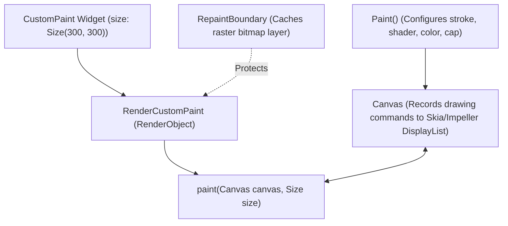

# Custom Painters, Canvas, and Low-Level GPU Graphics

> **Module:** 05-animations-and-motion  
> **Subsection:** 04-custom-painters-and-canvas  
> **Prerequisites:** [03-flutter-fundamentals/02-widget-tree-element-tree-renderobject/the-three-trees.md](../../03-flutter-fundamentals/02-widget-tree-element-tree-renderobject/the-three-trees.md)  
> **Official References:** [api.flutter.dev/flutter/rendering/CustomPainter-class.html](https://api.flutter.dev/flutter/rendering/CustomPainter-class.html) | [api.flutter.dev/flutter/dart-ui/Canvas-class.html](https://api.flutter.dev/flutter/dart-ui/Canvas-class.html)

---

## 1. Introduction

Flutter's widget catalog is vast, but standard composition cannot solve every visual problem. When your application requires:
- Financial line charts and candlestick graphs,
- Circular animated countdown rings,
- Custom audio waveforms and signature pads,
- Non-standard mathematical geometric shapes,

you step below the widget layer and paint directly onto Flutter's GPU-backed surface using **`CustomPainter`** and **`Canvas`**.

---

## 2. Core Concepts: The `CustomPainter` Pipeline



### The Two Mandatory Methods
1. **`paint(Canvas canvas, Size size)`:** Called whenever the widget needs to paint. The `canvas` gives you primitive drawing commands, and `size` gives you the exact allocated box dimensions.
2. **`shouldRepaint(covariant CustomPainter oldDelegate)`:** The optimization gate. Returning `false` tells Flutter: *"My visual input data has not changed; do NOT re-record the display list!"*

---

## 3. Syntax and Implementation

### Complete Example: Animated Circular Progress Ring with Gradient Shader

```dart
import 'dart:math' as math;
import 'package:flutter/material.dart';

class AnimatedProgressRing extends StatefulWidget {
  final double progress; // 0.0 to 1.0

  const AnimatedProgressRing({super.key, required this.progress});

  @override
  State<AnimatedProgressRing> createState() => _AnimatedProgressRingState();
}

class _AnimatedProgressRingState extends State<AnimatedProgressRing>
    with SingleTickerProviderStateMixin {
  late final AnimationController _controller;
  late Animation<double> _animation;

  @override
  void initState() {
    super.initState();
    _controller = AnimationController(
      vsync: this,
      duration: const Duration(milliseconds: 1200),
    );
    _animation = Tween<double>(begin: 0.0, end: widget.progress).animate(
      CurvedAnimation(parent: _controller, curve: Curves.easeOutCubic),
    );
    _controller.forward();
  }

  @override
  void didUpdateWidget(covariant AnimatedProgressRing oldWidget) {
    super.didUpdateWidget(oldWidget);
    if (oldWidget.progress != widget.progress) {
      _animation = Tween<double>(
        begin: _animation.value,
        end: widget.progress,
      ).animate(CurvedAnimation(parent: _controller, curve: Curves.easeOutCubic));
      _controller.forward(from: 0.0);
    }
  }

  @override
  void dispose() {
    _controller.dispose();
    super.dispose();
  }

  @override
  Widget build(BuildContext context) {
    return AnimatedBuilder(
      animation: _animation,
      builder: (context, child) {
        // PERFORMANCE BEST PRACTICE: Wrap expensive painters in RepaintBoundary
        return RepaintBoundary(
          child: CustomPaint(
            size: const Size(200, 200),
            painter: _RingPainter(progress: _animation.value),
            child: SizedBox(
              width: 200,
              height: 200,
              child: Center(
                child: Text(
                  '${(_animation.value * 100).toInt()}%',
                  style: const TextStyle(fontSize: 32, fontWeight: FontWeight.bold),
                ),
              ),
            ),
          ),
        );
      },
    );
  }
}

class _RingPainter extends CustomPainter {
  final double progress;

  _RingPainter({required this.progress});

  @override
  void paint(Canvas canvas, Size size) {
    final center = Offset(size.width / 2, size.height / 2);
    final radius = (size.width / 2) - 16; // Inset for stroke width

    // 1. Draw Background Track Ring
    final trackPaint = Paint()
      ..color = Colors.grey.shade200
      ..style = PaintingStyle.stroke
      ..strokeWidth = 14.0;

    canvas.drawCircle(center, radius, trackPaint);

    // 2. Draw Animated Gradient Sweep Arc
    final sweepAngle = 2 * math.pi * progress;
    final rect = Rect.fromCircle(center: center, radius: radius);

    final progressPaint = Paint()
      ..style = PaintingStyle.stroke
      ..strokeWidth = 14.0
      ..strokeCap = StrokeCap.round // Smooth rounded pill ends
      ..shader = const SweepGradient(
        startAngle: 0.0,
        endAngle: 2 * math.pi,
        colors: [Colors.cyanAccent, Colors.blueAccent, Colors.purpleAccent],
      ).createShader(rect);

    // Start at 12 o'clock (-pi / 2)
    canvas.drawArc(
      rect,
      -math.pi / 2,
      sweepAngle,
      false,
      progressPaint,
    );
  }

  @override
  bool shouldRepaint(covariant _RingPainter oldDelegate) {
    // Re-paint ONLY if progress value actually changed
    return oldDelegate.progress != progress;
  }
}
```

---

### 2. Smooth Curved Graphs using Bézier Paths

```dart
class SmoothWavePainter extends CustomPainter {
  @override
  void paint(Canvas canvas, Size size) {
    final paint = Paint()
      ..color = Colors.blue
      ..style = PaintingStyle.stroke
      ..strokeWidth = 4.0;

    final path = Path()
      ..moveTo(0, size.height * 0.7);

    // First wave crest using Quadratic Bézier curve
    path.quadraticBezierTo(
      size.width * 0.25, size.height * 0.3, // Control point
      size.width * 0.50, size.height * 0.7, // End point
    );

    // Second wave trough
    path.quadraticBezierTo(
      size.width * 0.75, size.height * 1.0, // Control point
      size.width, size.height * 0.7,        // End point
    );

    canvas.drawPath(path, paint);
  }

  @override
  bool shouldRepaint(covariant CustomPainter oldDelegate) => false;
}
```

---

## 4. Performance Optimization: `RepaintBoundary`

Painting onto a `Canvas` creates GPU instructions. If an ancestor widget (like a parent scroll view) repaints, all descendants repaint by default.
Wrapping your `CustomPaint` in a **`RepaintBoundary`**:
1. Isolates the render object into its own cached GPU texture layer (`RenderRepaintBoundary`).
2. When the rest of the screen repaints, Flutter simply composites the cached texture instead of re-executing your `paint()` method!

---

## 5. Interview & Assessment Takeaways

| Interview Question | Concise Verbal Answer |
|:---|:---|
| **What is the purpose of `shouldRepaint` in `CustomPainter`?** | It acts as a performance guard. It receives the old painter instance and returns a boolean. If it returns `false`, Flutter reuses the previously recorded display list without re-executing `paint()`, saving CPU/GPU cycles. |
| **Why should you wrap complex `CustomPaint` widgets in a `RepaintBoundary`?** | `RepaintBoundary` creates a separate display list texture layer. This prevents repaints from propagating across the tree, so animations or scrolling outside the painter won't trigger unnecessary canvas repainting. |
| **What is the difference between `drawArc` with `useCenter: true` vs `false`?** | When `useCenter: true`, lines connect both ends of the arc to the center point, creating a pie slice or wedge. When `false`, only the curved boundary arc is drawn. |
