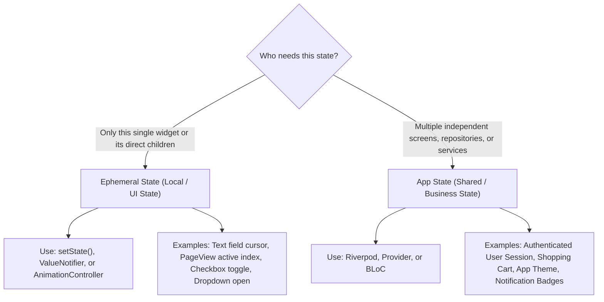
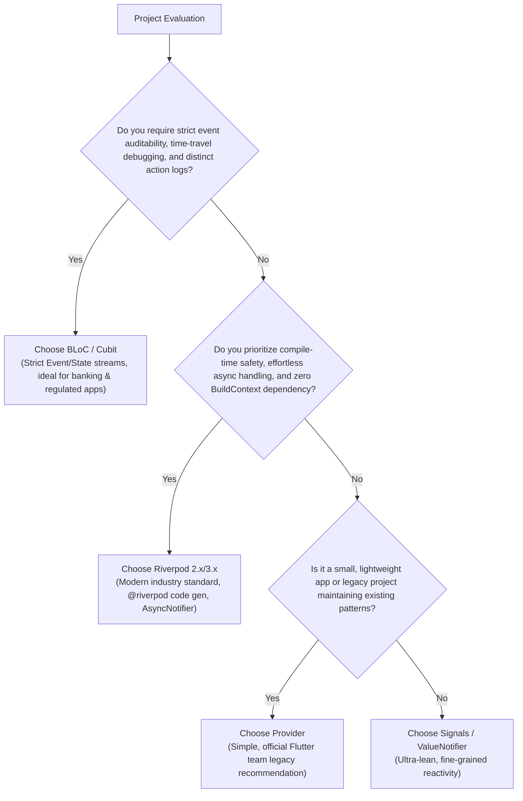

# The Flutter State Management Landscape: Ephemeral vs. App State

> **Module:** 06-state-management  
> **Subsection:** 01-state-management-overview  
> **Prerequisites:** [03-flutter-fundamentals/03-stateless-and-stateful-widgets/stateless-vs-stateful.md](../../03-flutter-fundamentals/03-stateless-and-stateful-widgets/stateless-vs-stateful.md)  
> **Official References:** [docs.flutter.dev/data-and-backend/state-mgmt/intro](https://docs.flutter.dev/data-and-backend/state-mgmt/intro) | [docs.flutter.dev/data-and-backend/state-mgmt/ephemeral-versus-app](https://docs.flutter.dev/data-and-backend/state-mgmt/ephemeral-versus-app)

---

## 1. Introduction

In Flutter, **state** is simply whatever data is required to rebuild your user interface at any given instant. 

A common architectural failure in early Flutter applications is over-engineering: attempting to route every single switch toggle, text field character change, or drawer animation through a heavyweight global state management container. Conversely, under-engineering leads to storing global user authentication or shopping cart contents inside local widget `State` objects, resulting in impossible callback spaghetti and prop-drilling.

To architect scalable Flutter applications, you must categorize state into two clear domains: **Ephemeral State** and **App State**.

---

## 2. Ephemeral vs. App State

### Detailed Comparison

| Criterion | Ephemeral State (Local) | App State (Global / Shared) |
|:---|:---|:---|
| **Lifespan** | Tied to the lifecycle of a single widget element. Disposed when the widget leaves the tree. | Persists across screen navigations and app sessions. |
| **Complexity** | Simple boolean, integer, or local controller. | Rich business models, domain entities, cached API responses. |
| **Tooling** | `StatefulWidget.setState()`, `ValueNotifier`. | `Riverpod`, `Provider`, `BLoC`. |
| **Testing** | Tested via Widget tests. | Easily tested via pure Dart Unit tests (independent of UI). |

---

## 3. How to Choose Your State Management Architecture

When deciding which enterprise state management library to adopt for your team, evaluate against these concrete technical criteria:

---

## 4. Common Pitfalls & Anti-Patterns

### Pitfall 1: Hoisting Ephemeral State to Global Providers
Putting local animation progress, text field text, or accordion expansion booleans into a global Riverpod or BLoC provider introduces unnecessary serialization overhead, triggers unnecessary cross-module rebuilds, and bloats the test suite. Keep local UI state local!

### Pitfall 2: Storing Business Logic in UI Widgets
Putting HTTP requests or SQLite database queries directly inside `StatefulWidget.setState()` couples your UI to platform I/O, prevents unit testing, and causes network requests to re-trigger unexpectedly whenever the phone rotates.

---

## 5. Interview & Assessment Takeaways

| Interview Question | Concise Verbal Answer |
|:---|:---|
| **What is the difference between Ephemeral State and App State?** | Ephemeral state is contained neatly within a single widget (e.g. current tab index, text selection) and can be cleanly managed via `setState()`. App state is shared across multiple disconnected screens or features (e.g. user authentication, shopping cart) and requires a dedicated state management architecture like Riverpod or BLoC. |
| **Can an app combine multiple state management approaches?** | Absolutely, and it is standard practice. A professional Flutter app uses `setState()` for local micro-interactions (e.g. password visibility toggle), while managing global user sessions, repositories, and checkout state via `Riverpod` or `BLoC`. |
| **Why is `InheritedWidget` alone rarely used directly for full app state?** | `InheritedWidget` is low-level and immutable; mutating its state requires pairing it with an external `StatefulWidget`, leading to verbose boilerplate and lack of built-in async primitives (`AsyncValue`). Libraries like Provider and Riverpod build on these fundamentals with developer ergonomics and compile-time safety. |
