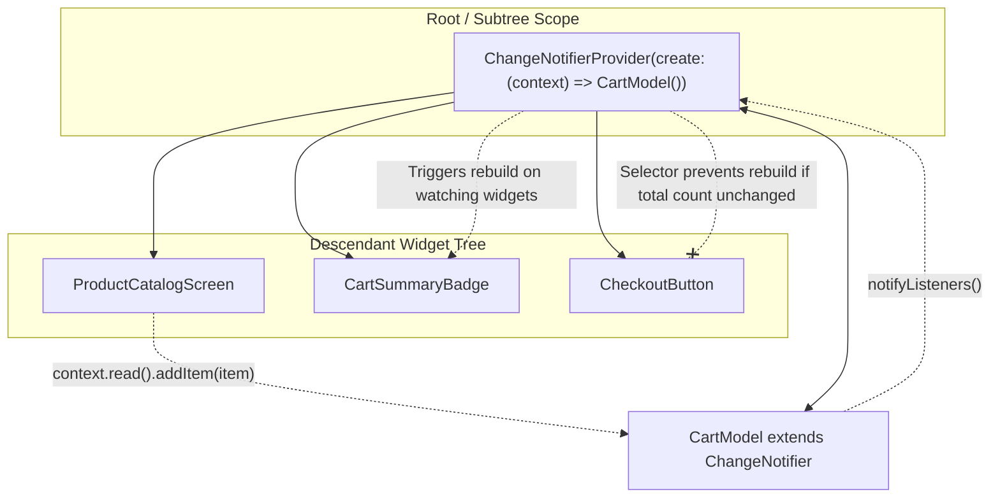

# Provider Deep Dive: ChangeNotifier, Scoped Rebuilds, and DI

> **Module:** 06-state-management  
> **Subsection:** 02-provider  
> **Prerequisites:** [03-flutter-fundamentals/04-buildcontext-and-keys/buildcontext-and-inheritedwidget.md](../../03-flutter-fundamentals/04-buildcontext-and-keys/buildcontext-and-inheritedwidget.md)  
> **Official References:** [pub.dev/packages/provider](https://pub.dev/packages/provider) | [docs.flutter.dev/data-and-backend/state-mgmt/simple](https://docs.flutter.dev/data-and-backend/state-mgmt/simple)

---

## 1. Introduction

Created by Remi Rousselet and officially endorsed by the Flutter team for many years, **Provider** is a developer-friendly abstraction over Flutter's native `InheritedWidget`. 

Before Provider, using `InheritedWidget` required massive boilerplate: writing custom element classes, managing widget updates manually, and handling disposal carefully. Provider solves this by wrapping state containers into simple, reactive widget providers that can be placed anywhere in the widget hierarchy.

---

## 2. Theoretical Mechanics: How Provider Operates

Provider works by injecting an `InheritedProvider<T>` widget into the widget tree:



### The Three Extension Methods on `BuildContext`

1. **`context.watch<T>()`:** Subscribes the calling widget to changes in `T`. Whenever `notifyListeners()` is called, the widget's `build()` method re-executes.
2. **`context.read<T>()`:** Reads `T` once **without** subscribing. Ideal for callbacks (`onPressed: () => context.read<CartModel>().addItem(item)`).
3. **`context.select<T, R>((T value) => R)`:** Subscribes *only* to a specific sub-field `R`. If other fields in `T` change but `R` remains identical, the widget does **not** rebuild!

---

## 3. Syntax and Implementation: Complete Shopping Cart Example

### 1. The Domain Model and ChangeNotifier

```dart
import 'dart:collection';
import 'package:flutter/foundation.dart';

class CartItem {
  final String id;
  final String name;
  final double price;
  final int quantity;

  const CartItem({
    required this.id,
    required this.name,
    required this.price,
    this.quantity = 1,
  });

  CartItem copyWith({int? quantity}) {
    return CartItem(
      id: id,
      name: name,
      price: price,
      quantity: quantity ?? this.quantity,
    );
  }
}

class CartModel extends ChangeNotifier {
  final Map<String, CartItem> _items = {};

  // Unmodifiable view encapsulates internal state
  UnmodifiableMapView<String, CartItem> get items => UnmodifiableMapView(_items);

  int get totalItemCount => _items.values.fold(0, (sum, item) => sum + item.quantity);

  double get totalPrice =>
      _items.values.fold(0.0, (sum, item) => sum + (item.price * item.quantity));

  void addItem(CartItem product) {
    if (_items.containsKey(product.id)) {
      _items.update(
        product.id,
        (existing) => existing.copyWith(quantity: existing.quantity + 1),
      );
    } else {
      _items[product.id] = product;
    }
    // NOTIFY: Alerts all subscribed widgets that state has updated
    notifyListeners();
  }

  void removeItem(String productId) {
    _items.remove(productId);
    notifyListeners();
  }

  void clearCart() {
    _items.clear();
    notifyListeners();
  }
}
```

---

### 2. App Root Setup with `MultiProvider`

```dart
import 'package:flutter/material.dart';
import 'package:provider/provider.dart';

void main() {
  runApp(
    MultiProvider(
      providers: [
        ChangeNotifierProvider(create: (_) => CartModel()),
      ],
      child: const ECommerceApp(),
    ),
  );
}

class ECommerceApp extends StatelessWidget {
  const ECommerceApp({super.key});

  @override
  Widget build(BuildContext context) {
    return MaterialApp(
      title: 'Provider Cart Store',
      theme: ThemeData(useMaterial3: true, colorSchemeSeed: Colors.indigo),
      home: const CatalogScreen(),
    );
  }
}
```

---

### 3. UI Optimization: `Consumer` vs. `Selector`

```dart
class CatalogScreen extends StatelessWidget {
  const CatalogScreen({super.key});

  @override
  Widget build(BuildContext context) {
    return Scaffold(
      appBar: AppBar(
        title: const Text('Store Catalog'),
        actions: [
          // OPTIMIZATION: Selector rebuilds ONLY when totalItemCount changes,
          // ignoring individual item description or price modifications!
          Selector<CartModel, int>(
            selector: (_, cart) => cart.totalItemCount,
            builder: (context, count, child) {
              return Stack(
                alignment: Alignment.center,
                children: [
                  IconButton(
                    icon: const Icon(Icons.shopping_cart),
                    onPressed: () => Navigator.push(
                      context,
                      MaterialPageRoute(builder: (_) => const CartScreen()),
                    ),
                  ),
                  if (count > 0)
                    Positioned(
                      right: 6,
                      top: 6,
                      child: Container(
                        padding: const EdgeInsets.all(4),
                        decoration: const BoxDecoration(
                          color: Colors.red,
                          shape: BoxShape.circle,
                        ),
                        child: Text(
                          '$count',
                          style: const TextStyle(color: Colors.white, fontSize: 10, fontWeight: FontWeight.bold),
                        ),
                      ),
                    ),
                ],
              );
            },
          ),
        ],
      ),
      body: ListView(
        children: [
          _ProductTile(
            item: const CartItem(id: 'prod_1', name: 'MacBook Pro M3', price: 1999.0),
          ),
          _ProductTile(
            item: const CartItem(id: 'prod_2', name: 'Sony WH-1000XM5', price: 399.0),
          ),
          _ProductTile(
            item: const CartItem(id: 'prod_3', name: 'Logitech MX Master 3S', price: 99.0),
          ),
        ],
      ),
    );
  }
}

class _ProductTile extends StatelessWidget {
  final CartItem item;

  const _ProductTile({required this.item});

  @override
  Widget build(BuildContext context) {
    return ListTile(
      title: Text(item.name),
      subtitle: Text('\$${item.price.toStringAsFixed(2)}'),
      trailing: ElevatedButton(
        // NEVER use context.watch() in onPressed! Use context.read()
        onPressed: () {
          context.read<CartModel>().addItem(item);
          ScaffoldMessenger.of(context).showSnackBar(
            SnackBar(
              content: Text('${item.name} added to cart!'),
              duration: const Duration(seconds: 1),
            ),
          );
        },
        child: const Text('Add'),
      ),
    );
  }
}
```

---

## 4. Common Pitfalls & Anti-Patterns

### Pitfall 1: Calling `context.watch()` Inside Callbacks
```dart
// ❌ CRASH / ANTI-PATTERN:
ElevatedButton(
  onPressed: () {
    context.watch<CartModel>().addItem(item); // CRITICAL BUG!
  },
  child: const Text('Add'),
)
```
**Why it fails:** `context.watch` registers an element dependency on an InheritedWidget. Flutter strictly forbids registering new InheritedWidget dependencies outside the `build()` phase.  
**Rule:** Use `context.read<T>()` inside callbacks and `context.watch<T>()` inside `build()`.

### Pitfall 2: The Dreaded `ProviderNotFoundException`
Occurs when you attempt to call `context.read<MyModel>()` using a `BuildContext` that is an ancestor of (or sibling to) the widget providing `MyModel`. The context passed to `of()` must be a strict **descendant** of the Provider widget.

---

## 5. Interview & Assessment Takeaways

| Interview Question | Concise Verbal Answer |
|:---|:---|
| **What is the difference between `context.watch<T>()` and `context.read<T>()`?** | `context.watch<T>()` subscribes the widget to changes in `T` and triggers a widget rebuild whenever `notifyListeners()` is called. `context.read<T>()` retrieves `T` without creating a subscription; it is strictly intended for event callbacks like `onPressed`. |
| **Why is `Selector` better than `Consumer` for fine-grained performance?** | `Consumer` rebuilds whenever *any* property on the `ChangeNotifier` calls `notifyListeners()`. `Selector` extracts a specific sub-value and rebuilds the child *only* if that extracted value changes according to `==` equality. |
| **What is `ProxyProvider`?** | A provider that builds a value based on values from other providers, automatically updating when any of its upstream dependency providers change (used for dependency injection). |
