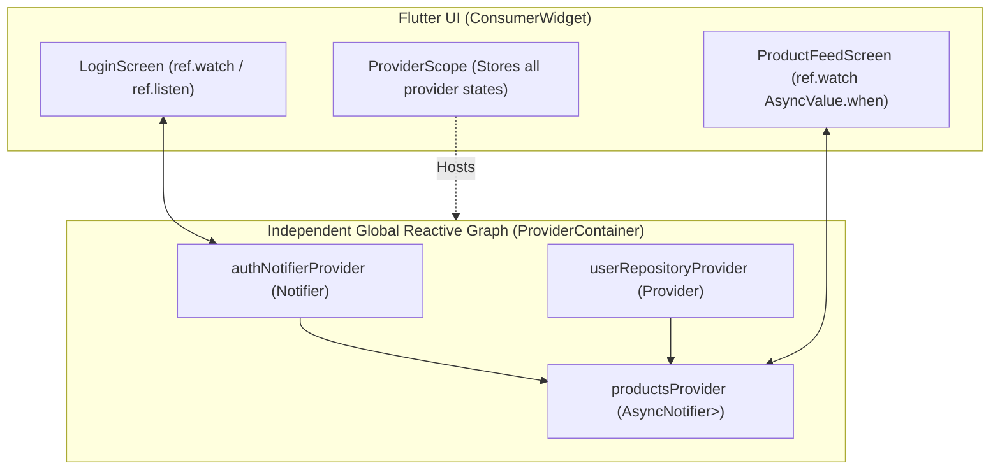
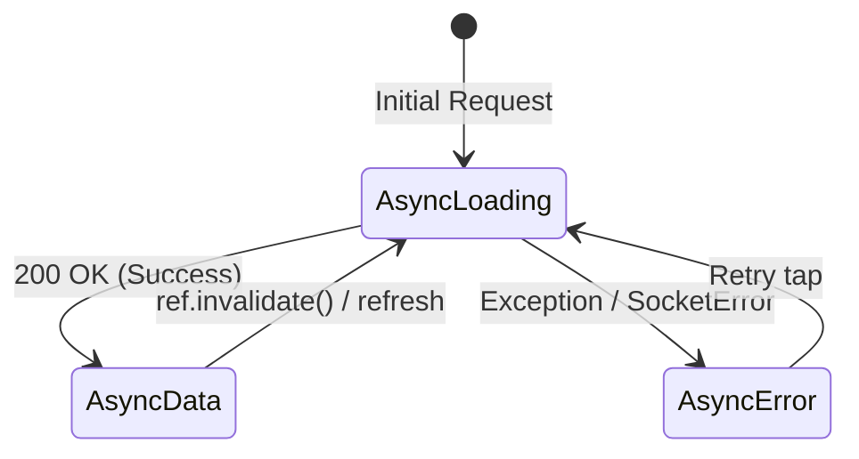

# Riverpod Deep Dive: Modern Reactive Architecture (2.x / 3.x)

> **Module:** 06-state-management  
> **Subsection:** 03-riverpod-modern  
> **Prerequisites:** [06-state-management/02-provider/provider-deep-dive.md](../02-provider/provider-deep-dive.md)  
> **Official References:** [riverpod.dev](https://riverpod.dev) | [pub.dev/packages/flutter_riverpod](https://pub.dev/packages/flutter_riverpod)

---

## 1. Introduction: Why Riverpod Over Provider?

Although `Provider` revolutionized Flutter state management, it suffered from architectural limitations inherent to `InheritedWidget`:
1. **Runtime Crashes (`ProviderNotFoundException`):** If a developer requested a provider above where it was declared, the app crashed at runtime.
2. **Coupled to `BuildContext`:** You could not read or modify providers from business services, background isolates, or repositories without passing `BuildContext` around.
3. **Difficult Combining / Asynchronous Data:** Combining two async providers often resulted in complicated `ProxyProvider` chains.
4. **Testing Obstacles:** Mocking required building an artificial widget tree in test environments.

**Riverpod** (an anagram of *Provider*) was created by the same author to fix all of these flaws. Riverpod is a **compile-safe, reactive dependency injection framework** completely independent of the Flutter widget tree.

---

## 2. Core Concepts & Architecture



### The Key Pillars of Riverpod

1. **`ProviderScope`:** Placed at the root of your application (`runApp(ProviderScope(child: MyApp()))`). It owns and stores the state of all providers.
2. **`WidgetRef`:** The bridge between Flutter widgets and Riverpod's reactive graph. Passed to `build(BuildContext context, WidgetRef ref)`.
3. **`ref.watch()`:** Subscribes to a provider and rebuilds the widget whenever the value changes.
4. **`ref.read()`:** Reads the current value once without subscribing (used strictly in buttons and callbacks).
5. **`ref.listen()`:** Listens to a provider and triggers **side effects** (e.g. showing a SnackBar, pushing a new route) without rebuilding the UI.
6. **`ref.invalidate()` / `ref.refresh()`:** Destroys the current provider state and forces an immediate reload (perfect for pull-to-refresh).

---

## 3. The `AsyncValue` Superpower

Handling asynchronous data (REST APIs, databases) traditionally requires verbose boolean flags (`isLoading`, `errorMessage`, `data`). Riverpod replaces this with **`AsyncValue<T>`**, an algebraic data type with three mutually exclusive states:
- `AsyncLoading()`
- `AsyncData(value)`
- `AsyncError(error, stackTrace)`

Using `.when()` guarantees **exhaustive pattern matching**—it is impossible to forget to handle loading or error states!



---

## 4. Syntax and Implementation

### 1. Modern Notifiers (`Notifier` & `AsyncNotifier`)

> 💡 **Notice on Modern Riverpod:**  
> In Riverpod 2.0+ and 3.0, `StateNotifierProvider` and `StateProvider` are considered legacy. The recommended modern syntax uses **`Notifier`** for synchronous state and **`AsyncNotifier`** for asynchronous network/database operations.

#### A. Authentication State Management (`Notifier`)

```dart
import 'package:flutter_riverpod/flutter_riverpod.dart';

// 1. Immutable State Definition
sealed class AuthState {
  const AuthState();
}

class AuthInitial extends AuthState {
  const AuthInitial();
}

class AuthLoading extends AuthState {
  const AuthLoading();
}

class Authenticated extends AuthState {
  final String userId;
  final String token;
  const Authenticated({required this.userId, required this.token});
}

class Unauthenticated extends AuthState {
  final String? reason;
  const Unauthenticated([this.reason]);
}

// 2. Synchronous Notifier
class AuthNotifier extends Notifier<AuthState> {
  @override
  AuthState build() {
    // Initial state
    return const AuthInitial();
  }

  Future<void> signIn(String email, String password) async {
    state = const AuthLoading();
    try {
      // Simulate network authentication call
      await Future.delayed(const Duration(seconds: 2));
      if (password == 'secret123') {
        state = const Authenticated(userId: 'usr_8923', token: 'jwt_token_abc');
      } else {
        state = const Unauthenticated('Invalid email or password');
      }
    } catch (e) {
      state = Unauthenticated(e.toString());
    }
  }

  void signOut() {
    state = const Unauthenticated('Signed out by user');
  }
}

// 3. Provider Declaration
final authNotifierProvider = NotifierProvider<AuthNotifier, AuthState>(() {
  return AuthNotifier();
});
```

---

#### B. Asynchronous Data Loading with Pull-to-Refresh (`AsyncNotifier`)

```dart
import 'package:flutter_riverpod/flutter_riverpod.dart';

class Product {
  final String id;
  final String title;
  final double price;

  const Product({required this.id, required this.title, required this.price});
}

// AsyncNotifier automatically manages AsyncValue<List<Product>>
class ProductsNotifier extends AsyncNotifier<List<Product>> {
  @override
  Future<List<Product>> build() async {
    // build() runs automatically on first provider read/watch
    return _fetchProductsFromApi();
  }

  Future<List<Product>> _fetchProductsFromApi() async {
    await Future.delayed(const Duration(milliseconds: 1500));
    return const [
      Product(id: '1', title: 'Mechanical Keyboard', price: 149.99),
      Product(id: '2', title: '4K IPS Monitor', price: 429.00),
      Product(id: '3', title: 'Ergonomic Desk Chair', price: 320.00),
    ];
  }

  Future<void> addProduct(String title, double price) async {
    // Set to loading while preserving existing data if desired
    state = const AsyncLoading();
    state = await AsyncValue.guard(() async {
      await Future.delayed(const Duration(seconds: 1)); // Network post
      final currentList = state.valueOrNull ?? [];
      final newProduct = Product(
        id: DateTime.now().millisecondsSinceEpoch.toString(),
        title: title,
        price: price,
      );
      return [...currentList, newProduct];
    });
  }
}

final productsNotifierProvider =
    AsyncNotifierProvider<ProductsNotifier, List<Product>>(() {
  return ProductsNotifier();
});
```

---

### 2. The Flutter UI Layer: `ConsumerWidget` and `ref.listen`

```dart
import 'package:flutter/material.dart';
import 'package:flutter_riverpod/flutter_riverpod.dart';

class ProductsScreen extends ConsumerWidget {
  const ProductsScreen({super.key});

  @override
  Widget build(BuildContext context, WidgetRef ref) {
    // 1. Listen for Auth State changes to trigger one-shot UI side-effects
    ref.listen<AuthState>(authNotifierProvider, (previous, next) {
      if (next is Unauthenticated && next.reason != null) {
        ScaffoldMessenger.of(context).showSnackBar(
          SnackBar(content: Text(next.reason!), backgroundColor: Colors.red),
        );
      }
    });

    // 2. Watch AsyncValue stream
    final productsAsync = ref.watch(productsNotifierProvider);

    return Scaffold(
      appBar: AppBar(
        title: const Text('Store Products'),
        actions: [
          IconButton(
            icon: const Icon(Icons.refresh),
            onPressed: () {
              // Invalidate forces build() to re-execute
              ref.invalidate(productsNotifierProvider);
            },
          ),
          IconButton(
            icon: const Icon(Icons.logout),
            onPressed: () => ref.read(authNotifierProvider.notifier).signOut(),
          ),
        ],
      ),
      body: productsAsync.when(
        loading: () => const Center(child: CircularProgressIndicator()),
        error: (error, stack) => Center(
          child: Column(
            mainAxisAlignment: MainAxisAlignment.center,
            children: [
              Text('Failed to load products: $error'),
              const SizedBox(height: 12),
              FilledButton(
                onPressed: () => ref.refresh(productsNotifierProvider),
                child: const Text('Retry'),
              ),
            ],
          ),
        ),
        data: (products) {
          if (products.isEmpty) {
            return const Center(child: Text('No products available.'));
          }

          return RefreshIndicator(
            onRefresh: () async {
              // Refresh returns a Future that resolves when reloading completes
              return ref.refresh(productsNotifierProvider.future);
            },
            child: ListView.separated(
              itemCount: products.length,
              separatorBuilder: (_, __) => const Divider(height: 1),
              itemBuilder: (context, index) {
                final product = products[index];
                return ListTile(
                  leading: CircleAvatar(child: Text('${index + 1}')),
                  title: Text(product.title),
                  subtitle: Text('\$${product.price.toStringAsFixed(2)}'),
                  trailing: const Icon(Icons.chevron_right),
                );
              },
            ),
          );
        },
      ),
      floatingActionButton: FloatingActionButton(
        onPressed: () {
          ref
              .read(productsNotifierProvider.notifier)
              .addProduct('Wireless Earbuds', 79.99);
        },
        child: const Icon(Icons.add),
      ),
    );
  }
}
```

---

## 5. Legacy Migration Guide: Deprecating `StateNotifierProvider`

Many older tutorials teach `StateNotifier` and `StateNotifierProvider`. Here is the modern migration path:

| Legacy Pattern | Modern Replacement (Riverpod 2.x/3.x) | Why Migrate? |
|:---|:---|:---|
| `StateNotifier<T>` | `Notifier<T>` | Better lifecycle control; access to `ref` inside the class via `ref`. |
| `StateNotifier<AsyncValue<T>>` | `AsyncNotifier<T>` | Automatic `Future` resolution, cancellation, and error catching. |
| `StateProvider<int>` | `NotifierProvider` or simple immutable Notifier | Discourages external arbitrary state mutation without methods. |
| `Provider.autoDispose` | Auto-dispose by default in `@riverpod` | Prevents memory leaks by automatically collecting unobserved providers. |

---

## 6. Interview & Assessment Takeaways

| Interview Question | Concise Verbal Answer |
|:---|:---|
| **What makes Riverpod compile-time safe compared to Provider?** | Riverpod providers are declared as top-level final constants outside the widget tree. You cannot get a `ProviderNotFoundException` because references are resolved at compile time by the Dart analyzer, completely bypassing `InheritedWidget` ancestry lookups. |
| **When should you use `ref.listen` instead of `ref.watch`?** | Use `ref.watch` when you want to rebuild UI widgets in response to state changes. Use `ref.listen` when you need to trigger one-shot imperative side-effects (e.g. showing a SnackBar, opening a dialog, or triggering route navigation) without rebuilding the UI. |
| **What is `AsyncValue.guard()`?** | A utility that wraps an asynchronous `Future` in a try/catch block, automatically transforming a successful result into `AsyncData(data)` and any thrown exception into `AsyncError(e, st)`. |
