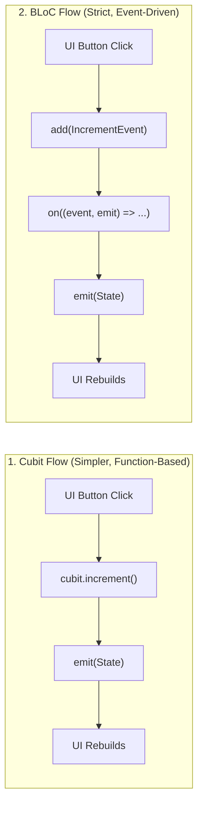

# BLoC and Cubit: Predictable Event-Driven State Architecture

> **Module:** 06-state-management  
> **Subsection:** 04-bloc-and-cubit  
> **Prerequisites:** [02-advanced-dart/03-streams-and-generators/stream-fundamentals.md](../../02-advanced-dart/03-streams-and-generators/stream-fundamentals.md)  
> **Official References:** [bloclibrary.dev](https://bloclibrary.dev) | [pub.dev/packages/flutter_bloc](https://pub.dev/packages/flutter_bloc)

---

## 1. Introduction

Created by Felix Angelov, **BLoC** (Business Logic Component) is one of the most widely adopted state management patterns in large enterprise teams, regulated banking apps, and high-scale distributed codebases.

The core philosophy of BLoC is **predictability through strict separation**:
- UI components never modify state directly.
- UI components emit **Events**.
- The BLoC receives Events, executes business logic, and emits immutable **States**.
- Every single transition is auditable and loggable via `BlocObserver`.

---

## 2. Core Concepts: Cubit vs. BLoC

The `flutter_bloc` package provides two classes:



| Criterion | `Cubit<State>` | `Bloc<Event, State>` |
|:---|:---|:---|
| **Mechanism** | Calls public functions (`cubit.login(...)`) | Dispatches explicit event objects (`bloc.add(LoginSubmitted(...))`) |
| **Complexity** | Low boilerplate; straightforward | Formal event class hierarchy |
| **Event Transformers**| None (runs immediately on function call) | Powerful (`debounce`, `droppable`, `restartable` via RxDart) |
| **Best Used For** | Simple feature screens, local forms, counters | Complex event streams, search autocomplete, high-auditability enterprise apps |

---

## 3. Syntax and Implementation

### 1. The Cubit Approach (Counter & Form Validation)

```dart
import 'package:flutter/material.dart';
import 'package:flutter_bloc/flutter_bloc.dart';

// --- 1. Cubit Definition ---
class CounterCubit extends Cubit<int> {
  CounterCubit() : super(0); // Initial state is 0

  void increment() => emit(state + 1);
  void decrement() {
    if (state > 0) emit(state - 1);
  }
  void reset() => emit(0);
}

// --- 2. Flutter UI Integration ---
class CounterScreen extends StatelessWidget {
  const CounterScreen({super.key});

  @override
  Widget build(BuildContext context) {
    return BlocProvider(
      create: (_) => CounterCubit(),
      child: const _CounterView(),
    );
  }
}

class _CounterView extends StatelessWidget {
  const _CounterView();

  @override
  Widget build(BuildContext context) {
    return Scaffold(
      appBar: AppBar(title: const Text('Cubit State Counter')),
      body: Center(
        // BlocBuilder rebuilds ONLY this text widget when state updates
        child: BlocBuilder<CounterCubit, int>(
          builder: (context, count) {
            return Text(
              '$count',
              style: const TextStyle(fontSize: 48, fontWeight: FontWeight.bold),
            );
          },
        ),
      ),
      floatingActionButton: Row(
        mainAxisAlignment: MainAxisAlignment.end,
        children: [
          FloatingActionButton(
            heroTag: 'btn_dec',
            onPressed: () => context.read<CounterCubit>().decrement(),
            child: const Icon(Icons.remove),
          ),
          const SizedBox(width: 12),
          FloatingActionButton(
            heroTag: 'btn_inc',
            onPressed: () => context.read<CounterCubit>().increment(),
            child: const Icon(Icons.add),
          ),
        ],
      ),
    );
  }
}
```

---

### 2. Full BLoC: Authentication with `BlocConsumer`

`BlocConsumer` uniquely pairs UI building (`builder`) with side-effect execution (`listener`):

```dart
import 'package:flutter/material.dart';
import 'package:flutter_bloc/flutter_bloc.dart';

// --- 1. Events ---
sealed class LoginEvent {
  const LoginEvent();
}

class LoginSubmitted extends LoginEvent {
  final String email;
  final String password;
  const LoginSubmitted(this.email, this.password);
}

// --- 2. States ---
sealed class LoginState {
  const LoginState();
}

class LoginInitial extends LoginState {
  const LoginInitial();
}

class LoginSubmitting extends LoginState {
  const LoginSubmitting();
}

class LoginSuccess extends LoginState {
  final String userId;
  const LoginSuccess(this.userId);
}

class LoginFailure extends LoginState {
  final String error;
  const LoginFailure(this.error);
}

// --- 3. BLoC ---
class LoginBloc extends Bloc<LoginEvent, LoginState> {
  LoginBloc() : super(const LoginInitial()) {
    on<LoginSubmitted>(_onLoginSubmitted);
  }

  Future<void> _onLoginSubmitted(
    LoginSubmitted event,
    Emitter<LoginState> emit,
  ) async {
    emit(const LoginSubmitting());
    try {
      await Future.delayed(const Duration(seconds: 2)); // Simulated API
      if (event.password == 'admin123') {
        emit(const LoginSuccess('user_admin_99'));
      } else {
        emit(const LoginFailure('Invalid credentials provided.'));
      }
    } catch (e) {
      emit(LoginFailure(e.toString()));
    }
  }
}

// --- 4. UI with BlocConsumer ---
class LoginScreen extends StatelessWidget {
  const LoginScreen({super.key});

  @override
  Widget build(BuildContext context) {
    return BlocProvider(
      create: (_) => LoginBloc(),
      child: Scaffold(
        appBar: AppBar(title: const Text('Enterprise Login')),
        body: Padding(
          padding: const EdgeInsets.all(24.0),
          child: BlocConsumer<LoginBloc, LoginState>(
            listener: (context, state) {
              if (state is LoginFailure) {
                ScaffoldMessenger.of(context).showSnackBar(
                  SnackBar(content: Text(state.error), backgroundColor: Colors.red),
                );
              } else if (state is LoginSuccess) {
                ScaffoldMessenger.of(context).showSnackBar(
                  SnackBar(content: Text('Welcome, ${state.userId}!'), backgroundColor: Colors.green),
                );
              }
            },
            builder: (context, state) {
              if (state is LoginSubmitting) {
                return const Center(child: CircularProgressIndicator());
              }

              return Column(
                mainAxisAlignment: MainAxisAlignment.center,
                crossAxisAlignment: CrossAxisAlignment.stretch,
                children: [
                  const TextField(decoration: InputDecoration(labelText: 'Email')),
                  const SizedBox(height: 16),
                  const TextField(
                    obscureText: true,
                    decoration: InputDecoration(labelText: 'Password'),
                  ),
                  const SizedBox(height: 24),
                  FilledButton(
                    onPressed: () {
                      context.read<LoginBloc>().add(
                            const LoginSubmitted('user@enterprise.com', 'admin123'),
                          );
                    },
                    child: const Text('Sign In'),
                  ),
                ],
              );
            },
          ),
        ),
      ),
    );
  }
}
```

---

## 4. Global Logging with `BlocObserver`

One of BLoC's greatest enterprise assets is the ability to monitor every event, transition, and error across the entire application in a single file:

```dart
class AppBlocObserver extends BlocObserver {
  @override
  void onTransition(Bloc bloc, Transition transition) {
    super.onTransition(bloc, transition);
    debugPrint('[BLoC Transition] ${bloc.runtimeType}: $transition');
  }

  @override
  void onError(BlocBase bloc, Object error, StackTrace stackTrace) {
    debugPrint('[BLoC Error] ${bloc.runtimeType}: $error');
    super.onError(bloc, error, stackTrace);
  }
}

// In main.dart:
void main() {
  Bloc.observer = AppBlocObserver();
  runApp(const MyApp());
}
```

---

## 5. Interview & Assessment Takeaways

| Interview Question | Concise Verbal Answer |
|:---|:---|
| **What is the difference between `BlocBuilder`, `BlocListener`, and `BlocConsumer`?** | `BlocBuilder` rebuilds UI widgets when state updates. `BlocListener` executes one-shot imperative actions (showing SnackBars, navigation) without rebuilding UI. `BlocConsumer` combines both into a single widget with separate `builder` and `listener` blocks. |
| **When should you choose `Bloc` over `Cubit`?** | Choose `Bloc` when you need event traceability (e.g. analytics or auditing every action dispatched), or when you need reactive event transformers (e.g. debouncing rapid search queries or dropping duplicate rapid button taps). Choose `Cubit` for simpler, straightforward state with less boilerplate. |
| **Why is state mutation strictly forbidden in BLoC?** | BLoC relies on Dart's `identical()` or `==` operator to detect if state has changed. If you mutate fields inside an existing state object and emit it, BLoC detects that the instance reference hasn't changed and silently cancels the UI rebuild. Always emit new immutable instances. |
