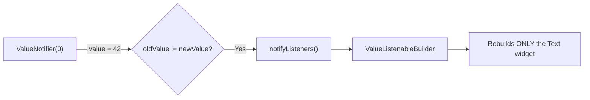

# Lightweight Reactivity: ValueNotifier and Flutter Signals

> **Module:** 06-state-management  
> **Subsection:** 05-valuenotifier-and-signals  
> **Prerequisites:** [06-state-management/01-state-management-overview/state-management-landscape.md](../01-state-management-overview/state-management-landscape.md)  
> **Official References:** [api.flutter.dev/flutter/foundation/ValueNotifier-class.html](https://api.flutter.dev/flutter/foundation/ValueNotifier-class.html) | [pub.dev/packages/signals_flutter](https://pub.dev/packages/signals_flutter)

---

## 1. Introduction

Not every project requires a full third-party state management framework like Riverpod or BLoC. When building:
- An isolated custom UI component (e.g. an audio player scrubber, a bottom sheet expansion percentage),
- A lightweight SDK or plugin intended to have zero external package dependencies, or
- High-frequency numerical updates (like a 60fps stopwatch or sensor accelerometer stream),

Flutter's built-in **`ValueNotifier`** and the modern **`Signals`** paradigm provide ultra-fast, fine-grained reactivity with zero overhead.

---

## 2. Core Concepts: `ValueNotifier` and `ValueListenableBuilder`

`ValueNotifier<T>` subclasses `ChangeNotifier` and wraps a single piece of data (`value`). Whenever you assign a new value to `.value`, it checks equality (`==`). If the value changed, it automatically invokes `notifyListeners()`.



---

## 3. Syntax and Implementation

### 1. Zero-Dependency Counter / Timer with `ValueNotifier`

```dart
import 'dart:async';
import 'package:flutter/material.dart';

class StopwatchWidget extends StatefulWidget {
  const StopwatchWidget({super.key});

  @override
  State<StopwatchWidget> createState() => _StopwatchWidgetState();
}

class _StopwatchWidgetState extends State<StopwatchWidget> {
  // Built into Flutter foundation - zero external packages needed!
  final ValueNotifier<int> _secondsElapsed = ValueNotifier<int>(0);
  Timer? _timer;

  @override
  void initState() {
    super.initState();
    _timer = Timer.periodic(const Duration(seconds: 1), (_) {
      _secondsElapsed.value++;
    });
  }

  @override
  void dispose() {
    _timer?.cancel();
    _secondsElapsed.dispose(); // Always dispose notifiers
    super.dispose();
  }

  @override
  Widget build(BuildContext context) {
    return Scaffold(
      appBar: AppBar(title: const Text('ValueNotifier Stopwatch')),
      body: Center(
        // Rebuild is strictly scoped to this single builder
        child: ValueListenableBuilder<int>(
          valueListenable: _secondsElapsed,
          builder: (context, seconds, child) {
            return Column(
              mainAxisAlignment: MainAxisAlignment.center,
              children: [
                Text(
                  '$seconds s',
                  style: const TextStyle(fontSize: 54, fontWeight: FontWeight.bold),
                ),
                const SizedBox(height: 8),
                // Static child is cached and passed through without rebuild!
                child!,
              ],
            );
          },
          child: const Text('Running in background...', style: TextStyle(color: Colors.grey)),
        ),
      ),
    );
  }
}
```

---

### 2. The Modern Alternative: Fine-Grained Reactivity with `Signals`

Signals (popularized by SolidJS and Preact, brought to Flutter via `signals_flutter`) provide automatic dependency tracking. Instead of manual builder subscriptions, reading a signal's value inside a `Watch` widget or signal context automatically binds the reactive graph.

```dart
import 'package:flutter/material.dart';
import 'package:signals_flutter/signals_flutter.dart';

// Top-level signal declaration
final countSignal = signal<int>(0);
final doubleCountSignal = computed(() => countSignal.value * 2);

class SignalsCounterScreen extends StatelessWidget {
  const SignalsCounterScreen({super.key});

  @override
  Widget build(BuildContext context) {
    return Scaffold(
      appBar: AppBar(title: const Text('Fine-Grained Signals')),
      body: Center(
        child: Column(
          mainAxisAlignment: MainAxisAlignment.center,
          children: [
            // Watch widget subscribes automatically to countSignal
            Watch((context) => Text(
              'Count: ${countSignal.value}',
              style: const TextStyle(fontSize: 32),
            )),
            const SizedBox(height: 12),
            // Subscribes automatically to computed signal
            Watch((context) => Text(
              'Double: ${doubleCountSignal.value}',
              style: const TextStyle(fontSize: 24, color: Colors.blueGrey),
            )),
          ],
        ),
      ),
      floatingActionButton: FloatingActionButton(
        onPressed: () => countSignal.value++,
        child: const Icon(Icons.add),
      ),
    );
  }
}
```

---

## 4. Common Pitfalls & Anti-Patterns

### Pitfall 1: Mutating Collections Inside `ValueNotifier`
```dart
final listNotifier = ValueNotifier<List<String>>(['apple']);

// ❌ FAILS TO NOTIFY: The list reference hasn't changed, so .value = list does nothing!
listNotifier.value.add('banana');
listNotifier.value = listNotifier.value; 

// ✅ CORRECT: Assign a new immutable list instance
listNotifier.value = [...listNotifier.value, 'banana'];
```

---

## 5. Interview & Assessment Takeaways

| Interview Question | Concise Verbal Answer |
|:---|:---|
| **Why is `ValueNotifier` preferable to `setState()` for local performance?** | `setState()` marks the entire `StatefulWidget`'s element dirty, re-running its full `build()` method. `ValueNotifier` paired with `ValueListenableBuilder` confines rebuilds strictly to the sub-tree defined in the builder closure, ignoring the parent widget. |
| **How does `ValueNotifier` compare to `ChangeNotifier`?** | `ValueNotifier<T>` is a specialized subclass of `ChangeNotifier` that holds a single `value`. Setting `.value` automatically checks equality and calls `notifyListeners()`, eliminating manual `notifyListeners()` calls for single-property changes. |
| **What is the primary advantage of Signals over traditional Flutter state management?** | Automatic dependency tracking. In Signals, accessing `.value` registers the dependency automatically without manual providers, controllers, or inherited context lookups. |
