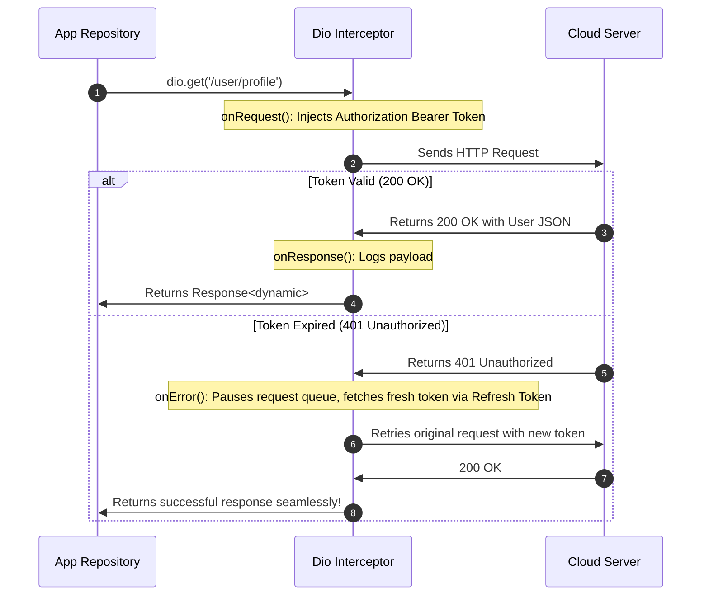

# Enterprise REST Architecture: Dio, Interceptors, and Token Refresh

> **Module:** 07-networking-and-backend  
> **Subsection:** 01-rest-apis-http-and-dio  
> **Prerequisites:** [02-advanced-dart/01-asynchronous-programming/futures-and-async-await.md](../../02-advanced-dart/01-asynchronous-programming/futures-and-async-await.md)  
> **Official References:** [pub.dev/packages/dio](https://pub.dev/packages/dio) | [docs.flutter.dev/data-and-backend/networking](https://docs.flutter.dev/data-and-backend/networking)

---

## 1. Introduction

While Dart provides a basic `package:http` library suitable for minimal scripts, enterprise Flutter applications require robust networking infrastructure:
- Request/response interception (for logging, auth headers, and analytics),
- Automatic **JWT Access Token refresh queues** when tokens expire (HTTP 401),
- Connection and receive timeouts to prevent hanging sockets,
- Global error mapping,
- Request cancellation via `CancelToken` when navigating away from views.

**`Dio`** is the gold standard HTTP client in the Flutter ecosystem that satisfies all of these enterprise requirements.

---

## 2. Core Concepts: The Interceptor Pipeline

An Interceptor is a middleware hook that sits between your application and the network socket:



---

## 3. Syntax and Implementation

### Complete Enterprise Dio Client with Automatic 401 Token Refresh

```dart
import 'package:dio/dio.dart';
import 'package:flutter/foundation.dart';

class ApiClient {
  late final Dio _dio;

  ApiClient({required String baseUrl, required TokenStorage tokenStorage}) {
    _dio = Dio(
      BaseOptions(
        baseUrl: baseUrl,
        connectTimeout: const Duration(seconds: 10),
        receiveTimeout: const Duration(seconds: 10),
        sendTimeout: const Duration(seconds: 10),
        headers: {
          'Content-Type': 'application/json',
          'Accept': 'application/json',
        },
      ),
    );

    // Attach production interceptor
    _dio.interceptors.addAll([
      _AuthInterceptor(_dio, tokenStorage),
      if (kDebugMode)
        LogInterceptor(
          requestHeader: true,
          requestBody: true,
          responseBody: true,
          responseHeader: false,
          error: true,
        ),
    ]);
  }

  Dio get dio => _dio;
}

/// Abstract contract for secure token persistence
abstract class TokenStorage {
  Future<String?> getAccessToken();
  Future<String?> getRefreshToken();
  Future<void> saveTokens({required String accessToken, required String refreshToken});
  Future<void> clearTokens();
}

class _AuthInterceptor extends QueuedInterceptor {
  final Dio _dio;
  final TokenStorage _tokenStorage;

  _AuthInterceptor(this._dio, this._tokenStorage);

  @override
  Future<void> onRequest(
    RequestOptions options,
    RequestInterceptorHandler handler,
  ) async {
    // 1. Injects Bearer token automatically if available
    final token = await _tokenStorage.getAccessToken();
    if (token != null && token.isNotEmpty) {
      options.headers['Authorization'] = 'Bearer $token';
    }
    return handler.next(options);
  }

  @override
  Future<void> onError(
    DioException err,
    ErrorInterceptorHandler handler,
  ) async {
    // 2. Intercept 401 Unauthorized errors
    if (err.response?.statusCode == 401) {
      final refreshToken = await _tokenStorage.getRefreshToken();
      if (refreshToken != null) {
        try {
          // Dedicated un-intercepted Dio instance to prevent infinite loops
          final refreshDio = Dio(BaseOptions(baseUrl: err.requestOptions.baseUrl));
          final response = await refreshDio.post(
            '/auth/refresh',
            data: {'refreshToken': refreshToken},
          );

          if (response.statusCode == 200) {
            final newAccessToken = response.data['accessToken'] as String;
            final newRefreshToken = response.data['refreshToken'] as String;

            // Persist new credentials
            await _tokenStorage.saveTokens(
              accessToken: newAccessToken,
              refreshToken: newRefreshToken,
            );

            // Retry original request with the fresh token
            final originalOptions = err.requestOptions;
            originalOptions.headers['Authorization'] = 'Bearer $newAccessToken';

            final retriedResponse = await _dio.fetch(originalOptions);
            return handler.resolve(retriedResponse);
          }
        } catch (refreshError) {
          // Refresh token expired or revoked; force logout
          await _tokenStorage.clearTokens();
        }
      }
    }
    return handler.next(err);
  }
}
```

---

### 2. Request Cancellation with `CancelToken`

When a user rapidly switches tabs or leaves a screen while a 10MB file or heavy list is downloading, the request should be aborted immediately to preserve bandwidth:

```dart
class SearchRepository {
  final Dio _dio;
  CancelToken? _cancelToken;

  SearchRepository(this._dio);

  Future<List<String>> searchProducts(String query) async {
    // Cancel any ongoing inflight search request
    _cancelToken?.cancel('Cancelled due to new query entry');
    _cancelToken = CancelToken();

    try {
      final response = await _dio.get(
        '/products/search',
        queryParameters: {'q': query},
        cancelToken: _cancelToken,
      );
      return List<String>.from(response.data['results']);
    } on DioException catch (e) {
      if (CancelToken.isCancel(e)) {
        debugPrint('Request safely aborted by user: ${e.message}');
        return [];
      }
      rethrow;
    }
  }
}
```

---

## 4. Exponential Backoff Retry Policy

Network failures often occur due to momentary cellular handoffs. Implementing an exponential backoff retry strategy prevents hammering servers while gracefully recovering:

$$\text{Delay} = \text{baseDelay} \times 2^{\text{attempt}}$$

```dart
Future<Response<T>> retryWithBackoff<T>(
  Future<Response<T>> Function() request, {
  int maxRetries = 3,
  Duration baseDelay = const Duration(milliseconds: 500),
}) async {
  int attempts = 0;
  while (true) {
    try {
      attempts++;
      return await request();
    } on DioException catch (e) {
      final isNetworkError = e.type == DioExceptionType.connectionTimeout ||
                             e.type == DioExceptionType.connectionError;

      if (!isNetworkError || attempts >= maxRetries) {
        rethrow;
      }

      final delay = baseDelay * (1 << (attempts - 1)); // Exponential bitshift
      await Future.delayed(delay);
    }
  }
}
```

---

## 5. Interview & Assessment Takeaways

| Interview Question | Concise Verbal Answer |
|:---|:---|
| **Why is `QueuedInterceptor` preferred over `Interceptor` for token refreshing?** | Standard `Interceptor` processes calls concurrently. If five API calls trigger simultaneously and all get 401s, a standard interceptor fires five simultaneous token refresh requests. `QueuedInterceptor` locks the queue, allowing only one refresh call to complete while pausing the other requests until they can be retried with the new token. |
| **What is the purpose of `CancelToken` in Dio?** | It links to an active HTTP socket request and allows the client to abort the network call midway. This prevents memory leaks and saves mobile cellular data when a user navigates away from a screen before a request finishes. |
| **How does Dio handle JSON parsing compared to `http.get`?** | `package:http` returns a raw text string that requires manual `jsonDecode(response.body)`. `Dio` detects the `Content-Type: application/json` header and automatically deserializes the response body into Dart `Map` / `List` primitives in background isolates. |
