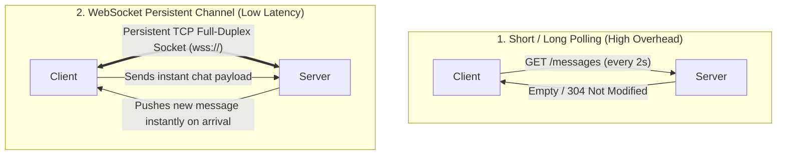

# Real-Time Streaming with WebSockets

> **Module:** 07-networking-and-backend  
> **Subsection:** 03-websockets-and-realtime  
> **Prerequisites:** [02-advanced-dart/03-streams-and-generators/stream-fundamentals.md](../../02-advanced-dart/03-streams-and-generators/stream-fundamentals.md)  
> **Official References:** [docs.flutter.dev/cookbook/networking/web-sockets](https://docs.flutter.dev/cookbook/networking/web-sockets) | [pub.dev/packages/web_socket_channel](https://pub.dev/packages/web_socket_channel)

---

## 1. Introduction

Standard REST APIs follow a request-response model initiated exclusively by the client. However, real-time features—such as live chat messaging, live financial stock tickers, collaborative whiteboards, or multiplayer gaming—require **full-duplex, bidirectional communication** over a persistent TCP socket.

The official `web_socket_channel` package bridges low-level WebSocket connections into idiomatic Dart `Stream` and `StreamSink` interfaces.

---

## 2. Core Concepts: REST Polling vs. WebSockets



---

## 3. Syntax and Implementation

### Resilient WebSocket Service with Heartbeat & Reconnection

```dart
import 'dart:async';
import 'dart:convert';
import 'package:flutter/foundation.dart';
import 'package:web_socket_channel/web_socket_channel.dart';
import 'package:web_socket_channel/status.dart' as status;

class LivePriceSocketService {
  final Uri _serverUri;
  WebSocketChannel? _channel;
  StreamSubscription? _subscription;
  Timer? _heartbeatTimer;

  final StreamController<Map<String, dynamic>> _messageController =
      StreamController<Map<String, dynamic>>.broadcast();

  LivePriceSocketService(String url) : _serverUri = Uri.parse(url);

  Stream<Map<String, dynamic>> get messageStream => _messageController.stream;

  void connect() {
    try {
      _channel = WebSocketChannel.connect(_serverUri);

      _subscription = _channel!.stream.listen(
        (dynamic rawData) {
          final decoded = jsonDecode(rawData as String) as Map<String, dynamic>;
          // Ignore server heartbeat replies
          if (decoded['type'] == 'pong') return;
          _messageController.add(decoded);
        },
        onError: (error) {
          debugPrint('WebSocket error encountered: $error');
          _reconnect();
        },
        onDone: () {
          debugPrint('WebSocket connection closed by remote host.');
          _reconnect();
        },
      );

      _startHeartbeat();
    } catch (e) {
      _reconnect();
    }
  }

  void sendMessage(Map<String, dynamic> payload) {
    if (_channel != null) {
      _channel!.sink.add(jsonEncode(payload));
    }
  }

  void _startHeartbeat() {
    _heartbeatTimer?.cancel();
    // Send ping every 30 seconds to keep carrier NAT gateways open
    _heartbeatTimer = Timer.periodic(const Duration(seconds: 30), (_) {
      sendMessage({'type': 'ping', 'timestamp': DateTime.now().toIso8601String()});
    });
  }

  void _reconnect() {
    _heartbeatTimer?.cancel();
    _subscription?.cancel();
    _channel?.sink.close(status.goingAway);

    // Exponential or fixed retry after 5 seconds
    Future.delayed(const Duration(seconds: 5), () {
      connect();
    });
  }

  void dispose() {
    _heartbeatTimer?.cancel();
    _subscription?.cancel();
    _channel?.sink.close(status.normalClosure);
    _messageController.close();
  }
}
```

---

## 4. Interview & Assessment Takeaways

| Interview Question | Concise Verbal Answer |
|:---|:---|
| **What is the difference between `Stream` and `StreamSink` in `WebSocketChannel`?** | `channel.stream` provides an inbound stream of messages arriving from the remote server. `channel.sink` is the outbound destination where the Flutter app sends (`.add()`) data to the remote server. |
| **Why is a heartbeat (ping-pong) mechanism necessary in mobile WebSockets?** | Mobile cellular carriers and NAT routers automatically kill idle TCP connections after 30–60 seconds of inactivity without notifying the client. Heartbeat packets keep the route active and detect silently dropped connections immediately. |
| **Why should you always close `WebSocketChannel.sink` with `status.normalClosure` on widget disposal?** | It sends an explicit WebSocket close frame to the server, releasing server memory and connections gracefully rather than leaving zombie sockets open. |
