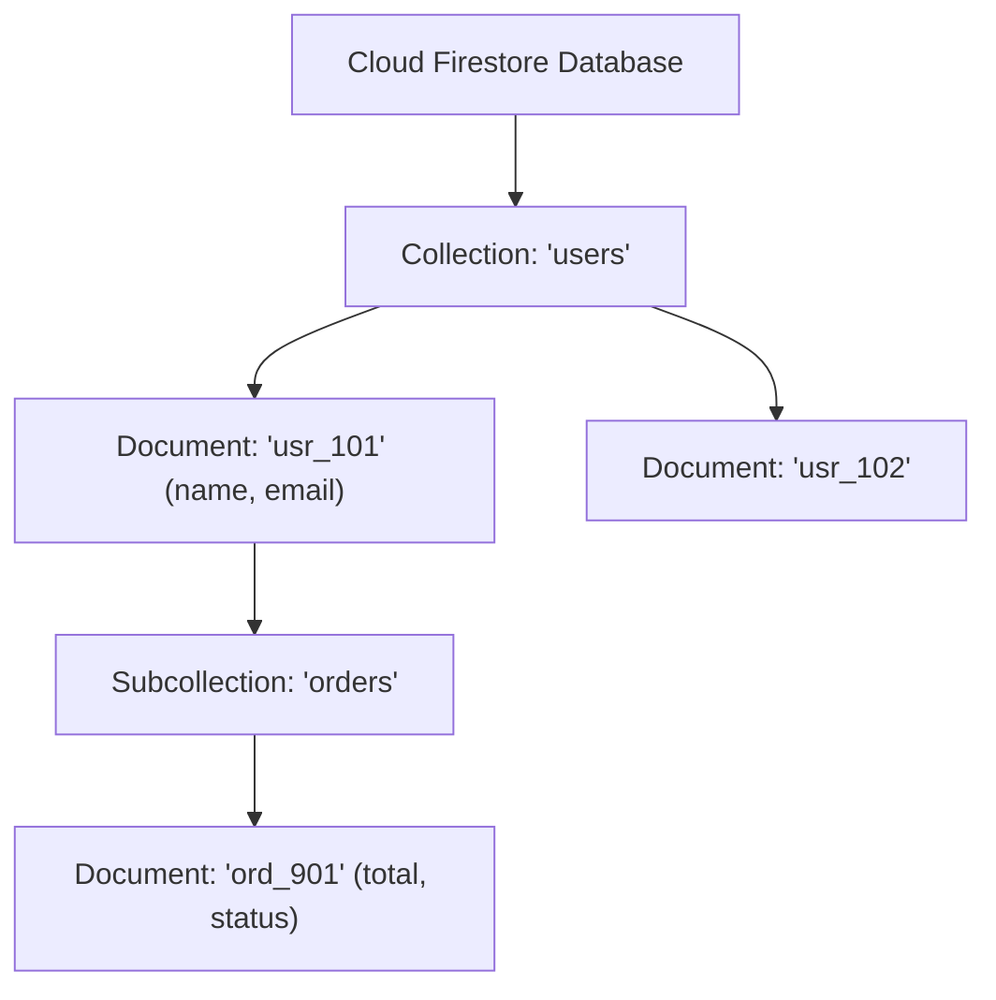

# Firebase Integration and Cloud Firestore Real-Time Database

> **Module:** 07-networking-and-backend  
> **Subsection:** 04-firebase-integration  
> **Prerequisites:** [06-state-management/03-riverpod-modern/riverpod-deep-dive.md](../../06-state-management/03-riverpod-modern/riverpod-deep-dive.md)  
> **Official References:** [firebase.google.com/docs/flutter/setup](https://firebase.google.com/docs/flutter/setup) | [firebase.google.com/docs/firestore](https://firebase.google.com/docs/firestore)

---

## 1. Introduction

Google Cloud Firestore is a serverless, NoSQL document database built for mobile and web development. It delivers automatic offline synchronization, enterprise security rules, and real-time live queries directly to Flutter applications without needing a custom Node.js/Go backend server.

---

## 2. Core Concepts: Document-Collection Data Hierarchy



- **Collections:** Containers for documents. You cannot place raw data directly in a collection; it must hold documents.
- **Documents:** Lightweight JSON-like key-value records containing fields, maps, arrays, or nested subcollections.
- **Subcollections:** Collections nested inside documents, useful for hierarchical data that scales indefinitely without bloating parent documents beyond the 1MB document limit.

---

## 3. Syntax and Implementation

### 1. App Initialization (`main.dart`)

```dart
import 'package:flutter/material.dart';
import 'package:firebase_core/firebase_core.dart';
import 'firebase_options.dart'; // Generated via flutterfire configure

void main() async {
  // 1. Ensure Flutter engine bindings are initialized before calling async platform code
  WidgetsFlutterBinding.ensureInitialized();

  // 2. Initialize Firebase with platform-specific credentials
  await Firebase.initializeApp(
    options: DefaultFirebaseOptions.currentPlatform,
  );

  runApp(const MyApp());
}
```

---

### 2. Type-Safe Firestore Queries using `withConverter()`

> 💡 **Best Practice:** Avoid working with raw `Map<String, dynamic>`. Use Firestore's `.withConverter<T>()` to automatically deserialize documents into typed Dart models!

```dart
import 'package:cloud_firestore/cloud_firestore.dart';

class Task {
  final String id;
  final String title;
  final bool isCompleted;
  final DateTime dueDate;

  Task({
    required this.id,
    required this.title,
    required this.isCompleted,
    required this.dueDate,
  });

  factory Task.fromJson(Map<String, dynamic> json, String docId) {
    return Task(
      id: docId,
      title: json['title'] as String,
      isCompleted: json['isCompleted'] as bool? ?? false,
      dueDate: (json['dueDate'] as Timestamp).toDate(),
    );
  }

  Map<String, dynamic> toJson() {
    return {
      'title': title,
      'isCompleted': isCompleted,
      'dueDate': Timestamp.fromDate(dueDate),
    };
  }
}

class TaskRepository {
  final FirebaseFirestore _firestore = FirebaseFirestore.instance;

  // Type-safe CollectionReference
  CollectionReference<Task> get _tasksRef =>
      _firestore.collection('tasks').withConverter<Task>(
            fromFirestore: (snapshot, _) => Task.fromJson(snapshot.data()!, snapshot.id),
            toFirestore: (task, _) => task.toJson(),
          );

  // 1. Real-time live query stream
  Stream<List<Task>> watchPendingTasks() {
    return _tasksRef
        .where('isCompleted', isEqualTo: false)
        .orderBy('dueDate', descending: false)
        .limit(20)
        .snapshots()
        .map((snapshot) => snapshot.docs.map((doc) => doc.data()).toList());
  }

  // 2. Create document
  Future<void> addTask(String title, DateTime dueDate) async {
    final newTask = Task(
      id: '',
      title: title,
      isCompleted: false,
      dueDate: dueDate,
    );
    await _tasksRef.add(newTask);
  }

  // 3. Update document field
  Future<void> toggleTask(String taskId, bool isCompleted) async {
    await _tasksRef.doc(taskId).update({'isCompleted': isCompleted});
  }

  // 4. Delete document
  Future<void> deleteTask(String taskId) async {
    await _tasksRef.doc(taskId).delete();
  }
}
```

---

## 4. Latency Compensation and Offline Persistence

By default, Cloud Firestore for Flutter enables **offline disk persistence** on mobile devices.
- When an app modifies a document while offline, Firestore writes the change to the local SQLite cache and triggers UI updates **instantly** (latency compensation).
- When internet connectivity is restored, Firestore synchronizes changes to the cloud automatically in the background.

---

## 5. Interview & Assessment Takeaways

| Interview Question | Concise Verbal Answer |
|:---|:---|
| **What is the difference between `collection.get()` and `collection.snapshots()`?** | `collection.get()` executes a one-time network/cache fetch returning a `Future<QuerySnapshot>`. `collection.snapshots()` creates a persistent live listener returning a `Stream<QuerySnapshot>` that automatically emits whenever remote documents are inserted, modified, or deleted. |
| **Why is `withConverter<T>()` recommended for Firestore in Flutter?** | It provides compile-time type safety. It attaches custom serialization and deserialization functions to the collection reference, ensuring all queries return strongly typed models rather than fragile raw maps. |
| **What is a composite index error in Firestore?** | In Firestore, querying across multiple fields with inequality filters and order-by clauses (e.g. `.where('age', isGreaterThan: 18).orderBy('score')`) requires a composite index. Firestore returns a helpful error log containing a direct URL to create the index in the Firebase Console with one click. |
