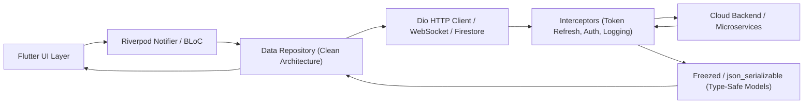

# Module 07: Networking, REST APIs, and Backend Integration

> **Stage:** Stage 3 (Continued) – Data Integration, Serialization & Real-Time Backends  
> **Target Audience:** Intermediate to Senior Flutter Engineers  
> **Prerequisites:** [02-advanced-dart/01-asynchronous-programming/futures-and-async-await.md](../02-advanced-dart/01-asynchronous-programming/futures-and-async-await.md) | [06-state-management/03-riverpod-modern/riverpod-deep-dive.md](../06-state-management/03-riverpod-modern/riverpod-deep-dive.md)

---

## Overview

Modern mobile apps rarely live in isolation; they are gateways to cloud services, RESTful microservices, and real-time streaming backends. Writing fragile networking code (such as raw JSON string maps, missing timeout configurations, or unhandled HTTP 500 crashes) creates bug-ridden, unreliable user experiences.

This module covers the entire Flutter networking pipeline:
- Enterprise HTTP client architecture with **`Dio`**: BaseOptions, Interceptors, Bearer Token injection, automatic token refresh queues, and exponential backoff.
- Type-safe JSON serialization: Manual parsing vs. **`json_serializable`** vs. immutable data modeling with **`Freezed`**.
- Bidirectional live streaming via **WebSockets** (`web_socket_channel`).
- Real-time cloud databases with **Google Cloud Firestore**.

---

## Architecture Flow



---

## Directory Roadmap

```
07-networking-and-backend/
├── README.md
├── 01-rest-apis-http-and-dio/
│   └── dio-and-rest-architecture.md         # Dio client, Interceptors, Token refresh, Retry policies
├── 02-json-serialization-and-freezed/
│   └── json-and-freezed-guide.md            # Manual jsonDecode vs json_serializable vs @freezed
├── 03-websockets-and-realtime/
│   └── websockets-guide.md                  # web_socket_channel, live streams, connection heartbeats
└── 04-firebase-integration/
    └── firebase-and-firestore-guide.md      # Firebase.initializeApp, Firestore streams, query caching
```
