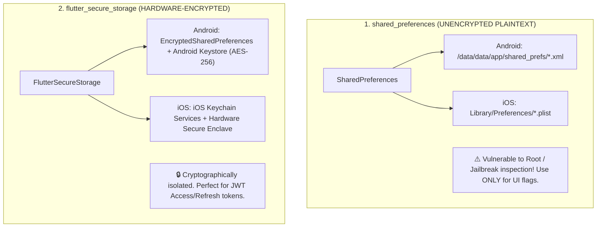

# SharedPreferences vs. FlutterSecureStorage: Secure Token Persistence

> **Module:** 08-local-storage-and-databases  
> **Subsection:** 01-shared-preferences-and-secure-storage  
> **Prerequisites:** [07-networking-and-backend/01-rest-apis-http-and-dio/dio-and-rest-architecture.md](../../07-networking-and-backend/01-rest-apis-http-and-dio/dio-and-rest-architecture.md)  
> **Official References:** [pub.dev/packages/shared_preferences](https://pub.dev/packages/shared_preferences) | [pub.dev/packages/flutter_secure_storage](https://pub.dev/packages/flutter_secure_storage)

---

## 1. Introduction

When storing simple data in mobile apps, developers frequently reach for key-value persistence. However, a major security pitfall is confusing **convenience storage** with **secure cryptographic storage**.

Storing authentication tokens, credit card tokens, or user passwords inside `shared_preferences` is a severe security vulnerability. On rooted Android phones or jailbroken iPhones, standard preferences are stored as unencrypted plaintext XML/plist files that any file browser can read in seconds.

---

## 2. Core Concepts: Plaintext vs. Hardware-Encrypted Storage



---

## 3. Syntax and Implementation

### 1. `shared_preferences` (For Non-Sensitive UI Settings)

```dart
import 'package:shared_preferences/shared_preferences.dart';

class SettingsPreferencesService {
  static const String _keyThemeMode = 'app_theme_mode';
  static const String _keyOnboardingDone = 'onboarding_completed';

  Future<void> saveThemeMode(bool isDarkMode) async {
    final prefs = await SharedPreferences.getInstance();
    await prefs.setBool(_keyThemeMode, isDarkMode);
  }

  Future<bool> getThemeMode() async {
    final prefs = await SharedPreferences.getInstance();
    return prefs.getBool(_keyThemeMode) ?? false; // Default to light mode
  }

  Future<void> markOnboardingComplete() async {
    final prefs = await SharedPreferences.getInstance();
    await prefs.setBool(_keyOnboardingDone, true);
  }

  Future<bool> isOnboardingComplete() async {
    final prefs = await SharedPreferences.getInstance();
    return prefs.getBool(_keyOnboardingDone) ?? false;
  }
}
```

---

### 2. `flutter_secure_storage` (For Cryptographic Authentication Tokens)

```dart
import 'package:flutter_secure_storage/flutter_secure_storage.dart';

class SecureAuthStorage {
  static const String _keyAccessToken = 'jwt_access_token';
  static const String _keyRefreshToken = 'jwt_refresh_token';
  static const String _keyUserId = 'auth_user_id';

  final FlutterSecureStorage _storage = const FlutterSecureStorage(
    // Android: Use modern EncryptedSharedPreferences backed by Android Keystore
    aOptions: AndroidOptions(
      encryptedSharedPreferences: true,
    ),
    // iOS: Ensure keys are accessible only when device is unlocked
    iOptions: IOSOptions(
      accessibility: KeychainAccessibility.first_unlock,
    ),
  );

  Future<void> saveAuthCredentials({
    required String accessToken,
    required String refreshToken,
    required String userId,
  }) async {
    await Future.wait([
      _storage.write(key: _keyAccessToken, value: accessToken),
      _storage.write(key: _keyRefreshToken, value: refreshToken),
      _storage.write(key: _keyUserId, value: userId),
    ]);
  }

  Future<String?> getAccessToken() async => await _storage.read(key: _keyAccessToken);
  Future<String?> getRefreshToken() async => await _storage.read(key: _keyRefreshToken);
  Future<String?> getUserId() async => await _storage.read(key: _keyUserId);

  Future<void> clearAll() async {
    // Purges cryptographic keys from Keychain/Keystore upon user logout
    await _storage.deleteAll();
  }
}
```

---

## 4. Interview & Assessment Takeaways

| Interview Question | Concise Verbal Answer |
|:---|:---|
| **Why is storing authentication JWT tokens in `SharedPreferences` considered an anti-pattern?** | `SharedPreferences` persists values as unencrypted plaintext XML files on Android and `.plist` files on iOS. Any rooted/jailbroken device or backup tool can read the plaintext tokens directly. Sensitive credentials must be stored via `flutter_secure_storage`. |
| **How does `flutter_secure_storage` secure data on Android and iOS?** | On iOS, it writes to the native **Keychain Services** backed by the hardware Secure Enclave. On Android, it leverages **EncryptedSharedPreferences** with master keys generated and managed securely inside the **Android Keystore system**. |
| **Can you store complex objects in `SharedPreferences`?** | `SharedPreferences` natively only supports primitives (`int`, `double`, `bool`, `String`, `List<String>`). Complex objects must be serialized to a JSON string via `jsonEncode()` before saving. |
