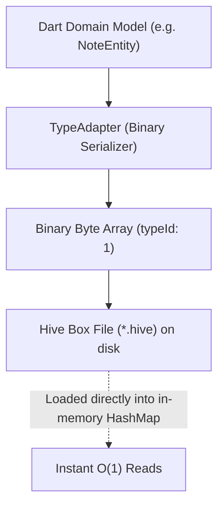

# High-Performance NoSQL: Hive, hive_ce, and Isar

> **Module:** 08-local-storage-and-databases  
> **Subsection:** 02-nosql-hive-and-isar  
> **Prerequisites:** [08-local-storage-and-databases/01-shared-preferences-and-secure-storage/preferences-and-secure-storage.md](../01-shared-preferences-and-secure-storage/preferences-and-secure-storage.md)  
> **Official References:** [pub.dev/packages/hive_ce](https://pub.dev/packages/hive_ce) | [isar.dev](https://isar.dev)

---

## 1. Introduction

When storing thousands of cached items (such as news feed cards, product catalogs, or user drafts), SQLite can sometimes feel excessively rigid and boilerplate-heavy. Conversely, writing raw JSON strings to flat files introduces severe CPU bottlenecks due to JSON decoding overhead.

**`Hive`** (and its modern community-maintained fork **`hive_ce`**) and **`Isar`** are embedded, high-performance NoSQL binary databases written specifically for Dart and Flutter. Because they store data in optimized binary formats, read operations approach in-memory speeds.

---

## 2. Core Concepts: How Hive Operates

Hive stores data in **Boxes** (analogous to SQL tables or NoSQL collections).



### Regular Box vs. Lazy Box
- **`Box<T>`:** Keeps all keys and values loaded in RAM. Read operations (`box.get('key')`) are instantaneous $O(1)$ in-memory lookups. Ideal for datasets up to ~10MB.
- **`LazyBox<T>`:** Keeps only keys in memory and reads values asynchronously from disk on demand (`await lazyBox.get('key')`). Ideal for large datasets (e.g. hundreds of megabytes of media metadata).

---

## 3. Syntax and Implementation with `hive_ce`

### 1. Model Definition and Adapter Generation

```dart
import 'package:hive_ce/hive.dart';

part 'note_model.g.dart';

@HiveType(typeId: 1) // Unique typeId (0 to 223) allocated to this class
class NoteModel extends HiveObject {
  @HiveField(0)
  final String id;

  @HiveField(1)
  final String title;

  @HiveField(2)
  final String content;

  @HiveField(3)
  final DateTime createdAt;

  NoteModel({
    required this.id,
    required this.title,
    required this.content,
    required this.createdAt,
  });
}
```

---

### 2. Initialization & Registration (`main.dart`)

```dart
import 'package:flutter/material.dart';
import 'package:hive_ce/hive.dart';
import 'package:path_provider/path_provider.dart';
import 'note_model.dart';

void main() async {
  WidgetsFlutterBinding.ensureInitialized();

  // 1. Initialize Hive with application documents directory
  final appDir = await getApplicationDocumentsDirectory();
  Hive.init(appDir.path);

  // 2. Register Generated TypeAdapter
  Hive.registerAdapter(NoteModelAdapter());

  // 3. Open Box
  await Hive.openBox<NoteModel>('notes_box');

  runApp(const MyApp());
}
```

---

### 3. CRUD Repository Pattern

```dart
import 'package:hive_ce/hive.dart';
import 'note_model.dart';

class NoteRepository {
  Box<NoteModel> get _box => Hive.box<NoteModel>('notes_box');

  // Create or Update (Keyed by unique ID)
  Future<void> saveNote(NoteModel note) async {
    await _box.put(note.id, note);
  }

  // Read single
  NoteModel? getNote(String id) => _box.get(id);

  // Read all
  List<NoteModel> getAllNotes() => _box.values.toList();

  // Delete
  Future<void> deleteNote(String id) async {
    await _box.delete(id);
  }

  // Reactive Stream of Box changes
  Stream<BoxEvent> watchNotes() => _box.watch();
}
```

---

## 4. Modern Note: Why `hive_ce`?
The original `hive` package went unmaintained for a prolonged period, leading to dependency conflicts with modern Dart 3. The open-source community created **`hive_ce`** (Hive Community Edition), fixing critical memory bugs, updating Dart 3 class modifiers, and maintaining full compatibility with existing `.hive` box files.

---

## 5. Interview & Assessment Takeaways

| Interview Question | Concise Verbal Answer |
|:---|:---|
| **Why is Hive significantly faster than SQLite for simple key-value reads?** | Hive loads the entire box index into an in-memory Dart `HashMap`. Reading a key (`box.get()`) is a direct pointer lookup in RAM without SQLite C-interop translation or SQL query compilation overhead. |
| **What is the significance of `typeId` in Hive?** | Hive's binary serialization assigns each class a unique integer `typeId` ($0 \dots 223$). When writing binary bytes to disk, Hive writes the `typeId` at the header so the correct registered `TypeAdapter` can be invoked upon deserialization. |
| **When should you use `LazyBox` instead of a standard `Box`?** | Use `LazyBox` when storing large collections or large binary blobs where loading all records into device RAM would trigger an Out-Of-Memory (OOM) crash. `LazyBox` keeps only keys in memory and fetches values from disk on demand. |
