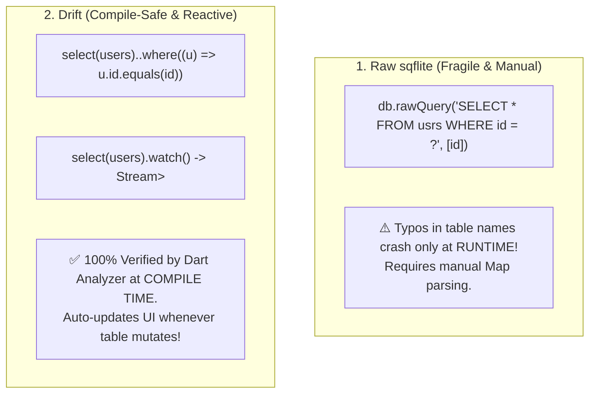

# Type-Safe Reactive SQLite with Drift

> **Module:** 08-local-storage-and-databases  
> **Subsection:** 03-relational-sqlite-and-drift  
> **Prerequisites:** [08-local-storage-and-databases/02-nosql-hive-and-isar/hive-and-isar-guide.md](../02-nosql-hive-and-isar/hive-and-isar-guide.md)  
> **Official References:** [drift.simonbinder.eu](https://drift.simonbinder.eu) | [pub.dev/packages/drift](https://pub.dev/packages/drift)

---

## 1. Introduction

When an application's data involves complex relational structures—such as users with many orders, orders with many line items, foreign keys, cascading deletes, transactions, and aggregate joins—NoSQL document stores fall short.

In the Flutter ecosystem, **`sqflite`** provides raw SQLite bindings, but forces developers to write raw SQL strings with runtime column mapping errors.

**`Drift`** (formerly Moor) is an enterprise-grade, type-safe persistence library for Flutter and Dart built on top of SQLite. It parses your SQL schemas at compile-time, verifies query correctness before your app runs, generates type-safe Dart classes, and offers **reactive auto-updating streams** whenever underlying database rows change.

---

## 2. Core Concepts: Why Drift Over Raw `sqflite`?



---

## 3. Syntax and Implementation

### 1. Declaring Tables in Pure Dart

```dart
import 'package:drift/drift.dart';

// Declare table schema
class Todos extends Table {
  IntColumn get id => integer().autoIncrement()();
  TextColumn get title => text().withLength(min: 1, max: 100)();
  TextColumn get content => text().nullable()();
  IntColumn get categoryId => integer().nullable().references(Categories, #id)();
  BoolColumn get isCompleted => boolean().withDefault(const Constant(false))();
  DateTimeColumn get createdAt => dateTime().withDefault(currentDateAndTime)();
}

class Categories extends Table {
  IntColumn get id => integer().autoIncrement()();
  TextColumn get name => text()();
}
```

---

### 2. Database Definition and Reactive DAO

```dart
import 'dart:io';
import 'package:drift/drift.dart';
import 'package:drift/native.dart';
import 'package:path_provider/path_provider.dart';
import 'package:path/path.dart' as p;

part 'app_database.g.dart';

@DriftDatabase(tables: [Todos, Categories])
class AppDatabase extends _$AppDatabase {
  AppDatabase() : super(_openConnection());

  @override
  int get schemaVersion => 1;

  // --- Type-Safe Reactive Queries ---

  // 1. Returns a reactive Stream that auto-emits whenever the Todos table is updated!
  Stream<List<Todo>> watchAllTodos() {
    return (select(todos)..orderBy([(t) => OrderingTerm.desc(t.createdAt)])).watch();
  }

  // 2. Insert with type-safe companion object
  Future<int> insertTodo(TodosCompanion entry) {
    return into(todos).insert(entry);
  }

  // 3. Update completion toggle
  Future<bool> toggleTodoStatus(int id, bool completed) {
    return (update(todos)..where((t) => t.id.equals(id)))
        .write(TodosCompanion(isCompleted: Value(completed)))
        .then((rows) => rows > 0);
  }

  // 4. Delete
  Future<int> deleteTodoById(int id) {
    return (delete(todos)..where((t) => t.id.equals(id))).go();
  }

  // 5. Relational Join Query (Todo with Category name)
  Stream<List<TodoWithCategory>> watchTodosWithCategories() {
    final query = select(todos).join([
      leftOuterJoin(categories, categories.id.equalsExp(todos.categoryId)),
    ]);

    return query.watch().map((rows) {
      return rows.map((row) {
        return TodoWithCategory(
          todo: row.readTable(todos),
          category: row.readTableOrNull(categories),
        );
      }).toList();
    });
  }
}

class TodoWithCategory {
  final Todo todo;
  final Category? category;
  TodoWithCategory({required this.todo, this.category});
}

LazyDatabase _openConnection() {
  return LazyDatabase(() async {
    final dbFolder = await getApplicationDocumentsDirectory();
    final file = File(p.join(dbFolder.path, 'app_database.sqlite'));
    return NativeDatabase.createInBackground(file);
  });
}
```

---

## 4. Database Migrations

When your app evolves across app store releases, changing the database schema requires careful versioning to prevent erasing user data:

```dart
@override
MigrationStrategy get migration => MigrationStrategy(
  onCreate: (Migrator m) async {
    await m.createAll();
  },
  onUpgrade: (Migrator m, int from, int to) async {
    if (from < 2) {
      // Version 2 added categoryId to Todos table
      await m.addColumn(todos, todos.categoryId);
      await m.createTable(categories);
    }
  },
);
```

---

## 5. Interview & Assessment Takeaways

| Interview Question | Concise Verbal Answer |
|:---|:---|
| **What makes Drift superior to raw `sqflite` for enterprise Flutter development?** | Drift provides compile-time verification of SQL queries and schemas, automatically generates type-safe model classes, and delivers built-in reactive streaming (`.watch()`) that automatically pushes fresh data to UI widgets whenever database tables are modified. |
| **How does Drift's `watch()` method know when to emit new query results?** | Drift tracks table dependencies inside its query executor. When an `insert()`, `update()`, or `delete()` operation executes on the `todos` table, Drift's stream manager automatically notifies all active stream subscriptions querying the `todos` table to re-run and emit. |
| **Why should you use `NativeDatabase.createInBackground()`?** | It moves all SQLite disk I/O, SQL parsing, and query execution onto a background Dart isolate, ensuring heavy queries never block the Flutter main UI thread or cause frame drops. |
