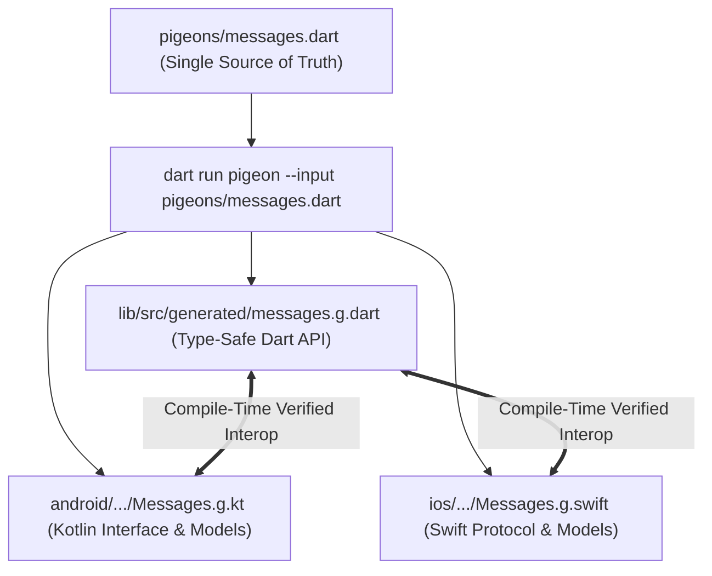

# Type-Safe Platform Communication with Pigeon

> **Module:** 09-platform-integration  
> **Subsection:** 02-type-safe-interop-pigeon  
> **Prerequisites:** [09-platform-integration/01-platform-channels-methodchannel/platform-channels-guide.md](../01-platform-channels-methodchannel/platform-channels-guide.md)  
> **Official References:** [pub.dev/packages/pigeon](https://pub.dev/packages/pigeon) | [docs.flutter.dev/platform-integration/platform-channels/pigeon](https://docs.flutter.dev/platform-integration/platform-channels/pigeon)

---

## 1. Introduction

While `MethodChannel` works well for simple integrations, it poses major risks in enterprise projects:
- **Stringly-Typed:** Method names and channel identifiers are raw strings; a minor typo causes silent `MissingPluginException` crashes at runtime.
- **Untyped Arguments:** Arguments are passed as raw `Map<dynamic, dynamic>`, requiring manual casting and defensive type checks on both sides.
- **API Drift:** If a native Android developer modifies a return parameter but forgets to inform the iOS or Flutter engineer, runtime crashes occur in production.

To solve this, the Flutter team developed **`Pigeon`**—a code-generator tool that turns a single Dart schema file into strongly typed, compile-safe interfaces in **Dart, Kotlin, and Swift**.

---

## 2. Core Concepts: The Pigeon Workflow



- **`@HostApi()`:** Defines APIs implemented by the native platform (Kotlin/Swift) and called by Flutter.
- **`@FlutterApi()`:** Defines APIs implemented by Flutter (Dart) and called by the native host.

---

## 3. Syntax and Implementation

### 1. Schema Definition (`pigeons/device_security.dart`)

```dart
import 'package:pigeon/pigeon.dart';

@ConfigurePigeon(PigeonOptions(
  dartOut: 'lib/src/generated/device_security.g.dart',
  kotlinOut: 'android/app/src/main/kotlin/com/example/app/DeviceSecurity.g.kt',
  kotlinOptions: KotlinOptions(package: 'com.example.app'),
  swiftOut: 'ios/Runner/DeviceSecurity.g.swift',
  swiftOptions: SwiftOptions(),
))

class SecurityCheckResult {
  final bool isJailbroken;
  final bool hasPinEnabled;
  final String integrityLevel;

  SecurityCheckResult({
    required this.isJailbroken,
    required this.hasPinEnabled,
    required this.integrityLevel,
  });
}

@HostApi()
abstract class DeviceSecurityHostApi {
  @async
  SecurityCheckResult verifyDeviceIntegrity();
  
  void triggerBiometricAuth(String promptMessage);
}
```

---

### 2. Generating the Code

Execute the command from your terminal:

```bash
dart run pigeon --input pigeons/device_security.dart
```

---

### 3. Implementing the Native Interface in Kotlin (`DeviceSecurityImpl.kt`)

Because Pigeon generates a Kotlin interface, the Kotlin compiler **forces** you to implement all methods with exact types:

```kotlin
package com.example.app

class DeviceSecurityImpl(private val context: Context) : DeviceSecurityHostApi {
    override fun verifyDeviceIntegrity(callback: (Result<SecurityCheckResult>) -> Unit) {
        val isRooted = checkRootAccess()
        val hasPin = checkDeviceLock()
        
        val result = SecurityCheckResult(
            isJailbroken = isRooted,
            hasPinEnabled = hasPin,
            integrityLevel = if (!isRooted && hasPin) "HIGH" else "COMPROMISED"
        )
        callback(Result.success(result))
    }

    override fun triggerBiometricAuth(promptMessage: String) {
        // Biometric prompt implementation
    }
}

// In MainActivity.kt:
DeviceSecurityHostApi.setUp(flutterEngine.dartExecutor.binaryMessenger, DeviceSecurityImpl(this))
```

---

### 4. Calling from Flutter UI (Zero String Literals)

```dart
import 'package:flutter/material.dart';
import 'src/generated/device_security.g.dart';

class SecurityAuditScreen extends StatelessWidget {
  final DeviceSecurityHostApi _api = DeviceSecurityHostApi();

  SecurityAuditScreen({super.key});

  Future<void> _runAudit(BuildContext context) async {
    // 100% type-safe! No string method names, no untyped casting!
    final SecurityCheckResult result = await _api.verifyDeviceIntegrity();

    if (result.isJailbroken) {
      showDialog(
        context: context,
        builder: (_) => const AlertDialog(
          title: Text('Security Warning'),
          content: Text('Device appears to be rooted/jailbroken!'),
        ),
      );
    }
  }

  @override
  Widget build(BuildContext context) {
    return ElevatedButton(
      onPressed: () => _runAudit(context),
      child: const Text('Verify Device Security'),
    );
  }
}
```

---

## 4. Interview & Assessment Takeaways

| Interview Question | Concise Verbal Answer |
|:---|:---|
| **What problem does Pigeon solve compared to raw `MethodChannel`?** | Pigeon eliminates "stringly-typed" APIs and manual JSON map casting. It uses a single Dart schema to generate strongly typed classes and interfaces in Dart, Kotlin, and Swift, ensuring complete compile-time type safety across platform boundaries. |
| **What is the difference between `@HostApi` and `@FlutterApi` in Pigeon?** | `@HostApi` defines methods implemented in native platform code (Kotlin/Swift) that Flutter invokes. `@FlutterApi` defines methods implemented in Dart that the native platform host invokes. |
