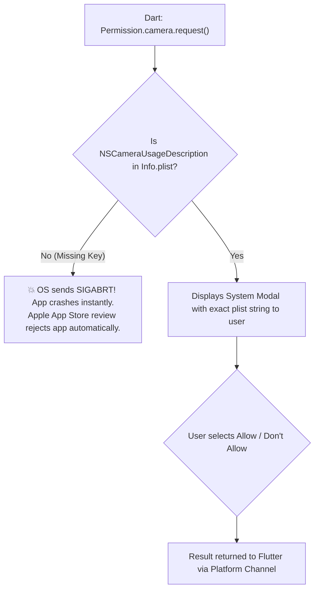

# iOS Configuration, Info.plist, and CocoaPods Setup

> **Module:** 09-platform-integration  
> **Subsection:** 04-ios-configuration-and-permissions  
> **Prerequisites:** [09-platform-integration/03-android-configuration-and-permissions/android-permissions-and-gradle.md](../03-android-configuration-and-permissions/android-permissions-and-gradle.md)  
> **Official References:** [developer.apple.com/documentation/bundleresources/information_property_list](https://developer.apple.com/documentation/bundleresources/information_property_list) | [docs.flutter.dev/deployment/ios](https://docs.flutter.dev/deployment/ios)

---

## 1. Introduction

Apple enforces some of the most rigorous privacy and permission policies in the software industry. On iOS, simply requesting a camera or location access from Dart without an explicit, human-readable justification declared inside **`Info.plist`** triggers an immediate, uncatchable native `SIGABRT` crash.

Furthermore, deploying to iOS requires configuring Xcode signing identities, bundle identifiers, and managing native iOS libraries via **CocoaPods** (`Podfile`).

---

## 2. Core Concepts: The `Info.plist` Privacy String Contract

Whenever an app accesses sensitive user sensors or data on iOS, the operating system pauses the app and displays a modal dialog containing the developer's purpose string.



---

## 3. Syntax and Implementation

### 1. Declaring Purpose Strings in `ios/Runner/Info.plist`

```xml
<?xml version="1.0" encoding="UTF-8"?>
<!DOCTYPE plist PUBLIC "-//Apple//DTD PLIST 1.0//EN" "http://www.apple.com/DTDs/PropertyList-1.0.dtd">
<plist version="1.0">
<dict>
    <key>CFBundleDevelopmentRegion</key>
    <string>$(DEVELOPMENT_LANGUAGE)</string>
    <key>CFBundleDisplayName</key>
    <string>Enterprise App</string>
    <key>CFBundleIdentifier</key>
    <string>$(PRODUCT_BUNDLE_IDENTIFIER)</string>
    <key>CFBundleVersion</key>
    <string>$(FLUTTER_BUILD_NUMBER)</string>

    <!-- 1. Camera Access (Mandatory) -->
    <key>NSCameraUsageDescription</key>
    <string>We require camera access to scan physical identity documents and QR codes.</string>

    <!-- 2. Photo Library Access (Mandatory for image picking) -->
    <key>NSPhotoLibraryUsageDescription</key>
    <string>Photo library access is needed so you can select and upload profile avatars.</string>

    <!-- 3. Foreground Location Access -->
    <key>NSLocationWhenInUseUsageDescription</key>
    <string>Your location is used to show nearby service centers and branches.</string>

    <!-- 4. FaceID / TouchID Biometrics -->
    <key>NSFaceIDUsageDescription</key>
    <string>Authenticate securely with FaceID to access your financial dashboard.</string>

    <!-- 5. Network Security (Allow local HTTP development if needed) -->
    <key>NSAppTransportSecurity</key>
    <dict>
        <key>NSAllowsLocalNetworking</key>
        <true/>
    </dict>
</dict>
</plist>
```

---

### 2. Modern `Podfile` Configuration (`ios/Podfile`)

Ensure modern minimum deployment target (iOS 13+ or 14+) and configure `post_install` hooks to prevent compiler warnings:

```ruby
# Set platform minimum target
platform :ios, '14.0'

# CocoaPods analytics opt-out
ENV['COCOAPODS_DISABLE_STATS'] = 'true'

project 'Runner', {
  'Debug' => :debug,
  'Profile' => :release,
  'Release' => :release,
}

def flutter_root
  generated_xcode_build_settings_path = File.expand_path(File.join('..', 'Flutter', 'Generated.xcconfig'), __FILE__)
  unless File.exist?(generated_xcode_build_settings_path)
    raise "#{generated_xcode_build_settings_path} must exist. If you're running pod install manually, make sure flutter pub get is executed first"
  end

  File.foreach(generated_xcode_build_settings_path) do |line|
    matches = line.match(/FLUTTER_ROOT\=(.*)/)
    return matches[1].strip if matches
  end
  raise "FLUTTER_ROOT not found in #{generated_xcode_build_settings_path}. Try deleting Generated.xcconfig, then run flutter pub get"
end

require File.expand_path(File.join('packages', 'flutter_tools', 'bin', 'podhelper'), flutter_root)

flutter_ios_podfile_setup

target 'Runner' do
  use_frameworks!
  use_modular_headers!

  flutter_install_all_ios_pods File.dirname(File.realpath(__FILE__))
  target 'RunnerTests' do
    inherit! :search_paths
  end
end

post_install do |installer|
  installer.pods_project.targets.each do |target|
    flutter_additional_ios_build_settings(target)
    target.build_configurations.each do |config|
      # Force minimum deployment target across all pod dependencies
      config.build_settings['IPHONEOS_DEPLOYMENT_TARGET'] = '14.0'
    end
  end
end
```

---

## 4. Common Pitfalls & Anti-Patterns

### Pitfall 1: Generic or Empty Purpose Strings
Submitting strings like `"We need camera"` or `"For app features"` will cause Apple App Review to reject the application under App Store Guideline 5.1.1 (Data Collection and Storage). Strings must clearly describe the user-benefiting scenario.

---

## 5. Interview & Assessment Takeaways

| Interview Question | Concise Verbal Answer |
|:---|:---|
| **What happens on iOS if your Flutter app requests camera access without `NSCameraUsageDescription` in `Info.plist`?** | The app terminates immediately with a native `SIGABRT` crash. Furthermore, Apple's automated binary ingestion checks will reject the build upon upload to App Store Connect. |
| **What is the purpose of `post_install` in a Flutter `Podfile`?** | It is a Ruby hook executed by CocoaPods after resolving dependencies. In Flutter, it calls `flutter_additional_ios_build_settings(target)` to inject architecture flags and standardize `IPHONEOS_DEPLOYMENT_TARGET` across all third-party plugin pods. |
| **What is App Tracking Transparency (ATT)?** | An Apple privacy requirement (iOS 14.5+) mandating that apps request explicit user permission before collecting the native Identifier for Advertisers (IDFA) or tracking user activity across apps owned by other companies. |
