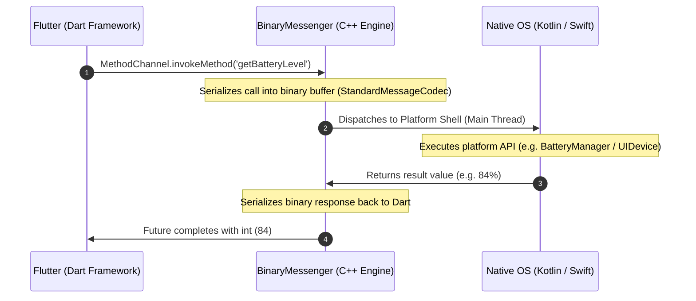

# Module 09: Platform Integration, Platform Channels, and OS Permissions

> **Stage:** Stage 4 – Native Bridges, Hardware Integration & OS Configuration  
> **Target Audience:** Intermediate to Senior Flutter Engineers  
> **Prerequisites:** [03-flutter-fundamentals/01-flutter-architecture-and-engine/layered-architecture.md](../03-flutter-fundamentals/01-flutter-architecture-and-engine/layered-architecture.md)

---

## Overview

Although Flutter renders its own pixels independently on a GPU canvas, mobile apps cannot escape the operating system. When an application needs access to native hardware or OS APIs—such as device battery level, Bluetooth BLE scanning, biometric FaceID/fingerprint authentication, camera sensors, or background geofencing—Flutter must communicate with the host operating system (Android / iOS).

This module details how Flutter bridges the gap between the Dart runtime and native platform code:
- The internal architecture of **Platform Channels**: `BinaryMessenger`, `MethodChannel`, and `EventChannel`.
- Writing native handlers in **Kotlin (Android)** and **Swift (iOS)**.
- Eliminating fragile string channels with type-safe **`Pigeon`** code generation.
- Configuring **Android permissions**, Gradle Kotlin DSL (`build.gradle.kts`), and SHA fingerprint generation.
- Configuring **iOS `Info.plist`** privacy permissions and Xcode pod configurations.

---

## Architecture Flow



---

## Directory Roadmap

```
09-platform-integration/
├── README.md
├── 01-platform-channels-methodchannel/
│   └── platform-channels-guide.md           # MethodChannel, EventChannel, Kotlin & Swift implementations
├── 02-type-safe-interop-pigeon/
│   └── pigeon-type-safe-interop.md          # Type-safe code generator for Dart/Kotlin/Swift
├── 03-android-configuration-and-permissions/
│   └── android-permissions-and-gradle.md    # AndroidManifest.xml, build.gradle.kts, SHA keys, runtime permissions
└── 04-ios-configuration-and-permissions/
    └── ios-permissions-and-plist.md         # Info.plist privacy descriptions, Podfile, iOS deployment
```
