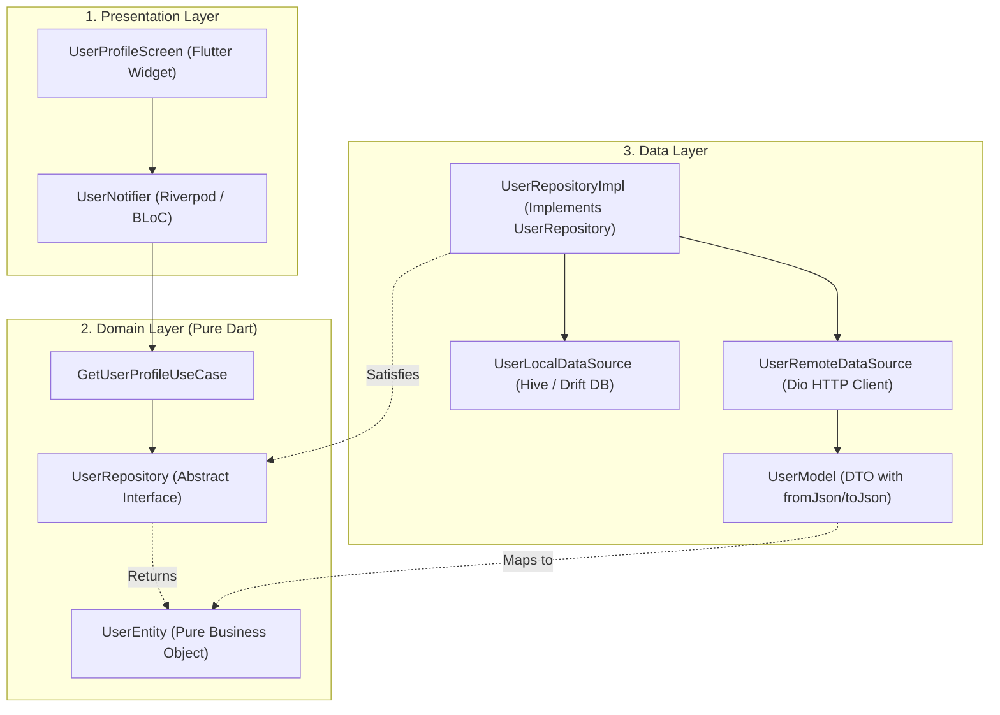

# Clean Architecture in Flutter: Domain, Data, and Presentation Layers

> **Module:** 10-architecture-and-clean-code  
> **Subsection:** 01-clean-architecture-in-flutter  
> **Prerequisites:** [06-state-management/03-riverpod-modern/riverpod-deep-dive.md](../../06-state-management/03-riverpod-modern/riverpod-deep-dive.md) | [07-networking-and-backend/01-rest-apis-http-and-dio/dio-and-rest-architecture.md](../../07-networking-and-backend/01-rest-apis-http-and-dio/dio-and-rest-architecture.md)  
> **Official References:** [blog.cleancoder.com/uncle-bob/2012/08/13/the-clean-architecture.html](https://blog.cleancoder.com/uncle-bob/2012/08/13/the-clean-architecture.html)

---

## 1. Introduction

In enterprise mobile applications, UI frameworks come and go, backends migrate from REST to GraphQL or gRPC, and database engines evolve from SQLite to NoSQL. **Clean Architecture** decouples your core business rules from external frameworks, tools, and UI technologies.

If the Flutter framework were completely rewritten tomorrow, your **Domain Layer** (business rules and entities) should not require changing a single line of code.

---

## 2. The Three Layers in Detail



### 1. The Domain Layer (The Core)
- **Role:** Represents the heart of your software.
- **Constraints:** **Zero dependencies** on Flutter, third-party libraries (Dio, Hive, Firebase), or external packages. Contains only pure Dart standard libraries.
- **Components:**
  - `Entities`: Pure business models (e.g. `User`, `Cart`).
  - `Repository Interfaces`: Abstract contracts declaring what data the application needs, without defining *how* it is fetched.
  - `UseCases` (Interactors): Discrete business actions (e.g. `AuthenticateUser`, `AddToCart`, `FetchLivePrices`).

### 2. The Data Layer
- **Role:** Implements the contracts declared by the Domain layer and interfaces with external I/O (APIs, databases, Bluetooth).
- **Components:**
  - `Models` (DTOs): Data Transfer Objects containing JSON serialization or database schemas. Models map directly to and from Domain Entities.
  - `DataSources`: Low-level network callers (`UserRemoteDataSource`) and database drivers (`UserLocalDataSource`).
  - `Repository Implementations`: Implements the Domain repository interface, coordinating caching strategies (e.g. *"Check local DB first; if expired, fetch from REST API and cache result"*).

### 3. The Presentation Layer
- **Role:** Handles rendering pixels and receiving user input.
- **Components:**
  - `Widgets`: Declarative UI elements.
  - `State Controllers`: Riverpod `Notifier`, BLoC `Cubit`, or Provider `ChangeNotifier`. Calls Use Cases and maps results to UI states.

---

## 3. Codebase Organization: Feature-First vs. Layer-First

### Layer-First (Antipattern for large apps)
```
lib/
├── data/          # 150 files across all features mixed together
├── domain/        # 100 use cases and entities mixed together
└── presentation/  # 200 widgets and screens mixed together
```
*Why it fails:* To modify the "Authentication" feature, an engineer must jump across 5 different root folders. Merge conflicts abound.

### Feature-First (Recommended Enterprise Architecture)
```
lib/
├── core/                        # Shared utilities, network clients, base themes
│   ├── network/dio_client.dart
│   └── errors/failures.dart
└── features/
    ├── authentication/          # Self-contained slice
    │   ├── domain/
    │   │   ├── entities/user_entity.dart
    │   │   ├── repositories/auth_repository.dart
    │   │   └── usecases/login_usecase.dart
    │   ├── data/
    │   │   ├── datasources/auth_remote_data_source.dart
    │   │   ├── models/user_model.dart
    │   │   └── repositories/auth_repository_impl.dart
    │   └── presentation/
    │       ├── controllers/auth_controller.dart
    │       └── views/login_screen.dart
    └── shopping_cart/           # Completely independent slice
        ├── domain/
        ├── data/
        └── presentation/
```

---

## 4. Syntax and Implementation

### 1. Domain Layer (`features/auth/domain/`)

```dart
// 1. Entity (Pure Dart)
class UserEntity {
  final String id;
  final String email;
  final String displayName;

  const UserEntity({
    required this.id,
    required this.email,
    required this.displayName,
  });
}

// 2. Abstract Repository Contract
abstract class AuthRepository {
  Future<UserEntity> login({required String email, required String password});
  Future<void> logout();
}

// 3. Single-Responsibility Use Case
class LoginUseCase {
  final AuthRepository _repository;

  LoginUseCase(this._repository);

  Future<UserEntity> call({required String email, required String password}) async {
    if (email.isEmpty || !email.contains('@')) {
      throw FormatException('Invalid email address provided');
    }
    if (password.length < 6) {
      throw ArgumentError('Password must be at least 6 characters');
    }
    return await _repository.login(email: email, password: password);
  }
}
```

---

### 2. Data Layer (`features/auth/data/`)

```dart
// 1. Model (DTO with JSON mapping)
class UserModel extends UserEntity {
  const UserModel({
    required super.id,
    required super.email,
    required super.displayName,
  });

  factory UserModel.fromJson(Map<String, dynamic> json) {
    return UserModel(
      id: json['id'] as String,
      email: json['email'] as String,
      displayName: json['display_name'] as String,
    );
  }

  Map<String, dynamic> toJson() => {
    'id': id,
    'email': email,
    'display_name': displayName,
  };
}

// 2. Data Source
abstract class AuthRemoteDataSource {
  Future<UserModel> authenticate(String email, String password);
}

// 3. Repository Implementation
class AuthRepositoryImpl implements AuthRepository {
  final AuthRemoteDataSource _remoteDataSource;

  AuthRepositoryImpl(this._remoteDataSource);

  @override
  Future<UserEntity> login({required String email, required String password}) async {
    // Model automatically satisfies UserEntity return type via inheritance/mapping
    return await _remoteDataSource.authenticate(email, password);
  }

  @override
  Future<void> logout() async {
    // Clear session
  }
}
```

---

## 5. Interview & Assessment Takeaways

| Interview Question | Concise Verbal Answer |
|:---|:---|
| **Why must the Domain Layer never import Flutter packages?** | To ensure business logic remains 100% platform-independent and UI-agnostic. This enables rapid pure Dart unit testing without mocking the Flutter engine and ensures business logic survives future UI framework changes. |
| **What is the difference between a Model (DTO) and an Entity?** | An Entity is an immutable business model in the Domain layer representing core business concepts. A Model is a Data Transfer Object in the Data layer that handles external concerns like JSON parsing (`fromJson`), SQLite schemas, or API-specific formatting. |
| **Why is Feature-First architecture preferred over Layer-First in large teams?** | Feature-First groups code by business domain (e.g. `auth`, `cart`, `checkout`), so each feature contains its own domain, data, and presentation. This improves code locality, minimizes merge conflicts across squads, and allows features to be developed, refactored, or deleted in isolation. |
