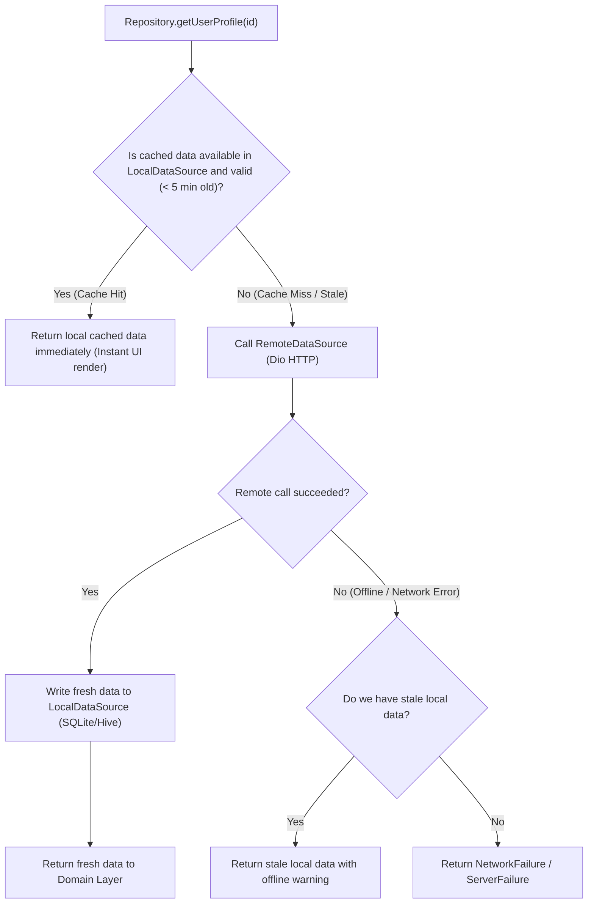

# The Repository Pattern: Data Sources, Caching, and Error Boundaries

> **Module:** 10-architecture-and-clean-code  
> **Subsection:** 02-repository-pattern  
> **Prerequisites:** [10-architecture-and-clean-code/01-clean-architecture-in-flutter/clean-architecture-guide.md](../01-clean-architecture-in-flutter/clean-architecture-guide.md)  
> **Official References:** [docs.flutter.dev/app-architecture](https://docs.flutter.dev/app-architecture)

---

## 1. Introduction

If your UI or state controllers directly query Dio or SQLite, your codebase is brittle. When you want to add offline caching, switch from REST to GraphQL, or mock data for testing, you are forced to refactor your entire presentation layer.

The **Repository Pattern** introduces a clean mediation layer between your data sources and your application's domain logic. The rest of the app asks the repository: *"Give me the user profile"*, and the repository autonomously decides whether to retrieve it from memory, load it from disk, or fetch it over the internet.

---

## 2. Core Concepts: Caching Policies



---

## 3. Functional Error Handling with `Result` Types

In Dart, throwing uncaught exceptions crashes applications or forces repetitive `try-catch` blocks throughout UI widgets. Modern Flutter architecture models outcomes as an immutable sealed **`Result`** type:

```dart
// Sealed Result hierarchy
sealed class Result<T> {
  const Result();
}

class Success<T> extends Result<T> {
  final T data;
  const Success(this.data);
}

class Failure<T> extends Result<T> {
  final AppFailure failure;
  const Failure(this.failure);
}

// Sealed failure hierarchy
sealed class AppFailure {
  final String message;
  const AppFailure(this.message);
}

class NetworkFailure extends AppFailure {
  const NetworkFailure([super.message = 'No internet connection detected']);
}

class ServerFailure extends AppFailure {
  final int statusCode;
  const ServerFailure(super.message, {required this.statusCode});
}

class CacheFailure extends AppFailure {
  const CacheFailure([super.message = 'Requested entity not found in local cache']);
}
```

---

## 4. Syntax and Implementation

### Complete Offline-First Repository Implementation

```dart
abstract class ProductRepository {
  Future<Result<List<ProductEntity>>> getFeaturedProducts({bool forceRefresh = false});
}

class ProductRepositoryImpl implements ProductRepository {
  final ProductRemoteDataSource _remoteDataSource;
  final ProductLocalDataSource _localDataSource;
  final NetworkInfo _networkInfo;

  ProductRepositoryImpl({
    required ProductRemoteDataSource remoteDataSource,
    required ProductLocalDataSource localDataSource,
    required NetworkInfo networkInfo,
  })  : _remoteDataSource = remoteDataSource,
        _localDataSource = localDataSource,
        _networkInfo = networkInfo;

  @override
  Future<Result<List<ProductEntity>>> getFeaturedProducts({
    bool forceRefresh = false,
  }) async {
    // 1. Check local cache first unless force refresh requested
    if (!forceRefresh) {
      final cachedProducts = await _localDataSource.getCachedProducts();
      if (cachedProducts.isNotEmpty) {
        return Success(cachedProducts);
      }
    }

    // 2. Verify internet connectivity
    if (!await _networkInfo.isConnected) {
      // Fallback to local cache if available
      final cachedProducts = await _localDataSource.getCachedProducts();
      if (cachedProducts.isNotEmpty) {
        return Success(cachedProducts);
      }
      return const Failure(NetworkFailure());
    }

    // 3. Fetch from remote server
    try {
      final remoteModels = await _remoteDataSource.fetchProducts();

      // 4. Update local cache with fresh data
      await _localDataSource.cacheProducts(remoteModels);

      return Success(remoteModels);
    } on DioException catch (dioErr) {
      return Failure(
        ServerFailure(
          dioErr.message ?? 'Unknown server error',
          statusCode: dioErr.response?.statusCode ?? 500,
        ),
      );
    } catch (e) {
      return Failure(ServerFailure(e.toString(), statusCode: 500));
    }
  }
}
```

---

## 5. Interview & Assessment Takeaways

| Interview Question | Concise Verbal Answer |
|:---|:---|
| **What is the primary role of the Repository Pattern?** | The Repository acts as a mediator between domain business logic and concrete data sources (network, database, file system). It provides a clean abstract interface for data retrieval, encapsulating caching rules and decoupling the app from third-party storage technologies. |
| **Why is returning a functional `Result<T>` type preferred over throwing exceptions?** | Throwing exceptions can lead to unhandled runtime crashes and forces callers to guess what exceptions might be thrown. A sealed `Result<T>` type makes failure handling explicit in the method signature and enforces compile-time exhaustiveness matching. |
| **What is the Stale-While-Revalidate caching pattern?** | The repository immediately returns whatever data is currently in local storage so the UI can render instantly without showing a loading spinner, while concurrently kicking off a background network fetch to refresh the local cache and push an updated UI event. |
