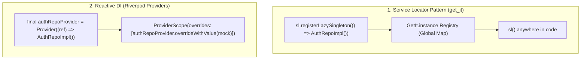

# Dependency Injection and Inversion of Control in Flutter

> **Module:** 10-architecture-and-clean-code  
> **Subsection:** 03-dependency-injection  
> **Prerequisites:** [10-architecture-and-clean-code/01-clean-architecture-in-flutter/clean-architecture-guide.md](../01-clean-architecture-in-flutter/clean-architecture-guide.md)  
> **Official References:** [pub.dev/packages/get_it](https://pub.dev/packages/get_it) | [riverpod.dev/docs/essentials/combining_requests](https://riverpod.dev/docs/essentials/combining_requests)

---

## 1. Introduction

When a class instantiates its own dependencies directly:

```dart
class OrderService {
  // ❌ Tightly coupled: Cannot swap with a mock during testing!
  final PaymentClient _paymentClient = StripePaymentClient();
}
```

it violates the **Dependency Inversion Principle**. Testing `OrderService` requires communicating with live Stripe payment servers, and changing payment gateways requires refactoring every consumer class.

**Dependency Injection (DI)** solves this by supplying dependencies from the outside via constructor parameters, enabling loose coupling and effortless unit testing.

---

## 2. Core Concepts: Two Major DI Approaches in Flutter



---

## 3. Syntax and Implementation

### Approach 1: Service Locator with `get_it`

The `get_it` package is a high-speed, zero-reflection Service Locator:

```dart
import 'package:get_it/get_it.dart';

final GetIt sl = GetIt.instance; // sl = Service Locator

void setupServiceLocator() {
  // 1. Singleton (Instantiated immediately at app startup)
  sl.registerSingleton<AppConfig>(AppConfig.loadFromEnv());

  // 2. Lazy Singleton (Instantiated only on first access; cached permanently thereafter)
  sl.registerLazySingleton<ApiClient>(() => ApiClient(baseUrl: sl<AppConfig>().apiBaseUrl));
  sl.registerLazySingleton<AuthRemoteDataSource>(() => AuthRemoteDataSourceImpl(sl<ApiClient>()));
  sl.registerLazySingleton<AuthRepository>(() => AuthRepositoryImpl(sl<AuthRemoteDataSource>()));

  // 3. Factory (A brand-new instance created EVERY time sl<T>() is called)
  sl.registerFactory<LoginUseCase>(() => LoginUseCase(sl<AuthRepository>()));
}
```

#### Usage in Business Logic:
```dart
class LoginController {
  // Resolve dependency cleanly via locator
  final LoginUseCase _loginUseCase = sl<LoginUseCase>();

  Future<void> submit(String email, String password) async {
    await _loginUseCase(email: email, password: password);
  }
}
```

---

### Approach 2: Reactive Dependency Injection with Riverpod

Riverpod is not merely a state management tool—it is a **hierarchical compile-safe dependency injection engine**:

```dart
import 'package:flutter_riverpod/flutter_riverpod.dart';

// 1. Low-level configuration provider
final apiBaseUrlProvider = Provider<String>((ref) => 'https://api.enterprise.com');

// 2. HTTP client depends on base URL
final apiClientProvider = Provider<ApiClient>((ref) {
  final baseUrl = ref.watch(apiBaseUrlProvider);
  return ApiClient(baseUrl: baseUrl);
});

// 3. Repository depends on ApiClient
final authRepositoryProvider = Provider<AuthRepository>((ref) {
  final client = ref.watch(apiClientProvider);
  return AuthRepositoryImpl(AuthRemoteDataSourceImpl(client));
});

// 4. Controller depends on Repository
final authControllerProvider = NotifierProvider<AuthController, AsyncValue<void>>(() {
  return AuthController();
});
```

#### The Power of Riverpod Overrides in Unit Tests:
```dart
void main() {
  test('User login succeeds with mock repository', () async {
    final mockRepo = MockAuthRepository();

    // Create container with injected mock override!
    final container = ProviderContainer(
      overrides: [
        authRepositoryProvider.overrideWithValue(mockRepo),
      ],
    );

    // Test controller logic against mock seamlessly
    final controller = container.read(authControllerProvider.notifier);
    await controller.login('test@test.com', 'password123');
    
    expect(container.read(authControllerProvider), const AsyncData(null));
  });
}
```

---

## 4. Comparison: `get_it` vs. Riverpod DI

| Feature | `get_it` Service Locator | `Riverpod` DI |
|:---|:---:|:---:|
| **Paradigm** | Service Locator | Reactive Dependency Graph |
| **Compile Safety** | Runtime (`sl<UnregisteredType>()` throws exception) | 100% Compile-Time Verified |
| **Lifecycle / Scoping** | Global singletons / manual factories | Automatic auto-dispose when unused |
| **Widget Integration** | Requires separate state management | Built-in reactive binding to UI widgets |

---

## 5. Interview & Assessment Takeaways

| Interview Question | Concise Verbal Answer |
|:---|:---|
| **What is the difference between `registerSingleton` and `registerLazySingleton` in `get_it`?** | `registerSingleton` instantiates the object immediately during app initialization. `registerLazySingleton` defers instantiation until the object is requested for the first time via `sl<T>()`, saving startup memory and speeding up initial application launch. |
| **Why is constructor injection generally preferred over global service locators?** | Constructor injection makes a class's dependencies completely explicit in its contract. When testing, you can see all required dependencies at a glance without having to read internal code to discover hidden `sl<T>()` calls. |
| **How does Riverpod handle dependency disposal?** | By default with code generation (or when using `autoDispose`), Riverpod tracks whether any widget or other provider is observing a given provider. When the last observer is removed from the widget tree, Riverpod automatically cancels the provider and frees its memory. |
