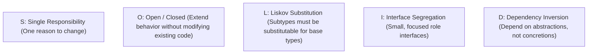

# SOLID Principles in Dart and Flutter: Enterprise Refactoring Guide

> **Module:** 10-architecture-and-clean-code  
> **Subsection:** 04-solid-principles-and-best-practices  
> **Prerequisites:** [01-dart-fundamentals/05-oop-and-type-system/inheritance-and-polymorphism.md](../../01-dart-fundamentals/05-oop-and-type-system/inheritance-and-polymorphism.md)  
> **Official References:** [dart.dev/effective-dart](https://dart.dev/effective-dart)

---

## 1. Introduction

The **SOLID** principles, formalized by Robert C. Martin (Uncle Bob), are five foundational software engineering principles that transform fragile, tightly coupled codebases into modular, easily maintainable, and testable architectures.

Many developers understand SOLID in abstract Java/C# theory but struggle to apply it effectively in a reactive, widget-based framework like Flutter. This guide demonstrates how to apply each SOLID principle to real-world Flutter and Dart applications with concrete **Before vs. After** refactoring patterns.

---

## 2. The 5 Principles Overview



---

## 3. Deep Dive & Refactoring Patterns

### 1. S — Single Responsibility Principle (SRP)
> *"A class or widget should have one, and only one, reason to change."*

#### ❌ The "God Widget" Anti-Pattern (Violates SRP):
```dart
class UserProfileWidget extends StatefulWidget {
  @override
  State<UserProfileWidget> createState() => _UserProfileWidgetState();
}

class _UserProfileWidgetState extends State<UserProfileWidget> {
  // VIOLATION: Handles UI layout, HTTP network requests, JSON decoding,
  // date formatting, and local SQLite caching all inside one widget!
  Future<void> fetchUser() async {
    final response = await http.get(Uri.parse('https://api.com/user'));
    final data = jsonDecode(response.body);
    // Writes directly to SQLite...
  }

  @override
  Widget build(BuildContext context) {
    return Scaffold(...);
  }
}
```

#### ✅ Refactored with SRP:
- **`UserRemoteDataSource`:** Handles HTTP requests and raw network status.
- **`UserRepository`:** Handles caching decisions and model mapping.
- **`DateFormatter`:** Handles locale date formatting.
- **`UserProfileWidget`:** Pure declarative UI that receives data and renders widgets.

---

### 2. O — Open / Closed Principle (OCP)
> *"Software entities should be open for extension, but closed for modification."*

#### ❌ Fragile Switch Anti-Pattern (Violates OCP):
```dart
class PaymentProcessor {
  void processPayment(String gateway, double amount) {
    // VIOLATION: Every time the business adds a new gateway (e.g. Apple Pay, Crypto),
    // you MUST modify this class, risking breaking existing payment flows!
    if (gateway == 'stripe') {
      _payWithStripe(amount);
    } else if (gateway == 'paypal') {
      _payWithPaypal(amount);
    }
  }
}
```

#### ✅ Refactored with Polymorphic Interfaces (OCP):
```dart
abstract interface class PaymentGateway {
  Future<void> pay(double amount);
}

class StripeGateway implements PaymentGateway {
  @override
  Future<void> pay(double amount) async { /* Stripe SDK logic */ }
}

class ApplePayGateway implements PaymentGateway {
  @override
  Future<void> pay(double amount) async { /* PassKit logic */ }
}

class PaymentProcessor {
  // Closed for modification! Accepts ANY future gateway without changing this code.
  Future<void> execute(PaymentGateway gateway, double amount) async {
    await gateway.pay(amount);
  }
}
```

---

### 3. L — Liskov Substitution Principle (LSP)
> *"Subtypes must be substitutable for their base types without altering program correctness."*

#### ❌ LSP Violation:
```dart
class Bird {
  void fly() => print('Flying');
}

class Penguin extends Bird {
  @override
  void fly() {
    // VIOLATION: Penguin cannot fly! Throws exception or does nothing,
    // breaking expectations of code working with Bird!
    throw UnsupportedError('Penguins cannot fly!');
  }
}
```

#### ✅ Refactored Hierarchy:
```dart
abstract class Bird {
  void eat();
}

abstract class FlyingBird extends Bird {
  void fly();
}

class Sparrow extends FlyingBird {
  @override
  void eat() {}
  @override
  void fly() {}
}

class Penguin extends Bird {
  @override
  void eat() {}
  // No fly() method; program correctness preserved!
}
```

---

### 4. I — Interface Segregation Principle (ISP)
> *"Clients should not be forced to depend on interfaces they do not use."*

#### ❌ The Bloated Interface (Violates ISP):
```dart
abstract class SmartDevice {
  void printDocument();
  void scanDocument();
  void faxDocument();
}

// VIOLATION: Budget printer forced to implement empty stubs for fax and scan!
class BasicPrinter implements SmartDevice {
  @override
  void printDocument() => print('Printing...');
  @override
  void scanDocument() => throw UnimplementedError();
  @override
  void faxDocument() => throw UnimplementedError();
}
```

#### ✅ Segregated Role Interfaces:
```dart
abstract interface class Printer {
  void printDocument();
}

abstract interface class Scanner {
  void scanDocument();
}

class BasicPrinter implements Printer {
  @override
  void printDocument() => print('Printing...');
}

class AllInOneOfficeDevice implements Printer, Scanner {
  @override
  void printDocument() => print('Printing...');
  @override
  void scanDocument() => print('Scanning...');
}
```

---

### 5. D — Dependency Inversion Principle (DIP)
> *"High-level modules should not depend on low-level modules. Both should depend on abstractions."*

#### ❌ Direct Coupling (Violates DIP):
```dart
class UserBloc {
  // VIOLATION: High-level BLoC directly instantiates low-level concrete SQLite database!
  final SqliteDatabase _database = SqliteDatabase();
}
```

#### ✅ Inversion via Abstract Contract (DIP):
```dart
abstract interface class UserStorage {
  Future<UserEntity?> loadUser();
}

class UserBloc {
  // High-level BLoC depends purely on abstraction
  final UserStorage _storage;

  UserBloc(this._storage);
}
```

---

## 4. Interview & Assessment Takeaways

| Interview Question | Concise Verbal Answer |
|:---|:---|
| **How does Flutter's widget composition promote the Single Responsibility Principle?** | Rather than creating monolithic classes with dozens of properties, Flutter encourages breaking UI into small, focused, single-purpose widgets (e.g. `Padding`, `Center`, `GestureDetector`, `Text`), each responsible for exactly one layout or interaction task. |
| **Why is the Open/Closed Principle crucial for Flutter plugin and package development?** | It allows consuming apps to extend widget behaviors, builders, or delegates (e.g. `itemBuilder` in `ListView`, `flightShuttleBuilder` in `Hero`) without modifying the internal source code of the underlying framework or package. |
| **How does Dependency Inversion simplify unit testing in Flutter?** | By depending on abstract interfaces rather than concrete network or storage clients, tests can pass lightweight in-memory mock implementations into use cases and BLoCs, eliminating the need for real HTTP servers or database files. |
