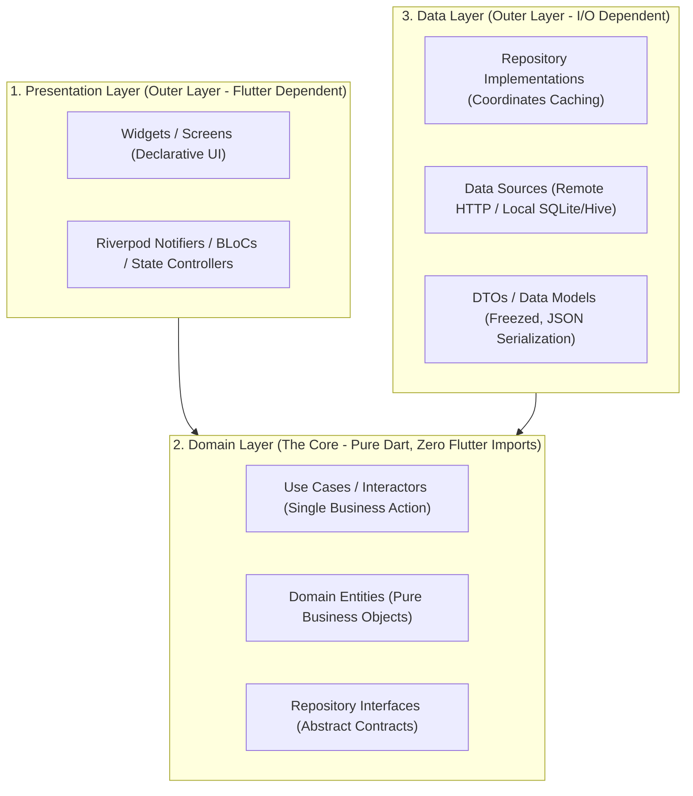

# Module 10: Enterprise Architecture and Clean Code

> **Stage:** Stage 4 (Continued) – Clean Architecture, Design Patterns & Enterprise Engineering  
> **Target Audience:** Intermediate to Senior Flutter Engineers & Tech Leads  
> **Prerequisites:** [01-dart-fundamentals/05-oop-and-type-system/](../01-dart-fundamentals/05-oop-and-type-system/) | [06-state-management/](../06-state-management/)

---

## Overview

Writing working code is easy; writing code that remains readable, testable, and maintainable when twenty engineers contribute to the same repository across three years is difficult.

In enterprise software engineering, codebases without strict architectural boundaries inevitably degenerate into "Spaghetti Architecture":
- Widgets making direct HTTP requests and parsing JSON strings in `initState()`.
- Business logic deeply intertwined with Flutter's UI `BuildContext`.
- Inability to write automated unit tests without booting up a full phone simulator.
- Database changes breaking UI screens across the entire application.

This module details the implementation of **Uncle Bob's Clean Architecture**, the **Repository Pattern**, **Dependency Injection (DI)**, and **SOLID Principles** adapted specifically for the Flutter and Dart ecosystem.

---

## The Onion Layer Diagram



> 🌟 **The Golden Dependency Rule:**  
> Dependencies point **inward** toward the **Domain Layer**.  
> The Domain layer must **never** import Flutter (`package:flutter`), Dio, Hive, or Firebase. It consists strictly of pure Dart language constructs, making your business logic 100% portable and lightning-fast to unit test.

---

## Directory Roadmap

```
10-architecture-and-clean-code/
├── README.md
├── 01-clean-architecture-in-flutter/
│   └── clean-architecture-guide.md          # Domain, Data, Presentation layers, Feature-first organization
├── 02-repository-pattern/
│   └── repository-and-data-sources.md       # Abstract Repositories, Remote & Local DataSources, Caching
├── 03-dependency-injection/
│   └── dependency-injection-guide.md        # Service Locator (get_it), Riverpod DI, Inversion of Control
└── 04-solid-principles-and-best-practices/
    └── solid-in-dart-flutter.md             # SOLID principles applied to real Flutter refactorings
```
