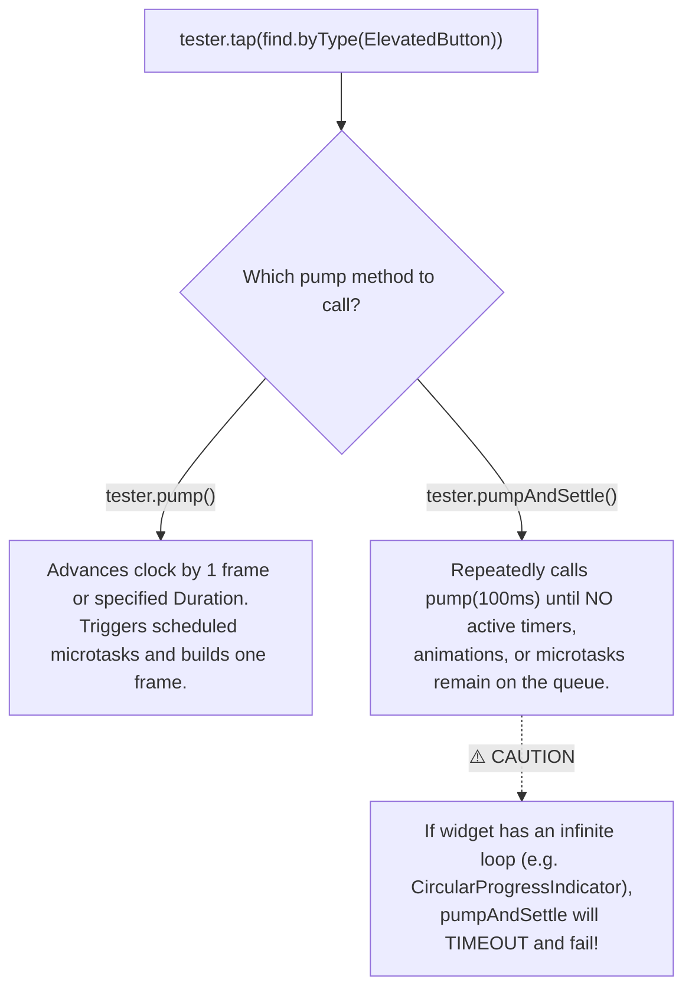

# Unit and Widget Testing in Flutter with Mocktail and WidgetTester

> **Module:** 11-testing-and-performance  
> **Subsection:** 01-unit-and-widget-testing  
> **Prerequisites:** [10-architecture-and-clean-code/01-clean-architecture-in-flutter/clean-architecture-guide.md](../../10-architecture-and-clean-code/01-clean-architecture-in-flutter/clean-architecture-guide.md)  
> **Official References:** [docs.flutter.dev/cookbook/testing/unit/introduction](https://docs.flutter.dev/cookbook/testing/unit/introduction) | [docs.flutter.dev/cookbook/testing/widget/introduction](https://docs.flutter.dev/cookbook/testing/widget/introduction)

---

## 1. Introduction

Automated testing is the primary mechanism that allows teams to ship software rapidly without introducing regressions. In Flutter, test automation is divided into distinct tiers:
1. **Unit Testing:** Exercises isolated algorithms, business rules, entities, and use cases in pure Dart with zero UI or OS overhead ($< 10\text{ms}$ per test).
2. **Widget Testing:** Renders isolated UI components into Flutter's headless virtual layout engine, simulating touch events, scrolls, and text entry without launching a slow emulator.

---

## 2. Unit Testing Pure Dart with Mocktail

The modern standard for mocking in Dart is **`mocktail`**. Unlike legacy `mockito`, `mocktail` requires **zero code generation** (`build_runner`) and uses idiomatic Dart closures.

```dart
import 'package:flutter_test/flutter_test.dart';
import 'package:mocktail/mocktail.dart';

// --- Domain Contract ---
abstract class AuthRepository {
  Future<String> login(String email, String password);
}

class LoginUseCase {
  final AuthRepository repository;
  LoginUseCase(this.repository);

  Future<String> execute(String email, String password) async {
    if (!email.contains('@')) throw ArgumentError('Invalid email');
    return await repository.login(email, password);
  }
}

// --- Mock Declaration ---
class MockAuthRepository extends Mock implements AuthRepository {}

void main() {
  late MockAuthRepository mockRepository;
  late LoginUseCase useCase;

  setUp(() {
    mockRepository = MockAuthRepository();
    useCase = LoginUseCase(mockRepository);
  });

  group('LoginUseCase Unit Tests', () {
    test('Throws ArgumentError if email format is invalid', () async {
      expect(
        () => useCase.execute('invalid-email', 'pass123'),
        throwsA(isA<ArgumentError>()),
      );
      // Verify repository was never contacted
      verifyNever(() => mockRepository.login(any(), any()));
    });

    test('Returns auth token when repository succeeds', () async {
      // 1. Arrange
      when(() => mockRepository.login('alice@test.com', 'secret123'))
          .thenAnswer((_) async => 'jwt_token_valid');

      // 2. Act
      final result = await useCase.execute('alice@test.com', 'secret123');

      // 3. Assert
      expect(result, equals('jwt_token_valid'));
      verify(() => mockRepository.login('alice@test.com', 'secret123')).called(1);
    });
  });
}
```

---

## 3. Widget Testing with `WidgetTester`

Widget tests instantiate Flutter's element and render trees in a simulated environment.

### Understanding `tester.pump()` vs. `tester.pumpAndSettle()`



---

### Complete Widget Test Implementation

```dart
import 'package:flutter/material.dart';
import 'package:flutter_test/flutter_test.dart';

class CounterComponent extends StatefulWidget {
  const CounterComponent({super.key});

  @override
  State<CounterComponent> createState() => _CounterComponentState();
}

class _CounterComponentState extends State<CounterComponent> {
  int _counter = 0;

  @override
  Widget build(BuildContext context) {
    return Column(
      mainAxisSize: MainAxisSize.min,
      children: [
        Text('Taps: $_counter', style: const TextStyle(fontSize: 24)),
        ElevatedButton(
          key: const ValueKey('increment_btn'),
          onPressed: () => setState(() => _counter++),
          child: const Text('Increment'),
        ),
      ],
    );
  }
}

void main() {
  group('CounterComponent Widget Tests', () {
    testWidgets('Initial count is 0 and increments on button tap', (WidgetTester tester) async {
      // 1. Inflate widget wrapped in MaterialApp/Scaffold directional ancestors
      await tester.pumpWidget(
        const MaterialApp(
          home: Scaffold(
            body: Center(child: CounterComponent()),
          ),
        ),
      );

      // 2. Verify initial state using Finders
      expect(find.text('Taps: 0'), findsOneWidget);
      expect(find.text('Taps: 1'), findsNothing);

      // 3. Simulate user interaction
      final buttonFinder = find.byKey(const ValueKey('increment_btn'));
      expect(buttonFinder, findsOneWidget);

      await tester.tap(buttonFinder);

      // 4. Advance virtual clock to trigger setState rebuild
      await tester.pump();

      // 5. Verify updated UI state
      expect(find.text('Taps: 0'), findsNothing);
      expect(find.text('Taps: 1'), findsOneWidget);
    });
  });
}
```

---

## 4. Interview & Assessment Takeaways

| Interview Question | Concise Verbal Answer |
|:---|:---|
| **What is the difference between `tester.pump()` and `tester.pumpAndSettle()`?** | `tester.pump()` advances the fake clock by a single frame (or specified duration), processing the current microtask queue. `tester.pumpAndSettle()` continuously pumps frames until all animations, transitions, and timers have completed and the UI is completely settled. |
| **Why does `tester.pumpAndSettle()` fail when testing screens with `CircularProgressIndicator`?** | `CircularProgressIndicator` uses an infinite looping animation controller that never stops ticking. Because animations never complete, `pumpAndSettle()` waits indefinitely and throws a test timeout exception. Use `tester.pump(Duration)` instead. |
| **Why is `mocktail` preferred over `mockito` in modern Dart projects?** | `mocktail` leverages Dart closures (`when(() => mock.call())`) and does not require running code generation via `build_runner`, resulting in significantly faster test authoring and cleaner setup. |
