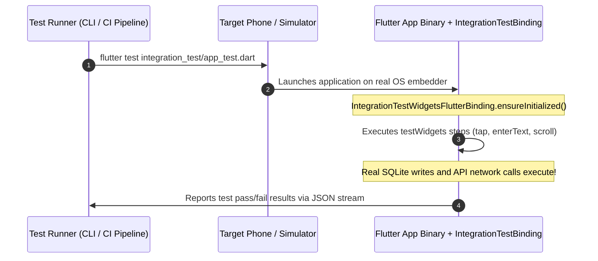

# Automated Integration Testing with package:integration_test

> **Module:** 11-testing-and-performance  
> **Subsection:** 02-integration-testing  
> **Prerequisites:** [11-testing-and-performance/01-unit-and-widget-testing/unit-and-widget-testing-guide.md](../01-unit-and-widget-testing/unit-and-widget-testing-guide.md)  
> **Official References:** [docs.flutter.dev/cookbook/testing/integration/introduction](https://docs.flutter.dev/cookbook/testing/integration/introduction)

---

## 1. Introduction

While unit tests prove algorithm correctness and widget tests verify isolated UI components in a mock environment, only **Integration Tests** verify that all software pieces work together in harmony on real hardware:
- Actual SQLite database file persistence,
- Real platform channel message exchanges,
- Native operating system keyboard popups,
- Real network socket handshakes and HTTP status decoding.

The official **`integration_test`** package runs automated tests directly inside the application binary on an actual Android device, iOS simulator, or browser.

---

## 2. Core Concepts: The Integration Test Pipeline



---

## 3. Syntax and Implementation

### 1. Project Directory Structure
Integration tests live in a dedicated top-level **`integration_test/`** directory (parallel to `lib/` and `test/`):

```
my_app/
├── lib/
│   └── main.dart
├── test/                 # Fast unit and widget tests
│   └── unit_test.dart
└── integration_test/     # End-to-end device integration tests
    └── checkout_flow_test.dart
```

---

### 2. Complete End-to-End User Flow Implementation

File: `integration_test/checkout_flow_test.dart`

```dart
import 'package:flutter/material.dart';
import 'package:flutter_test/flutter_test.dart';
import 'package:integration_test/integration_test.dart';
import 'package:my_enterprise_app/main.dart' as app;

void main() {
  // 1. Initialize the integration test harness
  IntegrationTestWidgetsFlutterBinding.ensureInitialized();

  group('End-to-End Checkout Test Suite', () {
    testWidgets('Full flow: Login -> Add to Cart -> Verify Cart Badge',
        (WidgetTester tester) async {
      // 2. Launch the real application
      app.main();
      await tester.pumpAndSettle();

      // 3. Step 1: Fill Login Form
      final emailField = find.byKey(const ValueKey('login_email_input'));
      final passwordField = find.byKey(const ValueKey('login_password_input'));
      final loginBtn = find.byKey(const ValueKey('login_submit_btn'));

      expect(emailField, findsOneWidget);
      await tester.enterText(emailField, 'shopper@store.com');
      await tester.enterText(passwordField, 'secretPass123');
      await tester.tap(loginBtn);

      // Wait for network authentication response and navigation transition
      await tester.pumpAndSettle(const Duration(seconds: 2));

      // 4. Step 2: Verify Catalog Screen Loaded
      expect(find.text('Store Catalog'), findsOneWidget);

      // 5. Step 3: Tap first product card "Add to Cart"
      final firstAddBtn = find.byKey(const ValueKey('add_to_cart_item_0'));
      expect(firstAddBtn, findsOneWidget);
      await tester.tap(firstAddBtn);
      await tester.pumpAndSettle();

      // 6. Step 4: Verify Floating Cart Badge shows count of 1
      final cartBadge = find.byKey(const ValueKey('cart_badge_counter'));
      expect(cartBadge, findsOneWidget);
      expect(find.descendant(of: cartBadge, matching: find.text('1')), findsOneWidget);

      // 7. Step 5: Navigate to Cart Screen
      await tester.tap(find.byIcon(Icons.shopping_cart));
      await tester.pumpAndSettle();

      // Verify item exists inside cart list
      expect(find.text('Order Summary'), findsOneWidget);
    });
  });
}
```

---

## 4. Execution Commands

### Running Locally on Connected Device / Emulator:
```bash
flutter test integration_test/checkout_flow_test.dart
```

### Running in Headless Device Clouds (Firebase Test Lab):
```bash
# Build Android test APKs
pushd android
./gradlew app:assembleAndroidTest
./gradlew app:assembleDebug -Ptarget=integration_test/checkout_flow_test.dart
popd

# Upload to Firebase Test Lab:
gcloud firebase test android run \
  --type instrumentation \
  --app build/app/outputs/apk/debug/app-debug.apk \
  --test build/app/outputs/apk/androidTest/debug/app-debug-androidTest.apk
```

---

## 5. Interview & Assessment Takeaways

| Interview Question | Concise Verbal Answer |
|:---|:---|
| **How do Integration Tests differ fundamentally from Widget Tests?** | Widget tests execute on the local development machine using Flutter's virtual mock environment without compiling native binaries. Integration tests build a full platform binary and run inside the real Android/iOS runtime on physical devices or emulators. |
| **Why should you avoid using integration tests for simple edge-case testing?** | Integration tests are computationally expensive, require launching an emulator or provisioning real hardware, and take minutes to execute compared to milliseconds for unit and widget tests. Edge cases should be thoroughly covered in fast unit tests. |
