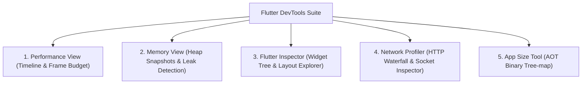

# Flutter DevTools, Profiling, and Performance Diagnostics

> **Module:** 11-testing-and-performance  
> **Subsection:** 03-flutter-devtools-and-profiling  
> **Prerequisites:** [03-flutter-fundamentals/01-flutter-architecture-and-engine/layered-architecture.md](../../03-flutter-fundamentals/01-flutter-architecture-and-engine/layered-architecture.md)  
> **Official References:** [docs.flutter.dev/tools/devtools](https://docs.flutter.dev/tools/devtools) | [docs.flutter.dev/perf/ui-performance](https://docs.flutter.dev/perf/ui-performance)

---

## 1. Introduction

Even cleanly architected apps can suffer from rendering jank, excessive CPU consumption, or memory leaks if developers do not profile their code.

Flutter DevTools is a comprehensive suite of performance, memory, and inspection diagnostics running in the browser. It gives developers direct visibility into the Dart VM runtime, the Impeller/Skia graphics rasterizer, and the Flutter widget tree.

---

## 2. The Cardinal Rule: Profile in Profile Mode!

> 🛑 **THE BIGGEST MISTAKE IN FLUTTER PROFILING:**  
> **NEVER** measure frame rates, memory, or CPU usage in **Debug Mode**!  
> In Debug Mode:
> - The Dart JIT compiler is running with heavy assertions and debug safety checks enabled.
> - The observatory service and hot reload hooks inject significant CPU overhead.
> - Code execution is up to **10x slower** than production.  
> 
> **Always run your profiling builds in Profile Mode on a physical device:**  
> `flutter run --profile`

---

## 3. The DevTools Diagnostic Suite



### 1. Performance View & The Frame Budget
Mobile screens refresh at 60Hz (60 fps) or 120Hz (ProMotion / high-refresh displays).
- **60 Hz Target:** Each frame has **16.6 milliseconds** to build, lay out, and render.
- **120 Hz Target:** Each frame has **8.3 milliseconds**.

If either the **UI Thread** (executing Dart code) or the **Raster Thread** (drawing GPU instructions) exceeds this time limit, a frame is dropped (**jank**).

```
[Normal Frame - 11ms]  UI Thread: 4ms | Raster Thread: 7ms   ---> 60fps Smooth!
[Janky Frame  - 28ms]  UI Thread: 22ms| Raster Thread: 6ms   ---> DROPPED FRAME! (Stutter visible to user)
```

---

### 2. Memory View & Allocation Tracing
- **Heap Snapshot:** Captures an instant snapshot of every object alive in Dart memory. Comparing two snapshots taken before and after opening a screen reveals **retained instances** (memory leaks).
- **Track Widget Rebuilds:** Shows an exact numerical counter next to every widget in your tree. If an animated screen causes your entire Scaffold to rebuild 60 times a second, DevTools highlights it in red.

---

### 3. Flutter Inspector & Layout Explorer
- **Debug Paint:** Draws visual bounding boxes, padding borders, and baseline guides around every RenderBox.
- **Invert Oversized Images:** Inverts the colors of any image asset decoded at a resolution significantly larger than its physical display size, instantly exposing memory bloat.

---

## 4. Interview & Assessment Takeaways

| Interview Question | Concise Verbal Answer |
|:---|:---|
| **Why must performance profiling be conducted in Profile Mode rather than Debug Mode?** | Debug mode runs the Dart Just-In-Time (JIT) VM with assertions enabled and hot-reload hooks active, introducing massive artificial CPU overhead. Profile mode uses the Ahead-Of-Time (AOT) compiled binary with optimizations enabled, mirroring real production performance while keeping profiling hooks active. |
| **What is the difference between the UI Thread and the Raster Thread in Flutter?** | The UI thread executes your Dart code, constructs widget trees, and calculates layout box constraints. The Raster (GPU) thread takes the recorded Layer tree and compiles graphics commands for the GPU using Impeller or Skia. |
| **What does the "Invert Oversized Images" debug flag do?** | It identifies images whose decoded bitmap memory size exceeds their on-screen display dimensions by at least 128KB. DevTools inverts the image colors and displays a diagnostic warning in the console indicating how much RAM is being wasted. |
