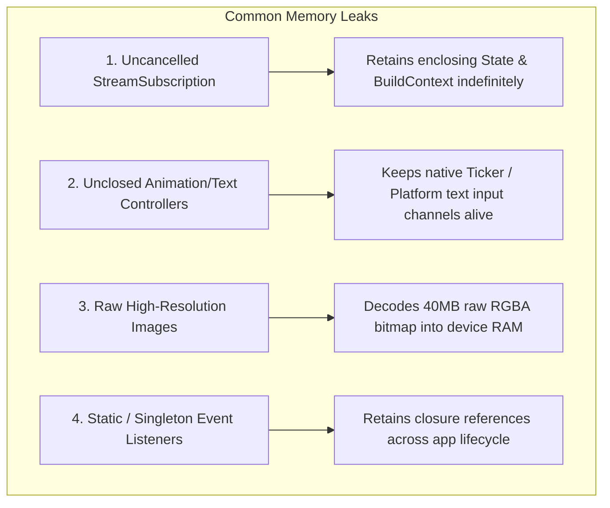

# Memory Leaks, Bitmap Optimization, and Garbage Collection in Flutter

> **Module:** 11-testing-and-performance  
> **Subsection:** 05-memory-leaks-and-optimization  
> **Prerequisites:** [11-testing-and-performance/03-flutter-devtools-and-profiling/flutter-devtools-guide.md](../03-flutter-devtools-and-profiling/flutter-devtools-guide.md)  
> **Official References:** [docs.flutter.dev/perf/rendering/ui-performance](https://docs.flutter.dev/perf/rendering/ui-performance)

---

## 1. Introduction

Because Dart uses a generational garbage collector with automatic memory management, many mobile developers assume memory leaks are impossible. This is false.

A **memory leak** in Dart occurs when an unused object is unintentionally retained by a persistent reference (such as a global singleton, a long-lived stream, or an unclosed native controller), preventing the garbage collector from freeing its memory. Over time, memory consumption climbs until the operating system terminates the app with an **Out-Of-Memory (OOM) crash**.

---

## 2. The Top 4 Flutter Memory Leaks



---

## 3. Syntax and Implementation: The Fixes

### 1. The Stream & Controller Leak

#### ❌ LEAKY CODE:
```dart
class _LeakyState extends State<LeakyWidget> {
  final TextEditingController _controller = TextEditingController();
  late StreamSubscription _sub;

  @override
  void initState() {
    super.initState();
    // Subscribes to a broadcast stream but NEVER cancels it!
    _sub = eventBus.stream.listen((event) => setState(() {}));
  }

  // dispose() is MISSING!
  // When user navigates away, this entire State instance remains in RAM forever!
}
```

#### ✅ PROPERLY DISPOSED:
```dart
class _CleanState extends State<CleanWidget> {
  final TextEditingController _controller = TextEditingController();
  StreamSubscription? _sub;

  @override
  void initState() {
    super.initState();
    _sub = eventBus.stream.listen((event) {
      if (mounted) setState(() {});
    });
  }

  @override
  void dispose() {
    // 1. Cancel active stream subscriptions
    _sub?.cancel();

    // 2. Dispose controllers to release native engine resources
    _controller.dispose();

    super.dispose();
  }
}
```

---

### 2. The 33MB Image Thumbnail Trap (Bitmap Bloat)

When Flutter loads an image, the encoded file format (JPEG, PNG, WebP) is decompressed into raw uncompressed **RGBA8888 bitmap pixels** in memory:

$$\text{RAM Bytes} = \text{Pixel Width} \times \text{Pixel Height} \times 4\text{ bytes}$$

If your app downloads a 4K camera photo ($3840 \times 2160$ px) to show inside an $80 \times 80$ list avatar:
- **Raw Bitmap Size:** $3840 \times 2160 \times 4 = 33,177,600\text{ bytes} \approx \mathbf{33.2\text{ MB}}$ **of RAM per image!**
- Rendering 10 such avatars consumes **330 MB of RAM**, triggering an immediate device OOM crash!

#### ✅ FIX: Resize During Decode via `cacheWidth` / `cacheHeight`

```dart
// Allocates ONLY 80 * 80 * 4 = 25.6 KB in memory (a 99.9% memory saving!)
Image.network(
  'https://example.com/huge-4k-photo.jpg',
  cacheWidth: 160,  // Target device pixels (80 logical px * 2.0 device pixel ratio)
  cacheHeight: 160,
  width: 80,
  height: 80,
  fit: BoxFit.cover,
)
```

For asset or memory images, use **`ResizeImage`**:
```dart
const Image(
  image: ResizeImage(
    AssetImage('assets/images/heavy_hero.png'),
    width: 300,
    height: 300,
  ),
)
```

---

## 4. Interview & Assessment Takeaways

| Interview Question | Concise Verbal Answer |
|:---|:---|
| **How does an uncancelled `StreamSubscription` cause a memory leak in Flutter?** | The subscription's `onData` callback holds a strong reference (closure) to the enclosing `State` object. Because the stream source retains the subscription, the `State` object, its `BuildContext`, and the entire associated widget subtree can never be garbage collected. |
| **How much memory does an uncompressed image consume in Flutter RAM?** | Uncompressed bitmap memory is calculated as $\text{Width} \times \text{Height} \times 4\text{ bytes}$ (for 32-bit RGBA). File compression (like a 200KB JPEG) only applies to disk storage; in memory, it decompresses fully based on physical pixel dimensions. |
| **How do you prevent image bitmap bloat in `ListView` thumbnails?** | Specify `cacheWidth` or `cacheHeight` on `Image.network` or wrap the `ImageProvider` in `ResizeImage`. This instructs the Flutter engine to downsample the image during the raster decoding pass before allocating bitmap RAM. |
