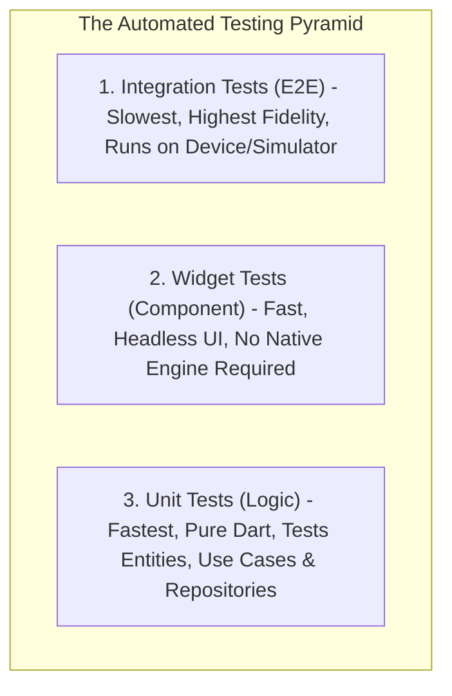

# Module 11: Quality Assurance, Testing, and Performance Engineering

> **Stage:** Stage 4 (Continued) – Automated Testing, DevTools Profiling & Impeller Engine  
> **Target Audience:** Intermediate to Senior Flutter Engineers & QA Automation Leads  
> **Prerequisites:** [03-flutter-fundamentals/](../03-flutter-fundamentals/) | [10-architecture-and-clean-code/](../10-architecture-and-clean-code/)

---

## Overview

Software quality is the boundary between an amateur hobby app and a reliable enterprise product. A production Flutter application requires automated regression safety nets across the entire testing pyramid, accompanied by rigorous performance profiling to maintain silky 60fps / 120fps animations.

This module provides exhaustive coverage of Flutter quality assurance and performance tuning:
- **Unit Testing:** Pure Dart business logic validation using `test` and `mocktail`.
- **Widget Testing:** Headless UI component interaction verification using `WidgetTester`, `pump`, and `pumpAndSettle`.
- **Integration Testing:** End-to-end device testing with `integration_test`.
- **Flutter DevTools:** CPU profiling, memory allocation snapshots, and widget rebuild counters.
- **Impeller Graphics Engine:** Elimination of shader compilation jank (AOT shaders on Vulkan and Metal).
- **Memory Leak Elimination:** Identifying and fixing leaked streams, unclosed controllers, and bloated image bitmaps.

---

## The Flutter Testing Pyramid



---

## Directory Roadmap

```
11-testing-and-performance/
├── README.md
├── 01-unit-and-widget-testing/
│   └── unit-and-widget-testing-guide.md     # package:test, mocktail, testWidgets, WidgetTester, Finders
├── 02-integration-testing/
│   └── integration-testing-guide.md         # package:integration_test, automated end-to-end workflows
├── 03-flutter-devtools-and-profiling/
│   └── flutter-devtools-guide.md            # DevTools CPU Profiler, Memory View, Rebuild Tracker
├── 04-rendering-performance-impeller-vs-skia/
│   └── impeller-and-rendering-performance.md# Impeller AOT shaders, 60fps/120fps frame budgets
└── 05-memory-leaks-and-optimization/
    └── memory-leaks-and-optimization.md     # Unclosed streams/controllers, ResizeImage, image caching
```
