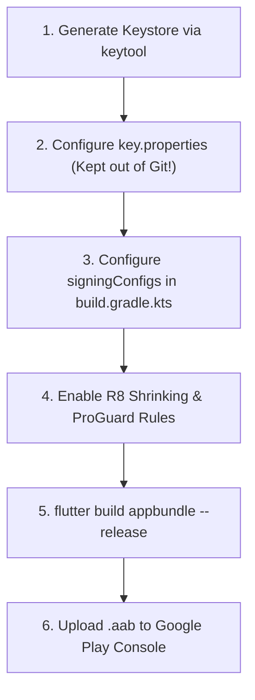

# Android Keystore Signing, R8 Obfuscation, and Google Play Store Release

> **Module:** 12-deployment-and-devops  
> **Subsection:** 02-android-build-and-play-store  
> **Prerequisites:** [12-deployment-and-devops/01-flavoring-and-environments/app-flavoring-and-environments.md](../01-flavoring-and-environments/app-flavoring-and-environments.md)  
> **Official References:** [docs.flutter.dev/deployment/android](https://docs.flutter.dev/deployment/android) | [developer.android.com/studio/publish](https://developer.android.com/studio/publish)

---

## 1. Introduction

You cannot upload a debug APK to the Google Play Store. Google Play requires an **Android App Bundle (`.aab`)** signed with a cryptographically secure private **Upload Keystore**, compiled against the latest Android Target API level, and optimized via R8 code shrinking and symbol obfuscation.

---

## 2. Step-by-Step Signing Pipeline



---

## 3. Syntax and Implementation

### Step 1: Generate the Cryptographic Upload Keystore

Run the JDK `keytool` command in your terminal:

```bash
keytool -genkey -v -keystore upload-keystore.jks -keyalg RSA -keysize 2048 -validity 10000 -alias upload
```
*Keep this `.jks` file secure and backed up! Losing this key makes it impossible to update your app on Google Play without contacting Google Developer Support!*

Place `upload-keystore.jks` inside `android/app/`.

---

### Step 2: Create `android/key.properties`

Create a file named `android/key.properties` (*Ensure this file is added to `.gitignore`!*):

```properties
storePassword=YourStorePasswordHere
keyPassword=YourKeyPasswordHere
keyAlias=upload
storeFile=upload-keystore.jks
```

---

### Step 3: Configure `android/app/build.gradle.kts`

```kotlin
import java.io.FileInputStream
import java.util.Properties

val keystorePropertiesFile = rootProject.file("key.properties")
val keystoreProperties = Properties()
if (keystorePropertiesFile.exists()) {
    keystoreProperties.load(FileInputStream(keystorePropertiesFile))
}

android {
    ...
    signingConfigs {
        create("release") {
            keyAlias = keystoreProperties["keyAlias"] as String
            keyPassword = keystoreProperties["keyPassword"] as String
            storeFile = file(keystoreProperties["storeFile"] as String)
            storePassword = keystoreProperties["storePassword"] as String
        }
    }

    buildTypes {
        getByName("release") {
            signingConfig = signingConfigs.getByName("release")
            // Enable R8 code shrinking and resource optimization
            isMinifyEnabled = true
            isShrinkResources = true
            proguardFiles(
                getDefaultProguardFile("proguard-android-optimize.txt"),
                "proguard-rules.pro"
            )
        }
    }
}
```

---

### Step 4: Configure ProGuard Rules (`android/app/proguard-rules.pro`)

R8 strips unused code aggressively, which can accidentally delete third-party model classes referenced via string reflection. Add necessary preserve rules:

```proguard
# Flutter Wrapper
-keep class io.flutter.app.** { *; }
-keep class io.flutter.plugin.**  { *; }
-keep class io.flutter.util.**  { *; }
-keep class io.flutter.view.**  { *; }
-keep class io.flutter.**  { *; }
-keep class io.flutter.plugins.**  { *; }

# Prevent obfuscation of serializable model classes
-keepclassmembers class * {
    @com.google.gson.annotations.SerializedName <fields>;
}
```

---

### Step 5: Build the Production App Bundle

```bash
flutter build appbundle --release --flavor prod --target lib/main_prod.dart
```
The output file is generated at:
`build/app/outputs/bundle/prodRelease/app-prod-release.aab`

---

## 4. Google Play Console Release Tracks

Google Play organizes releases into progressive validation rings:
1. **Internal Testing Track:** Rapid distribution to up to 100 internal developers (no Google review required; available within minutes).
2. **Closed Testing (Alpha):** Distributed to select external beta testers.
3. **Open Testing (Beta):** Public opt-in testing visible in the Play Store search.
4. **Production Track:** Full rollout to the public (supports staged rollout: 10% -> 25% -> 50% -> 100% to catch crashes safely).

---

## 5. Interview & Assessment Takeaways

| Interview Question | Concise Verbal Answer |
|:---|:---|
| **Why does Google Play require `.aab` (Android App Bundle) instead of `.apk`?** | An AAB is an upload format containing all platform architectures and language resources. Google Play's Dynamic Delivery system takes the AAB and generates optimized, device-specific split APKs for each user (e.g. delivering only `arm64-v8a` and `xxhdpi` assets), reducing the user's download size by up to 35%. |
| **What does R8 do during release compilation?** | R8 is Android's code shrinker and optimizer. It performs dead-code elimination (tree-shaking), rewrites code for size efficiency, shrinks unused resources, and obfuscates class and method names with short cryptic identifiers to make reverse engineering difficult. |
