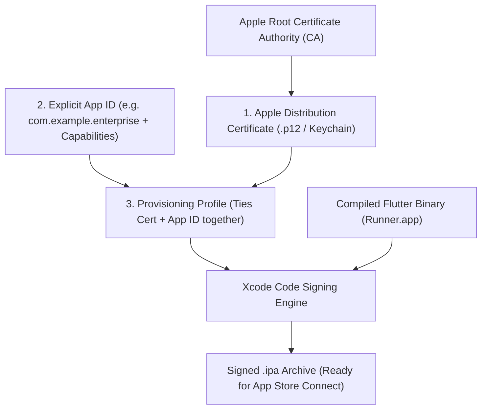

# iOS Code Signing, IPA Packaging, and App Store Release

> **Module:** 12-deployment-and-devops  
> **Subsection:** 03-ios-build-and-app-store  
> **Prerequisites:** [09-platform-integration/04-ios-configuration-and-permissions/ios-permissions-and-plist.md](../../09-platform-integration/04-ios-configuration-and-permissions/ios-permissions-and-plist.md)  
> **Official References:** [docs.flutter.dev/deployment/ios](https://docs.flutter.dev/deployment/ios) | [developer.apple.com/support/app-store](https://developer.apple.com/support/app-store)

---

## 1. Introduction

Distributing software on iOS is governed by Apple's strict cryptographic chain of trust. Every binary that runs on an iOS device must be signed by an **Apple Distribution Certificate** paired with an authorized **Provisioning Profile** linked to your active Apple Developer Program account.

---

## 2. Theoretical Mechanics: The iOS Signing Hierarchy



1. **Distribution Certificate:** Proves the identity of your organization or developer account. Contains a public certificate registered on Apple's portal and a private cryptographic key stored in your macOS Keychain.
2. **App ID:** A unique string identifying your application (e.g. `com.example.enterprise`) along with enabled entitlements (e.g. Sign in with Apple, Push Notifications).
3. **Provisioning Profile:** A cryptographically signed manifest issued by Apple that certifies that your specific app ID can be signed with your specific certificate.

---

## 3. Syntax and Implementation

### 1. Building the iOS Archive via CLI

Run the release build command from your repository root:

```bash
flutter build ipa --release --flavor prod --target lib/main_prod.dart
```

This compiles Ahead-of-Time native ARM64 machine code, archives the bundle, and outputs an `.xcarchive` and signed `.ipa` file inside:
`build/ios/archive/Runner.xcarchive`  
`build/ios/ipa/`

---

### 2. Uploading to App Store Connect

You can upload the archive to Apple's ingestion servers through three methods:

#### Method A: Using Xcode Organizer (GUI)
1. Open Xcode: `open ios/Runner.xcworkspace`.
2. Select **Window > Organizer** from the menu.
3. Select your recent build under **Archives**.
4. Click **Distribute App > App Store Connect > Upload**.

#### Method B: Using Fastlane (Automated CI/CD)
```ruby
lane :deploy_to_testflight do
  build_app(workspace: "ios/Runner.xcworkspace", scheme: "prod")
  upload_to_testflight(
    api_key_path: "fastlane/api_key.json",
    skip_waiting_for_build_processing: true
  )
end
```

---

## 4. TestFlight Distribution

Once App Store Connect processes the uploaded binary (~10 to 30 minutes), it becomes available in **TestFlight**:
- **Internal Testing:** Available instantly to up to 100 members of your App Store Connect team with zero review delay.
- **External Testing:** Can be distributed to up to 10,000 public testers via a shareable link. Requires an initial lightweight "Beta App Review" by Apple (typically takes 12–24 hours).

---

## 5. Critical App Store Rejection Traps (Watch Out!)

| Guideline | What Causes Rejection? | The Fix |
|:---|:---|:---|
| **5.1.1(v) Account Deletion** | Apps offering user account creation that do not offer a self-serve in-app "Delete Account" button. | Add an explicit "Delete Account" flow that permanently purges user data from your servers. |
| **5.1.1 Data Collection** | Missing or vague privacy descriptions in `Info.plist` (e.g. empty camera explanation). | Provide clear, user-focused justifications for all hardware permissions. |
| **2.1 App Completeness** | Broken links, placeholder "Lorem Ipsum" text, or crashes during Apple review. | Test the exact release archive thoroughly on TestFlight before requesting review. |
| **3.1.1 In-App Purchases** | Unlocking digital content/features via Stripe or credit card instead of Apple StoreKit IAP. | Digital goods must use Apple In-App Purchase; physical goods can use credit cards/Stripe. |

---

## 6. Interview & Assessment Takeaways

| Interview Question | Concise Verbal Answer |
|:---|:---|
| **What is the difference between an Apple Development Certificate and an Apple Distribution Certificate?** | A Development Certificate allows deploying debug builds to physically registered test devices for development. A Distribution Certificate signs release builds intended for public deployment via TestFlight, the App Store, or Enterprise MDM. |
| **What is Apple App Store Guideline 5.1.1(v) regarding account deletion?** | Any iOS application that allows users to create an account must also provide an easily accessible mechanism within the app for users to initiate the permanent deletion of their account and associated personal data. |
| **What is an `.ipa` file?** | An iOS App Store Package file (`.ipa`) is an archived `.zip` container enclosing the compiled native `Payload/Runner.app` executable bundle, bundled assets, embedded frameworks, code signatures, and the provisioning profile. |
