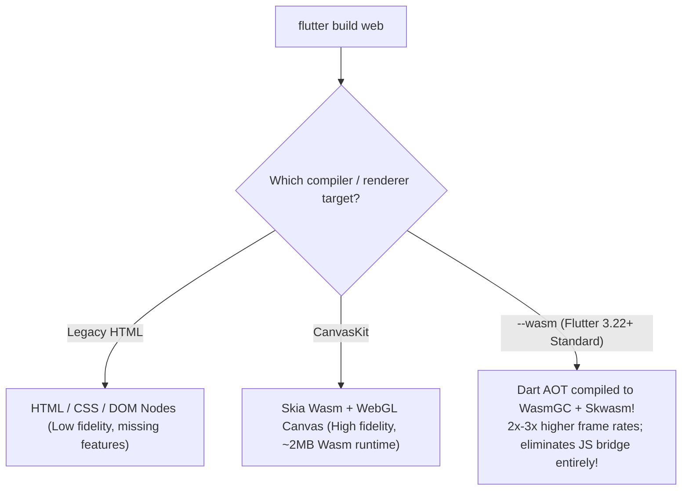
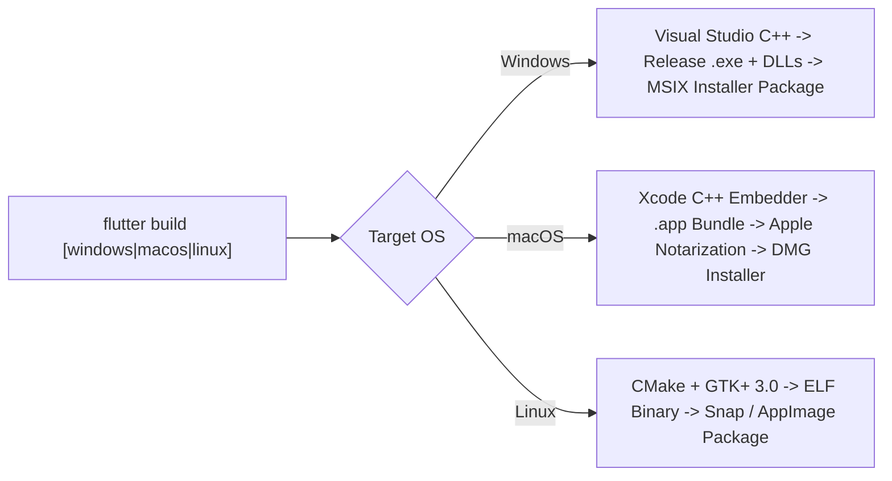

# WebAssembly (Wasm), CanvasKit, and Multi-Platform Desktop Deployment

> **Module:** 12-deployment-and-devops  
> **Subsection:** 04-web-and-desktop-deployment  
> **Prerequisites:** [03-flutter-fundamentals/01-flutter-architecture-and-engine/layered-architecture.md](../../03-flutter-fundamentals/01-flutter-architecture-and-engine/layered-architecture.md)  
> **Official References:** [docs.flutter.dev/platform-integration/web/wasm](https://docs.flutter.dev/platform-integration/web/wasm) | [docs.flutter.dev/desktop](https://docs.flutter.dev/desktop)

---

## 1. Introduction

Flutter's multi-platform promise extends beyond mobile to **Web** (browsers) and **Desktop** (Windows, macOS, Linux). 

Historically, Flutter on the web struggled with slow initial load times and JavaScript garbage collection pauses. In **Flutter 3.22+**, the Flutter team achieved a historic milestone: **compiling Dart directly to WebAssembly (Wasm)** utilizing the standardized WasmGC (WebAssembly Garbage Collection) specification.

---

## 2. Flutter Web Rendering Engines: HTML vs. CanvasKit vs. Wasm



| Dimension | HTML (Deprecated/Legacy) | CanvasKit | WebAssembly (`--wasm`) |
|:---|:---:|:---:|:---:|
| **Dart Compilation** | Compiles to JavaScript | Compiles to JavaScript | **Compiles to Wasm Bytecode** |
| **Graphics Engine** | Browser DOM / CSS | Skia compiled to Wasm | **Skwasm (Vulkan/WebGL Wasm)** |
| **Download Size** | Small (~1.8 MB) | Medium (~3.5 MB) | **Optimized (~2.2 MB)** |
| **Frame Rates** | Inconsistent (DOM overhead)| 60 fps (Occasional JS jank) | **Silky Smooth (Zero JS GC pauses)** |

---

## 3. Syntax and Implementation

### 1. Building for Flutter Web with WebAssembly

```bash
flutter build web --wasm --release
```
*Requirements: A modern browser supporting WasmGC (Chrome 119+, Edge 119+, Firefox 120+, Safari 18+).*

#### Hosting Requirements:
Because WebAssembly requires multithreaded shared array buffers, web servers must serve Flutter Wasm with these two HTTP response headers:
```
Cross-Origin-Opener-Policy: same-origin
Cross-Origin-Embedder-Policy: require-corp
```

---

### 2. Desktop Deployment: Windows, macOS, and Linux



#### A. Windows Packaging:
```bash
flutter build windows --release
```
Package into a Windows 10/11 installer using the official Microsoft MSIX tool:
```bash
dart run msix:create
```

#### B. macOS Packaging and Apple Notarization:
```bash
flutter build macos --release
```
To run on modern macOS without Gatekeeper blocking the app, binaries must be notarized via Apple's notary service:
```bash
xcrun notarytool submit build/macos/Build/Products/Release/Enterprise.app.zip \
  --apple-id "developer@enterprise.com" \
  --password "app-specific-password" \
  --team-id "TEAM_ID_123" \
  --wait
```

---

## 4. Interview & Assessment Takeaways

| Interview Question | Concise Verbal Answer |
|:---|:---|
| **What is WebAssembly (Wasm) with WasmGC in Flutter 3.22+?** | Previously, Flutter web compiled Dart into JavaScript, which suffered from JavaScript garbage collection pauses. WasmGC compiles Dart directly into native WebAssembly bytecode with hardware-level garbage collection, delivering 2x to 3x higher frame rates and near-native desktop performance inside web browsers. |
| **Why does Flutter Wasm require `Cross-Origin-Embedder-Policy` headers?** | High-performance Wasm multi-threading and texture streaming rely on `SharedArrayBuffer`. To mitigate Spectre-style hardware side-channel attacks, browsers mandate that servers provide `COOP: same-origin` and `COEP: require-corp` headers to unlock shared memory buffers. |
| **What is Apple Notarization for macOS desktop apps?** | An automated security process where Apple scans your compiled macOS `.app` binary for malicious code before distribution outside the Mac App Store, issuing a cryptographic ticket that Gatekeeper checks before allowing the app to launch. |
