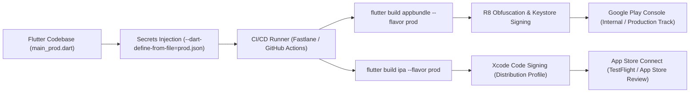

# Module 12: Deployment Pipelines, Flavoring, and App Store Release

> **Stage:** Stage 5 – Release Engineering, DevOps Pipelines & App Store Distribution  
> **Target Audience:** Intermediate to Senior Flutter Engineers & Release Managers  
> **Prerequisites:** [09-platform-integration/](../09-platform-integration/) | [11-testing-and-performance/](../11-testing-and-performance/)

---

## Overview

Writing features is only half the journey; getting code safely into the hands of millions of end users requires robust release engineering. Enterprise teams maintain isolated environments (Development, Staging, Production), inject secrets securely without checking them into version control, automate cryptographic binary signing, and navigate Apple App Store and Google Play Store compliance.

This module provides exhaustive coverage of Flutter release pipelines:
- **Multi-Environment Flavoring:** Configuring Android `productFlavors`, iOS Xcode Schemes, and modern `--dart-define-from-file`.
- **Android Play Store Release:** Keystore creation, `key.properties`, R8 ProGuard obfuscation, and Android App Bundles (`.aab`).
- **iOS App Store Release:** Certificates, Provisioning Profiles, `flutter build ipa`, TestFlight distribution, and App Store review checklists.
- **Web & Desktop Targets:** WebAssembly (WASM / Skwasm), CanvasKit, Windows MSIX, and macOS distribution.

---

## The Release Pipeline Flow



---

## Directory Roadmap

```
12-deployment-and-devops/
├── README.md
├── 01-flavoring-and-environments/
│   └── app-flavoring-and-environments.md    # productFlavors, Xcode Schemes, --dart-define
├── 02-android-build-and-play-store/
│   └── android-build-signing-playstore.md   # Keystore, key.properties, R8 shrinking, .aab
├── 03-ios-build-and-app-store/
│   └── ios-signing-and-app-store.md         # Certificates, Provisioning Profiles, IPA, TestFlight
└── 04-web-and-desktop-deployment/
    └── web-and-desktop-deployment.md        # Wasm / Skwasm, CanvasKit, MSIX, Desktop packaging
```
