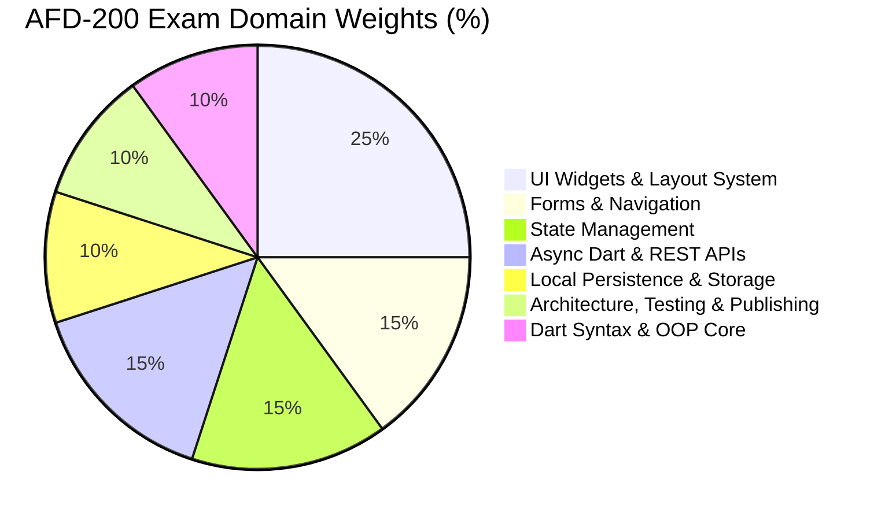

# Flutter Certified Application Developer (AFD-200) Curriculum Guide

> **Module:** 13-interview-and-certification  
> **Subsection:** 01-flutter-certified-application-developer-afd-200  
> **Official Certification:** [Android ATC – Flutter Certified Application Developer (Exam AFD-200)](https://androidatc.com)

---

## 1. Exam Overview and Format

The **AFD-200** examination tests core and advanced competencies in building production-ready Flutter and Dart applications for mobile, web, and desktop.

| Specification | Details |
|:---|:---|
| **Exam Code** | **AFD-200** |
| **Duration** | 90 Minutes |
| **Number of Questions** | 45 Multiple-Choice Questions |
| **Passing Score** | 70% (32 out of 45 correct answers) |
| **Delivery Mode** | Pearson VUE Authorized Testing Centers or Online Proctored Exam |
| **Prerequisites** | Solid understanding of object-oriented programming, Dart 3, and Flutter UI development |

---

## 2. Exam Domain Blueprint & Topic Weights

### Domain 1: Dart Fundamentals & OOP (10%)
- Variables, type inference (`var`, `final`, `const`), null safety.
- Classes, named/factory constructors, initializer lists, mixins, extension methods.
- Dart collections: List, Set, Map, collection operators (`...`, `if`, `for`).

### Domain 2: Flutter UI Widgets & Layout System (25%)
- The Three Trees: Widget, Element, and RenderObject.
- Box Constraints law: *"Constraints go down, sizes go up, parent sets position"*.
- `Row`, `Column`, `Flex`, `Expanded` vs `Flexible`.
- `Stack`, `Positioned`, `Align`.
- `ListView`, `GridView`, `SingleChildScrollView`, and Viewport slivers.

### Domain 3: User Input, Forms, and Navigation (15%)
- `TextField` vs `TextFormField`, `FormState`, input validation.
- `TextEditingController` and `FocusNode` lifecycles.
- Declarative and imperative navigation (`Navigator.push`, `Navigator.pop`, `PopScope`).

### Domain 4: State Management (15%)
- Ephemeral state (`setState()`, `ValueNotifier`).
- App state architecture (`Provider`, `ChangeNotifierProvider`, `Consumer`, `Selector`).
- Riverpod and BLoC high-level patterns.

### Domain 5: Asynchronous Programming & REST APIs (15%)
- Dart Event Loop, Microtask queue, Event queue.
- `Future`, `async`/`await`, `FutureBuilder`.
- `Stream`, `StreamController`, `StreamBuilder`.
- HTTP REST operations: GET, POST, PUT, DELETE, headers, and status code handling.

### Domain 6: Local Data Persistence (10%)
- Key-Value persistence: `SharedPreferences`.
- Encrypted credentials storage: `FlutterSecureStorage`.
- Embedded databases: SQLite (`sqflite` / `drift`) and NoSQL (`Hive`).

### Domain 7: Testing, Performance & App Store Publishing (10%)
- Unit testing with `test`, widget testing with `testWidgets`.
- Android Keystore, `key.properties`, R8 ProGuard rules.
- iOS `Info.plist` privacy strings and provisioning profiles.

---

## 3. Exam Strategy & Time Management Tips

1. **Pacing:** 90 minutes for 45 questions allows **2 minutes per question**.
2. **Watch for Dart 3 Traps:** Questions often test subtle syntax differences—such as `const` constructor immutability or null-safety promotion rules.
3. **Widget Return Types:** Beware of tricky questions that pass a widget where a `List<Widget>` is expected (e.g. forgetting `children: [...]` inside a `Column`).
4. **Flag and Review:** If a question has ambiguous phrasing, select your best estimate, flag it, and return after finishing the remaining questions.
