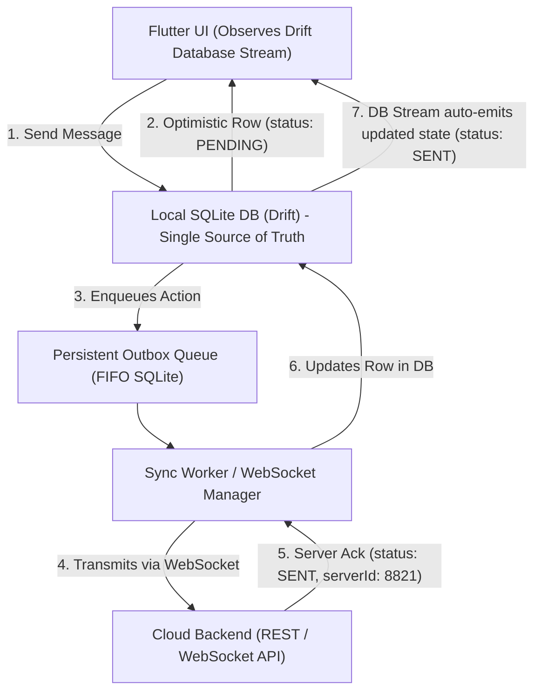
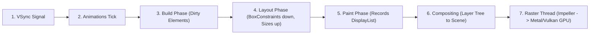

# Senior and Lead Architect Flutter Interview Questions

> **Module:** 13-interview-and-certification  
> **Subsection:** 03-senior-architect-qa  
> **Target Audience:** Senior Flutter Engineers, Tech Leads, and Mobile Solutions Architects

---

## 1. System Design: Architect an Offline-First Messaging App

### 🎙️ The Architectural Blueprint:
A production offline-first chat application must satisfy three core requirements:
1. **Zero-Latency Optimistic UI:** Sending a message displays it in the conversation list immediately with a "pending" clock icon before any network socket transmission occurs.
2. **Persistent Local Single-Source-of-Truth:** The UI observes *only* the local database (Drift SQLite). The network client writes directly to the database; the UI never listens to network streams directly.
3. **Queue-Based Synchronization Engine:** Outgoing messages and sync actions are dispatched to a persistent FIFO queue that retries with exponential backoff during network drops.

### Conflict Resolution Strategy:
- For immutable messages, conflict is trivial (messages are assigned client UUIDs).
- For mutable data (editing messages, profile updates), implement **Last-Write-Wins (LWW)** using server timestamps or **Conflict-Free Replicated Data Types (CRDTs)** if true multi-device collaborative state is needed.

---

## 2. Rendering Pipeline: Explain Flutter's Frame Lifecycle

### 🎙️ Concise Verbal Answer:
> "Flutter's rendering pipeline translates Dart code into GPU pixels across five synchronized phases: **VSync Tick**, **Animation**, **Build**, **Layout**, and **Compositing / Paint**. The UI thread produces a Layer tree, which the Raster thread compiles into GPU commands via Impeller."

### Deep Internals:
1. **VSync:** Hardware display controller notifies the engine that a new frame refresh has started (16.6ms at 60Hz, 8.3ms at 120Hz).
2. **Animate:** Active `Ticker`s advance and trigger `AnimationController` value updates.
3. **Build:** Elements marked "dirty" via `setState()` or provider notifications invoke their `build()` methods to construct new widget descriptions.
4. **Layout:** The engine executes a single one-pass walk through the `RenderObject` tree: constraints go down, sizes go up, parent sets position.
5. **Paint:** Render objects record drawing commands into a `DisplayList` buffer.
6. **Compositing:** Layers are assembled into a hierarchical `Scene` object and dispatched to the platform embedder.
7. **Rasterization:** Impeller translates the `Scene` into GPU-executable command buffers using Apple Metal or Vulkan.

---

## 3. Impeller vs. Skia: What Was the Root Cause of Early-Onset Jank?

### 🎙️ Technical Breakdown:
- **The Skia Flaw:** Skia relied on runtime Just-In-Time (JIT) shader compilation. The first time a user encountered a specific graphical operation (such as a custom rounded blur or clip path), Skia stopped the Raster thread to compile the GPU shader on-the-fly. Compiling a shader on low-to-mid-range hardware takes 50ms to 200ms. Since a 60fps frame must finish in 16.6ms, compilation caused massive dropped frames ("early-onset jank").
- **The Impeller Architecture:** Impeller completely eliminates runtime shader compilation. It uses a dedicated offline compiler (`impellerc`) that pre-compiles all shader pipelines directly into platform-native bytecode (Apple Metal Shading Language or Vulkan SPIR-V) during the Ahead-of-Time `flutter build` process. When the app runs, shaders are already compiled and instantly dispatched to the GPU.

---

## 4. State Management Architecture: Riverpod vs. BLoC Trade-offs

| Criterion | Modern Riverpod (2.x/3.x) | BLoC / Cubit |
|:---|:---|:---|
| **Paradigm** | Reactive Dependency Graph (Top-level providers) | Event-Driven Stream Architecture (Strict Event -> State) |
| **Compile Safety** | 100% Compile-Safe (Resolved at compile time) | High (Context lookups can fail if provider misplaced) |
| **Boilerplate** | Minimal with `@riverpod` annotations | Higher (Formal Event, State, and Handler classes) |
| **Async Support** | Native `AsyncValue` (`data`, `loading`, `error`) | Manual sealed state classes (`LoadingState`, `ErrorState`) |
| **Event Traceability** | Can be observed via `ProviderObserver` | Superb: `BlocObserver` logs every single action globally |
| **Best Used For** | Fast-paced product iterations, clean dependency injection | Highly regulated enterprise apps (Banking, FinTech) where auditability of every single user action is mandatory |

---

## 5. Production Debugging: How Do You Diagnose a 200MB Memory Leak?

### 🎙️ The Systematic Diagnostic Workflow:
1. **Reproduce in Profile Mode:** Boot the app on a physical device in `--profile` mode connected to **Flutter DevTools**. Never profile in debug mode.
2. **Collect Baseline Snapshot:** Navigate to the DevTools **Memory** tab and take Heap Snapshot #1 on the initial screen.
3. **Trigger Suspected Feature:** Perform the leaking user interaction (e.g. open a complex charting screen, scroll 50 items, and navigate back).
4. **Trigger Manual Garbage Collection:** Click the "Collect Garbage" (GC) button in DevTools to purge all unreferenced memory.
5. **Collect Second Snapshot & Diff:** Take Heap Snapshot #2 and use the **Diff View** to compare against Snapshot #1.
6. **Identify Retained Classes:** Look for objects whose instance counts should be zero (e.g. `_MyChartScreenState`, `StreamSubscription`, `TextEditingController`).
7. **Inspect Retaining Paths:** Click on the leaked object to inspect its **Retaining Path** in the object graph:
   - *Example Finding:* A global singleton event bus holds a closure referencing `this`, keeping the entire `State` and `BuildContext` alive.
   - *Remediation:* Add `cancel()` inside `dispose()` and verify the instance count drops to zero after navigation.
