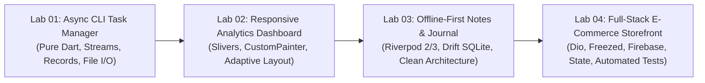

# Module 14: Hands-On Architectural Labs & Practical Projects

> **Stage:** Capstone Labs – End-to-End Enterprise System Implementation  
> **Target Audience:** All Engineers Building Practical Portfolios  
> **Prerequisites:** Modules 01 through 13

---

## Overview

Theory without implementation produces fragile understanding. This module contains **four progressive capstone architectural labs**, escalating in complexity from pure asynchronous Dart command-line engineering to a complete, test-driven, full-stack multiplatform application.

Every project includes:
1. **Business & Technical Requirements**
2. **Feature-First Architecture & Folder Structure**
3. **Step-by-Step Implementation Guide**
4. **Complete, Executable Code Examples**
5. **Automated Testing Suite (Unit & Widget Tests)**
6. **Future Architecture & Performance Extensions**

---

## The Four Capstone Labs

| Lab | Difficulty | Core Technologies Covered |
|:---|:---:|:---|
| **Lab 01: CLI Task Manager** | Beginner-Intermediate | Pure Dart 3, Records, Async Streams, Isolates, JSON File I/O |
| **Lab 02: Responsive Dashboard** | Intermediate | Adaptive Breakpoints, CustomScrollView, Slivers, CustomPainter Charts |
| **Lab 03: Offline-First Notes App**| Intermediate-Advanced | Riverpod 2/3 Notifiers, Drift SQLite, Optimistic UI, Clean Architecture |
| **Lab 04: Full-Stack E-Commerce** | Advanced-Architect | Dio Interceptors, Freezed Union DTOs, Firebase Auth/Firestore, Unit & Widget Tests |
