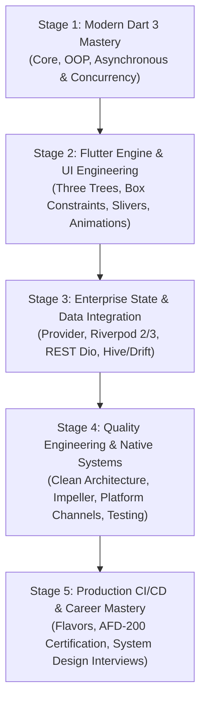

# Flutter & Dart Progressive Mastery Roadmap

> **Path Duration:** 16–20 Weeks (Self-Paced / Comprehensive)  
> **Target Level:** Senior Flutter Engineer & Certified Application Developer  
> **Official Certification Target:** Android ATC AFD-200 (Flutter Certified Application Developer)  

---

## Roadmap Overview

---

## Stage 1: Modern Dart 3 Mastery
*Estimated Timeline: Weeks 1 – 3*  
*Focus: Language fundamentals, sound null safety, object-oriented architecture, and asynchronous execution mechanics.*

### Milestones & Topics
1. **Language Core & Syntax Fundamentals:**
   - Type inference: `var` vs `dynamic` vs `Object` vs `Object?`.
   - Mutability semantics: `final` vs `const`, compile-time canonicalization.
   - Sound null safety: Null assertion (`!`), null-aware access (`?.`), null-coalescing (`??`, `??=`), and `late` initialization.
   - Operators: Type test (`is`, `as`), bitwise operations, cascade (`..`, `?..`), and collection spread (`...`, `...?`).
2. **Collections, Generics & Iteration:**
   - List, Set, and Map internals, hash codes, and equality.
   - Collection-if, collection-for, and comprehension patterns.
   - Generic constraints (`<T extends Comparable<T>>`) and type variance.
3. **Functions, Functional Programming & Closures:**
   - Named, positional, optional, and required parameters.
   - First-class functions, `typedef`, and callback contracts.
   - Anonymous lambdas, function tear-offs, and lexical closures.
4. **Modern Object-Oriented Architecture (Dart 3):**
   - Constructors: Generative, named, redirecting, const, and factory constructors.
   - Modern Dart 3 super-parameters (`super.key`, `super.name`).
   - Abstract classes vs implicit interfaces (`implements` vs `extends`).
   - Mixins: `with` keyword, linearization order, and `on` class restrictions.
   - Dart 3 Class Modifiers: `sealed`, `base`, `interface`, `final`.
5. **Advanced Concurrency & Async Engine:**
   - Event loop mechanics: Single-threaded event queue vs microtask queue.
   - Futures: `Future<T>`, `async`, `await`, `Future.wait`, `runZonedGuarded`.
   - Streams & Generators: `StreamController`, `sync*` (`Iterable`, `yield`), `async*` (`Stream`, `yield`, `yield*`).
   - Isolates: True parallel execution, memory isolation, `Isolate.spawn`, `ReceivePort`/`SendPort`, `Isolate.run`, and `compute()`.
   - Dart 3 Patterns & Records: Destructuring, switch expressions, and Dart 3.7 wildcard variables (`_`).

### Milestone Verification Lab
- **Hands-on Project:** `lab-01-dart-cli-task-manager`
  - Build an asynchronous, multi-threaded CLI application reading/writing JSON files using streams, isolates for heavy processing, sealed class result types, and records.

---

## Stage 2: Flutter Engine Core & UI Engineering
*Estimated Timeline: Weeks 4 – 7*  
*Focus: Internal rendering pipeline, widget lifecycle, box constraint layout protocol, slivers, and interactive animations.*

### Milestones & Topics
1. **Framework Internals & Architecture:**
   - Three architectural layers: Platform Embedder, C++ Engine (Impeller/Skia), and Dart Framework.
   - Compilation pipeline: JIT compilation in debug mode (Hot Reload) vs AOT native compilation in release.
   - Cross-platform architectural analysis: Flutter vs React Native (bridge/JSI) vs Native vs WebViews.
2. **The Three Trees & Rendering Pipeline:**
   - **Widget Tree:** Immutable configuration blueprints.
   - **Element Tree:** Lifecycle managers, component identity, `canUpdate()` algorithm.
   - **RenderObject Tree:** Geometry, box constraints calculation, painting, and hit-testing.
3. **Widget Lifecycle & Context:**
   - `StatelessWidget` vs `StatefulWidget`.
   - Chronological `State` lifecycle: `createState` $\to$ `initState` $\to$ `didChangeDependencies` $\to$ `build` $\to$ `didUpdateWidget` $\to$ `deactivate` $\to$ `dispose`.
   - Pitfalls: Missing `super.initState()` / `super.dispose()`.
   - `BuildContext` deep dive: Accessing ancestral elements via `context.findAncestorWidgetOfExactType` and `InheritedWidget`.
   - Keys: `ValueKey`, `ObjectKey`, `UniqueKey`, `PageStorageKey`, and `GlobalKey`.
4. **Layout Engine & The Box Constraint Rules:**
   - The golden rule: *"Constraints go down. Sizes go up. Parent sets position."*
   - Flex layouts: `Row`, `Column`, `Flex`, `Expanded`, `Flexible` (`FlexFit.tight` vs `FlexFit.loose`), `Spacer`.
   - Diagnosing and eliminating `RenderFlex` overflow errors.
   - Multi-layer positioning: `Stack`, `Positioned`, `Align`, `IndexedStack`.
   - Scrolling & Slivers: `SingleChildScrollView`, `ListView.builder`, `GridView`, `CustomScrollView`, `SliverAppBar`, `SliverList`, `NestedScrollView`.
   - Modern Back Navigation: Migrating from deprecated `WillPopScope` to `PopScope`.
5. **Interactive Motion & Animations:**
   - Implicit animations: `AnimatedContainer`, `AnimatedOpacity`, `AnimatedPositioned`, `AnimatedSwitcher`.
   - Explicit animations: `AnimationController`, `TickerProviderStateMixin`, `Tween`, `CurvedAnimation`, `AnimatedBuilder`.
   - Hero animations and custom page route transitions (`PageRouteBuilder`).
   - Custom graphics: `CustomPainter`, `Canvas`, and `Paint`.

### Milestone Verification Lab
- **Hands-on Project:** `lab-02-responsive-dashboard`
  - Build an adaptive multi-pane dashboard combining complex `CustomScrollView` slivers, Hero transitions, interactive `AnimatedSwitcher` tabs, and custom canvas charts.

---

## Stage 3: Enterprise State Management & Data Architecture
*Estimated Timeline: Weeks 8 – 11*  
*Focus: Reactive state management, REST API client design, JSON generation, and local persistence.*

### Milestones & Topics
1. **Architectural State Management:**
   - Ephemeral (widget-level) state vs App (shared) state.
   - **Provider Pattern:** `ChangeNotifier`, `ChangeNotifierProvider`, `Consumer`, `Selector`, `ProxyProvider`, `context.watch` vs `context.read`.
   - **Modern Riverpod 2.x / 3.x:** Compile-time safety, `ProviderScope`, `@riverpod` code generation, `Notifier` and `AsyncNotifier`, `WidgetRef`, `AsyncValue` handling.
   - Migration path: Transitioning legacy `StateNotifierProvider` to modern `Notifier`.
   - Introduction to **BLoC / Cubit** and reactive **Signals**.
2. **REST API & Network Integration:**
   - Networking architecture: `package:http` vs `Dio`.
   - Advanced Dio: Interceptors (auth token injection, logging), retry interceptors, certificate pinning, timeouts.
   - Robust JSON serialization: Manual mapping, `json_serializable`, and `@freezed` immutable union models.
   - WebSockets for bi-directional real-time data streaming (`web_socket_channel`).
   - Cloud Firestore integration: Collections, Documents, Query snapshots, real-time listeners.
3. **Local Storage & Database Persistence:**
   - Key-value stores: `shared_preferences` and encrypted storage with `flutter_secure_storage`.
   - NoSQL local databases: `Hive` fundamentals, TypeAdapters, boxes, and community forks (`hive_ce`, `isar`).
   - Relational SQL databases: `sqflite` and type-safe reactive SQL with `drift`.

### Milestone Verification Lab
- **Hands-on Project:** `lab-03-offline-first-notes-app`
  - Build a production-grade offline-first notes application powered by Riverpod 2/3 code-gen, local Hive-CE/Drift persistence, and mock REST sync.

---

## Stage 4: Quality Engineering, Performance & Native Interop
*Estimated Timeline: Weeks 12 – 14*  
*Focus: Clean architecture, testing pyramids, GPU rendering engines, DevTools profiling, and native platform integration.*

### Milestones & Topics
1. **Clean Architecture & Enterprise Patterns:**
   - Domain Layer: Entities, Value Objects, Use Cases (Interactors).
   - Data Layer: Repositories, Remote Data Sources, Local Data Sources, DTOs.
   - Presentation Layer: UI Widgets, Controllers / Notifiers, View Models.
   - Dependency Injection: Service Locator (`get_it`), `injectable`, and Riverpod DI.
   - SOLID principles applied cleanly to Flutter codebases.
2. **Automated Testing Pyramid:**
   - Unit Testing: Pure Dart logic tests, mocking external dependencies with `mocktail`.
   - Widget Testing: UI rendering, user interaction simulation (`tester.tap`, `tester.enterText`), pump vs pumpAndSettle.
   - Integration Testing: End-to-end device testing with `package:integration_test`.
3. **Performance Profiling & Impeller Engine:**
   - Modern rendering: **Impeller** vs legacy **Skia**; understanding ahead-of-time shader compilation.
   - Frame budget: 60 FPS (16.6ms) and 120 FPS (8.3ms); eliminating build/raster jank.
   - Flutter DevTools: CPU Profiler, Memory allocation tracker, tracking down widget rebuilds.
   - Memory leak prevention: Stream subscriptions, controllers, animation tickers.
4. **Native Platform Bridges & OS Integration:**
   - Platform Channels: `MethodChannel`, `EventChannel`, `BinaryMessenger`.
   - Type-safe interop with **Pigeon**.
   - Android configurations: `AndroidManifest.xml`, Gradle KTS, minSdk/targetSdk, SHA-1 / SHA-256 fingerprint generation.
   - iOS configurations: `Info.plist`, CocoaPods/SPM, Xcode build settings, permissions.

### Milestone Verification Lab
- **Hands-on Project:** `lab-04-fullstack-ecommerce-app`
  - Build an end-to-end e-commerce application featuring Clean Architecture, Dio API integration, Freezed models, Riverpod state, Platform Channels for native battery info, and automated unit/widget tests.

---

## Stage 5: Production CI/CD, Certification & Senior Interview Mastery
*Estimated Timeline: Weeks 15 – 18*  
*Focus: Release engineering, Android ATC AFD-200 certification, and senior architectural interview preparation.*

### Milestones & Topics
1. **Build Engineering & Production DevOps:**
   - Multi-environment setup: App flavors (`dev`, `staging`, `prod`) and `--dart-define`.
   - Android release: Keystore generation, `key.properties`, Android App Bundle (AAB), ProGuard/R8 shrinking and obfuscation.
   - iOS release: Certificates, Provisioning Profiles, Xcode archiving, TestFlight distribution.
   - Web deployment: CanvasKit vs Wasm/Skwasm compilation flags.
2. **Android ATC AFD-200 Certification Preparation:**
   - Full review of the AFD-200 curriculum domains.
   - Step-by-step solutions and deep explanations for the 45 official sample exam questions.
3. **Senior / Principal Flutter Technical Interview Preparation:**
   - High-frequency core Dart & Flutter Q&A.
   - State management trade-off comparisons.
   - Mobile system design interview problems: Offline-first architecture, large feed caching, real-time messaging.
   - Live coding machine rounds: Custom sliver challenges, complex form validations, memory leak debugging.

---

## Self-Assessment Checkpoints

| Checkpoint | Target Milestone | Self-Verification Criteria |
|------------|------------------|----------------------------|
| **Checkpoint 1** | End of Stage 1 | Can explain Dart event loop order (microtasks vs timers), write sealed classes with switch expressions, and spawn an isolate. |
| **Checkpoint 2** | End of Stage 2 | Can explain the 3 trees, calculate box constraints manually, implement custom slivers, and build explicit Tween animations. |
| **Checkpoint 3** | End of Stage 3 | Can build an offline-first app using Riverpod with `@riverpod` code generation, Dio with auth interceptors, and local database caching. |
| **Checkpoint 4** | End of Stage 4 | Can architect an app using Clean Architecture (Domain/Data/UI), write unit & widget tests, profile with DevTools, and explain Impeller vs Skia. |
| **Checkpoint 5** | End of Stage 5 | Can configure 3-tier flavors, build signed AAB/IPA binaries, score 90%+ on AFD-200 sample questions, and ace senior system design interviews. |
