# Cross-Platform Architecture Comparison: Native vs. WebViews vs. React Native vs. Flutter

> **Module:** reference-materials  
> **Subsection:** books-and-reading-guides  
> **Target Audience:** Tech Leads, Solution Architects, and Systems Evaluators

---

## 1. Introduction

Choosing a cross-platform mobile framework requires understanding the underlying rendering architecture and runtime trade-offs of each approach.

Historically, mobile development has passed through four distinct architectural generations:
1. **First Party Native** (Kotlin/Java on Android, Swift/Objective-C on iOS)
2. **Hybrid WebViews** (Cordova, Ionic, PhoneGap)
3. **Reactive Native Bridges** (React Native, NativeScript)
4. **Self-Contained GPU-Rendered Toolkits** (Flutter)

---

## 2. The Four Cross-Platform Architectures

```mermaid
flowchart TD
    subgraph NativeOS["1. Native (Swift / Kotlin)"]
        NCode["Native Swift/Kotlin"] --> NOEM["Direct Native OEM Widgets"]
    end

    subgraph HybridWV["2. Hybrid / WebView (Cordova / Ionic)"]
        WCode["HTML / CSS / JS"] --> WContainer["Platform WebView Container"] --> WCanvas["Slow DOM Rendering Engine"]
    end

    subgraph ReactiveBridge["3. Reactive Bridge (React Native)"]
        RNCode["JavaScript / Hermes VM"] <== "JSON Serialization Bridge / JSI" ==> ROEM["Native OEM Widgets (UIView / Android View)"]
    end

    subgraph SelfContained["4. Self-Contained Graphics Toolkit (Flutter)"]
        FCode["Dart AOT Native Code"] --> FEngine["C++ Graphics Engine (Impeller / Skia)"] --> FGPU["Direct GPU Texture (Metal / Vulkan)"]
    end
```

---

## 3. Comprehensive Architectural Comparison Matrix

| Evaluation Dimension | 1. Native (Kotlin/Swift) | 2. Hybrid (Cordova/Ionic) | 3. React Native | 4. Flutter |
|:---|:---:|:---:|:---:|:---:|
| **Language** | Kotlin / Swift | HTML / CSS / TypeScript | JavaScript / TypeScript | **Dart** |
| **Compilation** | AOT to native machine code | Interpreted JS in browser engine | Interpreted / Hermes bytecode | **AOT compiled to native ARM64** |
| **Rendering Pipeline** | Native OS Window Manager | Browser WebKit / Blink engine | Translates JSX to Native OEM views | **Draws directly onto GPU surface via Impeller** |
| **UI Consistency Across OS**| Divergent (Platform looks different by default) | High (CSS styling) | Inconsistent (OEM view styling changes between Android/iOS) | **100% Identical Pixel Fidelity (Pixel-Perfect)** |
| **Bridge Overhead** | Zero | High (DOM Events) | Medium-High (Bridge serialization / JSI) | **Zero (No bridge; direct C++ engine interop)** |
| **Startup / TTI** | Instantaneous | Slow (WebView spin-up) | Medium (Hermes VM load) | **Fast (AOT precompiled binary)** |
| **Code Sharing** | 0% (Two separate codebases) | 90% | 70% - 85% | **90% - 95% across Mobile, Web & Desktop** |

---

## 4. Key Architectural Takeaways for Interviews

1. **Why does Flutter avoid React Native's "Bridge"?**  
   React Native does not draw its own pixels; it translates JavaScript commands into native OEM Android and iOS views across an asynchronous bridge (or JSI). Flutter bypasses the platform's OEM widgets entirely: it compiles Dart code directly to native machine instructions and draws every button, text glyph, and transition directly onto a GPU texture using Impeller.
2. **What is the trade-off of Flutter's self-contained engine?**  
   Because Flutter bundles its own C++ rendering engine, text layout algorithms, and Skia/Impeller graphics pipelines directly into the APK/IPA, minimal baseline hello-world apps have a slightly larger initial download size (~4MB–6MB) than a bare-bones native app. However, this grants 100% immunity to platform fragmentation and OS OEM bugs.
